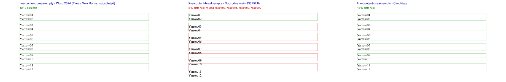
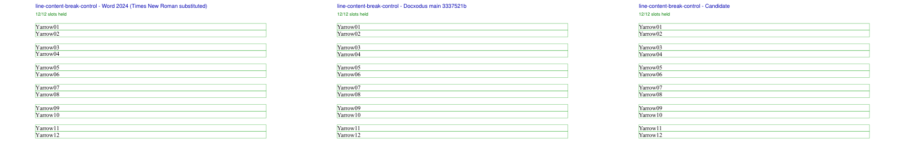
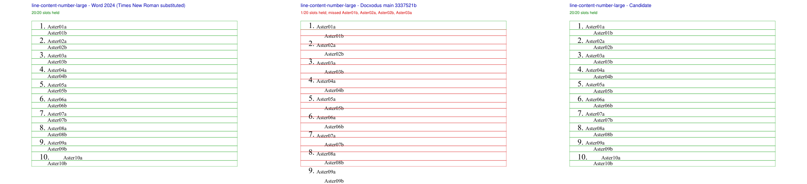
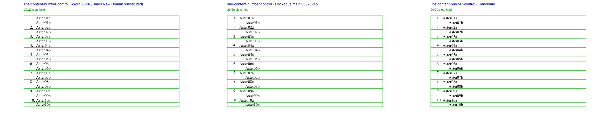
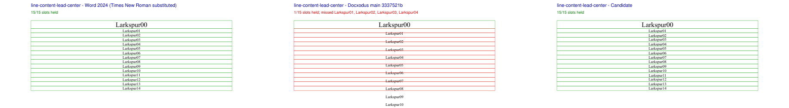
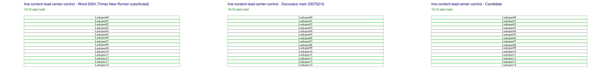
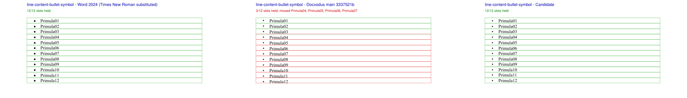
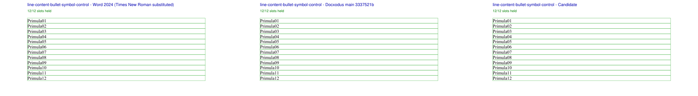

# Line content height

Eight original documents pin how tall each line is when the fonts on a paragraph's lines differ,
for [Docxodus #1565](https://github.com/JSv4/Docxodus/issues/1565) and
[#1567](https://github.com/JSv4/Docxodus/issues/1567). Related core PRs:
[Docxodus #1650](https://github.com/JSv4/Docxodus/pull/1650) (#1565) and
[Docxodus #1660](https://github.com/JSv4/Docxodus/pull/1660) (#1567). The inputs are literal
OOXML in `bench/fixtures.py` over 12pt Liberation Serif; no product fixture, helper or font
program is imported.

| Case | Lines | What differs from its control |
| --- | ---: | --- |
| `break-empty` / `break-control` | 12 labels, 5 empty | The empty lines between two breaks are 8pt breaks instead of 12pt |
| `number-large` / `number-control` | 20 | Ten two-line items (a line break inside each) under an 18pt list number instead of 12pt |
| `lead-center` / `lead-center-control` | 15 | A centered paragraph whose first, 16pt label sits above 9pt lines, against a 9pt first label |
| `bullet-symbol` / `bullet-symbol-control` | 12 | Twelve one-line items under Word's Symbol bullet (U+F0B7), against plain paragraphs |

Every label has a whole-line slot from the top margin, with a 0.76pt tolerance for Chromium's
0.75pt glyph-origin rounding. Slots use independent font metrics in 2048ths of an em: a line is
its text's largest ascent with line gap (1912 for Liberation Serif) plus its largest descent (443).
A list marker adds only its ascent: an 18pt number makes its line `(1912 × 18 + 443 × 12) / 2048`
= 19.40pt, and a Symbol bullet keeps Symbol's 2059 ascent, `(2059 + 443) × 12 / 2048` = 14.66pt.
A break sizes a line only when nothing else is on it, so an empty 8pt break line is 9.20pt.
Alignment changes nothing. Complete token inventories are required.

## Native Word evidence

Desktop Word 2024 (Windows) printed these exact inputs, substituting Times New Roman, Liberation
Serif's metric twin, and embedding its own Symbol for the bullet. Every label of all eight prints
falls inside its slot. The prints are diagnostic: with the substituted face they cannot be
registered references. Baseline-to-baseline steps from those prints, in points:

| Case | Word steps |
| --- | --- |
| `break-empty` | 13.80 between labels, 22.92–23.04 across each empty 8pt line |
| `break-control` | 13.80, 27.60 across each empty 12pt line |
| `number-large` | first baseline 88.82 (72 + the 18pt ascent), 13.80 out of each first line, 19.32–19.47 into the next item |
| `number-control` | 13.80 throughout |
| `lead-center` | 11.88 out of the 16pt line, then 10.32–10.44 |
| `bullet-symbol` | 14.64–14.76 per item (first baseline 84.02 = 72 + Symbol's 12.06pt ascent) |
| `bullet-symbol-control` | 13.80 |

The same rules were measured on separately authored Times New Roman/Arial documents, including
1.15 and double spacing, minima, 16pt Symbol and Wingdings bullets and a paragraph continuing on a
second page; those tables are in the core repository's `docs/ooxml_corner_cases.md`.

## Renders

Each sheet shows one case rendered three ways, left to right: desktop Word 2024's print,
Docxodus `main` at `3337521b` and the candidate (core PRs #1650 and #1660), all exported
locally on Windows with Times New Roman standing in for Liberation Serif. Green slots hold their
label within the 0.76pt tolerance; red ones miss. These are local diagnostic renders, not the
pinned-runtime benchmark or a LibreOffice reference capture; native LibreOffice references and
candidate scoring are pending.

| Case | Word | `main` | Candidate |
| --- | ---: | ---: | ---: |
| `break-empty` | 12/12 | 2/12 | 12/12 |
| `break-control` | 12/12 | 12/12 | 12/12 |
| `number-large` | 20/20 | 1/20 | 20/20 |
| `number-control` | 20/20 | 20/20 | 20/20 |
| `lead-center` | 15/15 | 1/15 | 15/15 |
| `lead-center-control` | 15/15 | 15/15 | 15/15 |
| `bullet-symbol` | 12/12 | 3/12 | 12/12 |
| `bullet-symbol-control` | 12/12 | 12/12 | 12/12 |

`main` misses every target and holds every control. The candidate's second line in each
`number-*` item starts 18pt right of Word's; that horizontal offset after a break in a
hanging-indent item is a separate difference, Docxodus #1654, and the slots here are vertical.

## Reproduction

Generate `core-v151` and select `line-content-*`. Print each input from Word and export it with
each renderer, then check every label's word box against its slot (any PDF word extractor; the
direction marks Docxodus emits after a break are not part of the label). Run
`python3 -m unittest tests.test_line_content` for the slot arithmetic and the mutations it rejects:
the control's uniform layout, every line as tall as the tallest, and a missing label.
