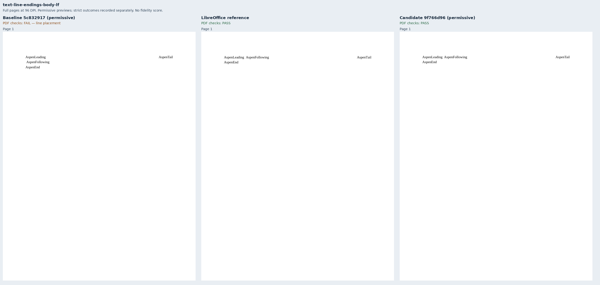
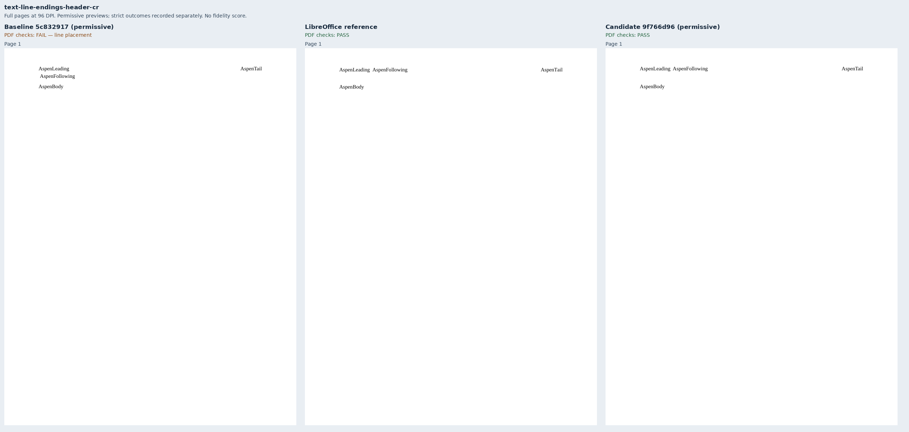
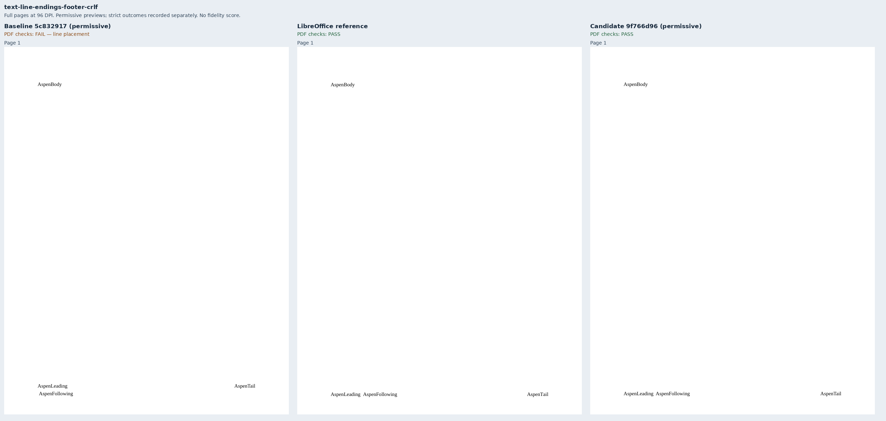
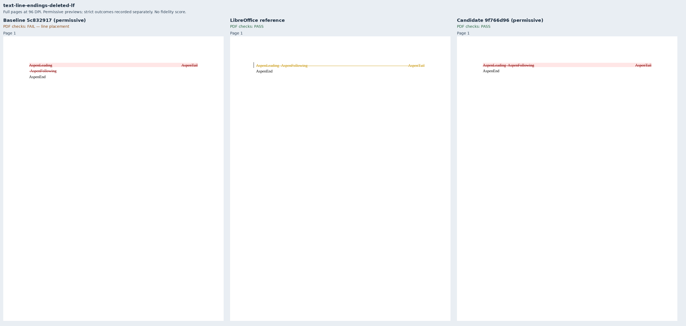
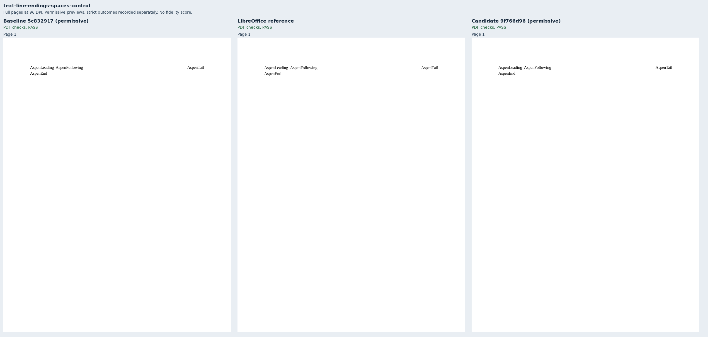
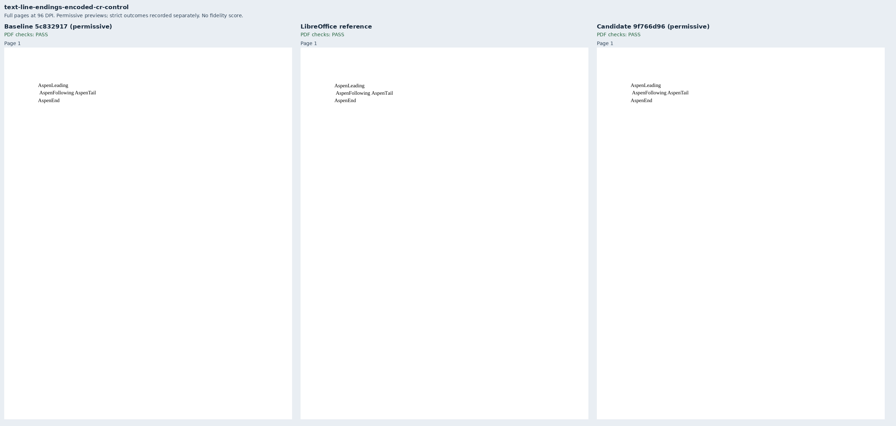

# Literal line endings retain the intended lines

Eight original Aspen cases cover the literal-newline portion of [Docxodus #1564](https://github.com/JSv4/Docxodus/issues/1564).
Body, header, footer and deleted-text cases pair line-ending text with a right tab.
A space control preserves that layout; an explicit-break control and two encoded-CR
controls preserve real breaks. Encoded CRLF also retains its following LF as a space.

| Exact production source | Permissive PDFs | Mandatory PDF checks | Strict-font PDFs |
|---|---:|---:|---:|
| Main `5c8329174f91692519e24217b2feacde2134e8b3` | 8/8 | 3/8 | 4/8 |
| Fixed `9f766d96a5767dbed0633d821cf062f359149eaa` | 8/8 | 8/8 | 6/8 |
| LibreOffice 25.8.7.3 | 8/8 | 8/8 | Not applicable |

Both renderer revisions were separately built with production AOT WASM and the public export
package. The screenshots explicitly use permissive font diagnostics. Strict-font captures are
retained separately: the encoded-CR controls still fail font-coverage verification in both builds.
These previews establish line placement and content, not strict export success or font parity.
Every delivered panel has a complete render report bound by SHA-256. No Word reference or
full-suite score is claimed; only these eight cases were rendered.

Raw XML CR and CRLF normalize to LF when parsed. LF becomes a space before layout.
Numeric `&#13;` survives parsing as CR and remains a break. The shared XML part writers
must entitize that character: otherwise final/original revision projection changes it to LF
before the converter sees it. Independent review caught this distinction, and the first
candidate's public test run exposed the serialization hop despite passing direct native tests.

The assertions derive from the declared 72pt body margin, 36pt header distance, 756pt footer
edge and 16pt line pitch. The following label stays beside the leading label for normalized
line endings. The tab label occupies the terminal 49pt band around its declared 540pt stop,
allowing glyph bounds at that edge. Break controls use the second line. Encoded CRLF requires
two leading 2.75pt spaces in 11pt Liberation Serif, so its following label starts at or beyond
77pt. LibreOffice independently satisfies every declaration. Reference-relative positioning
is deliberately absent: the unchanged space control already has an unrelated 0.66pt horizontal
difference, and running-story offsets differ slightly. No existing metric or tolerance changed.

Break controls omit tabs because break-plus-aligned-tab placement has a separate existing
defect. The four newline reproducers and space control retain their tab, with explicit line-band
checks. Product tests additionally compare actual/control PDF text, drawing operations and geometry.
The exact-width issue premise is separate: 65 Liberation Mono glyphs at 12pt occupy
468.076171875pt, not 468pt. A true 128-glyph boundary at 921.75pt passes on main; no wrapping
tolerance changed. Character scaling and fitted text remain open under #1564.

`core-v107` contains 768 PDF inputs. All 760 previous input bytes, tokens and assertions remain
unchanged; shared generator hashes refresh. All 470 harness contracts pass. The eight inputs
validate with Open XML SDK 3.5.1/Microsoft365. The author inspected all full-page sheets.

`evidence.json` binds inputs, source trees, build identities, runtime assets, render reports,
font/browser identities, PDFs, rasters, sheets and strict outcomes. Raw outputs remain under
ignored `runs/line-endings/`; final directories end in `v5`. Earlier candidates remain separate.
`Compose.py` combines unchanged 96-DPI full-page rasters (optional dependency: Pillow).

```sh
python3 -m bench build-docxodus --source SOURCE --commit FULL_SHA
python3 -m bench reference libreoffice --manifest MANIFEST --out REFERENCE
node docs/results/export-reliability/Capture.mjs SOURCE MANIFEST OUTPUT ENVIRONMENT --allow-unverified-fonts
python3 docs/results/export-reliability/Inspect.py MANIFEST OUTPUT/capture.json
```

Repeat capture without the optional flag to record strict outcomes. The shared capture helper
still defaults to strict verification; permissive capture is an explicit unscored diagnostic.















