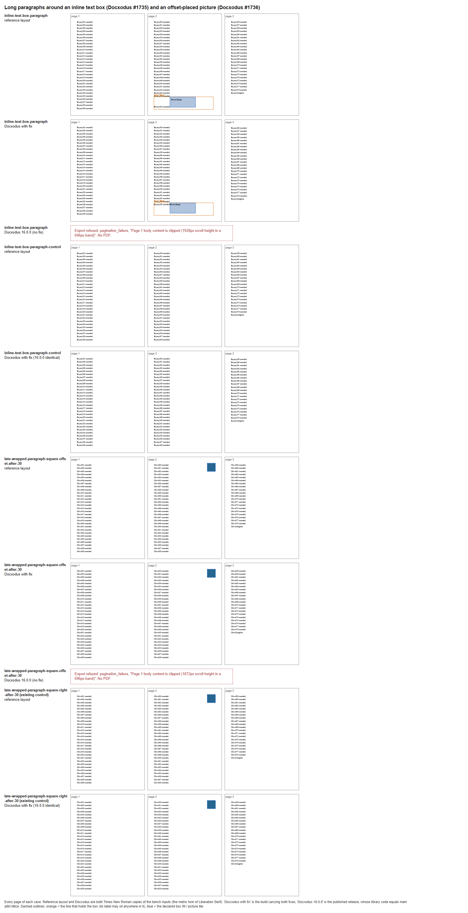

# Long paragraphs around an inline text box and an offset picture (Docxodus #1735, #1736)

Two defects shared one symptom: a paragraph longer than a page could not be broken across pages,
and the export failed with `Page 1 body content is clipped`.

| Case | Input | Control |
| --- | --- | --- |
| `inline-text-box-paragraph` | 78 original Bryony lines in one paragraph, at least 18pt each, with a 150 by 60pt legacy text box (`v:shape type="#_x0000_t202"`, no absolute position) in the line flow after `Bryony055` | `inline-text-box-paragraph-control`: the same paragraph without the box run |
| `late-wrapped-paragraph-square-offset-after-30` | the Chive square-wrapped tile after line 30, placed by `wp:posOffset` 312pt from the column (its right edge on the column's right edge) | `late-wrapped-paragraph-square-right-after-30` (existing): the same tile with `wp:align` `right` |

## What Word 2024 prints

Word 2024 (16.0.20326) printed Times New Roman copies of the four inputs (Liberation Serif renamed to
its metric twin in `styles.xml`) through `SaveAs2` to PDF.

**Text box.** The paragraph breaks across pages like its control. The box stays whole on the line
that holds it, the last line of page 2: lines 1-29 on page 1, 30-55 on page 2, 56-78 and
`BryonyComplete` on page 3 (the control: 29/29/20). Word sits the box on the line's baseline, so
the line is 62.5pt tall and `Bryony055` prints at its foot; the box fill spans 129.5-279.5pt by
486-546pt on page 2 and its story text starts 7.2pt inside it. Every other line's text sits at the
bottom of its 18pt line; its word box reaches at most 0.1pt below the line.

**Offset picture.** Word prints the offset tile exactly where it prints the right-aligned tile: at
the top of page 2's part of the paragraph (348-396pt by 36-84pt), the page that holds its run, and
every label on the same line of the same page as the control.

## Assertions

The text box pair asserts each label's page and its 18pt line with 1pt to spare above and below,
which holds Word's word boxes and any placement of the text inside its line. `Bryony055` may sit
anywhere in the box's line (486pt to the 558pt body bottom), and `BryonyGauge`, the box's story
text, anywhere inside the box. A Word-adjudicated `color-geometry` declares the box's fill whole on
page 2 (2pt and 10% coverage tolerance). The box's line is the last that fits on page 2 for any line
height over 54 and up to 72pt, so whether a renderer sits the box on the baseline or hangs it from
the line's top moves no other line; that vertical placement is not asserted.

The offset case reuses the control's assertions unchanged: every label's page and line slot, and
the tile's `color-reference-geometry` on page 2. Docxodus places an offset picture against the
nearer column edge behind its `distR` clearance (0 here), which is the source position for this
offset; other offsets are outside this case.

## Before and after

Docxodus 16.0.0, the published release whose library source equals main `a8b1d6ce`, refuses both
inputs (`pagination_failure`, page 1 body clipped) and prints both controls. A build carrying
[Docxodus PR #1740](https://github.com/JSv4/Docxodus/pull/1740) and
[Docxodus PR #1743](https://github.com/JSv4/Docxodus/pull/1743) prints all four with the same page
breaks, labels and fills as Word; measured with pdf.js, every declared assertion holds for Word's
PDFs and for that build. Differences that the regions deliberately allow: Docxodus hangs the text
box from its line's top, so `Bryony055` prints at the line's top; it starts the box's story text at
the box's edge; and it centres each at-least line's text on pages 1 and 2 but sets it at the bottom
on page 3.

## Limits

These are Times New Roman diagnostics on Windows, not registered references. LibreOffice references,
authored calibration and full-suite scoring are pending.
