# Markdown textbox and wrapped-table projection

These are exact Markdown diagnostics for [Docxodus #1445](https://github.com/JSv4/Docxodus/issues/1445), independent of PDF/redline scores. Every input is original literal OOXML with Ash labels, generated by `bench/projection_fixtures.py`; no external document or asset is used.

The [baseline](baseline.json) fails all seven reproducers and passes all seven controls. The [candidate](candidate.json) passes all fourteen cases, including exact complete text, `ProjectAnchor(SelfOnly)` for named paragraphs, and Microsoft 365 Open XML validation. The records retain full source commits, trees, adapter/build hashes and input hashes. These are targeted results, not a complete fidelity-suite score.

Textboxes project after their host paragraph; textbox tables use their own table anchor. Rows and cells wrapped in content controls contribute to the pipe table. The Choice fixture has distinct inactive fallback text, and the fallback fixture has distinct inactive choice text, so an always-fallback or always-choice implementation fails. Paired controls place the same text and tables directly in the body.

Screenshots display the actual public `DocxSession.Project` result from each recorded build, with only the anchor IDs shortened. They are Chromium screenshots of a text comparison, not Word page renders or a layout claim.

| Reproducer | Control |
| --- | --- |
| 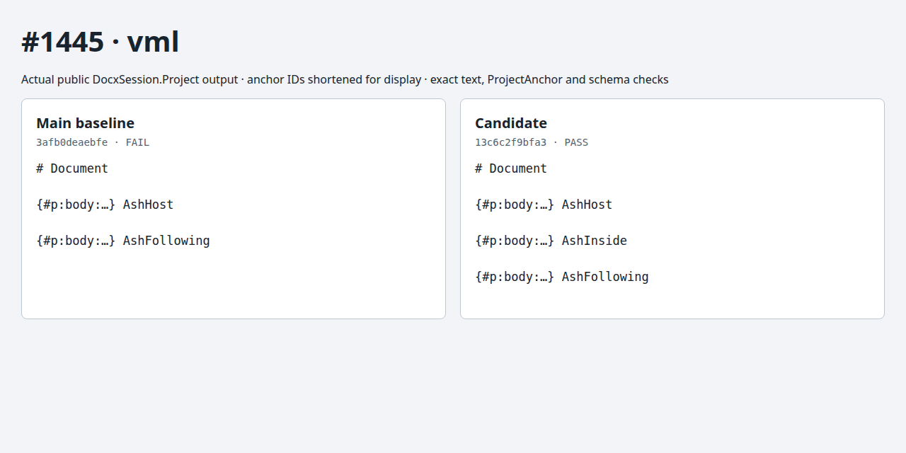 | 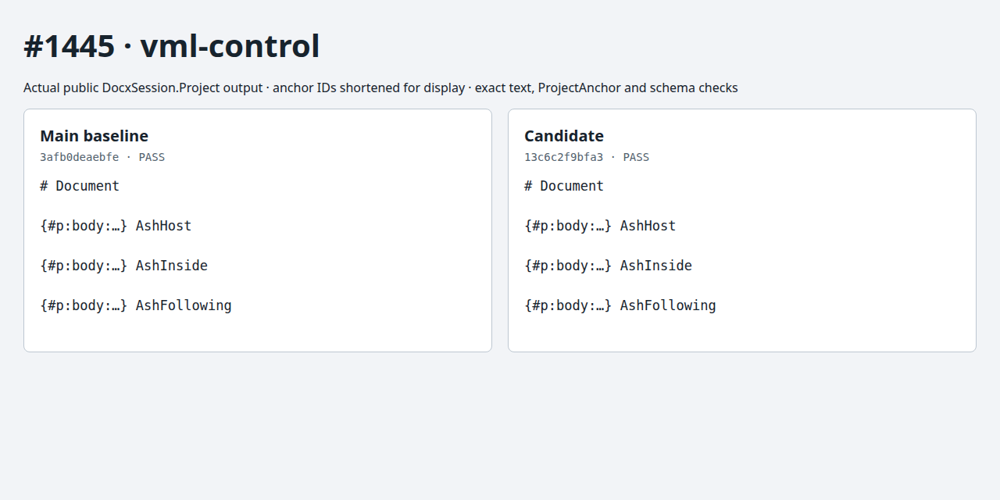 |
| 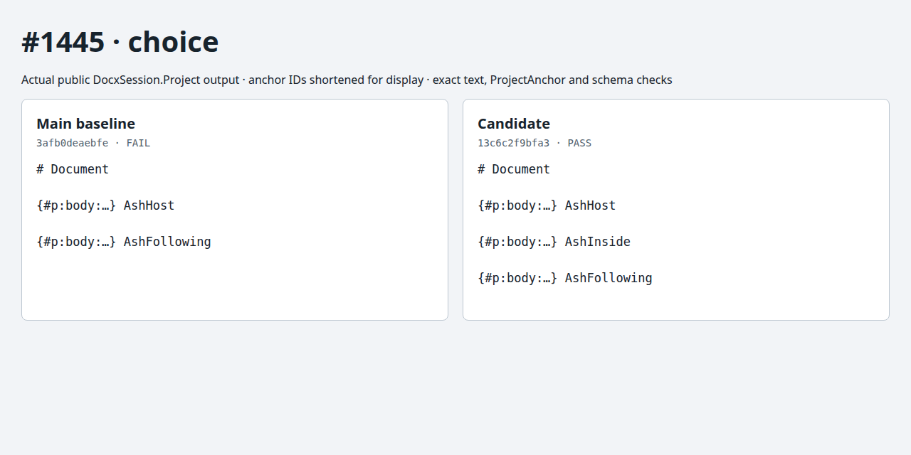 | 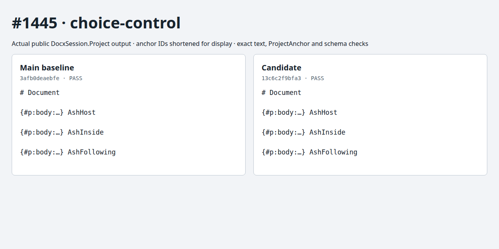 |
|  | 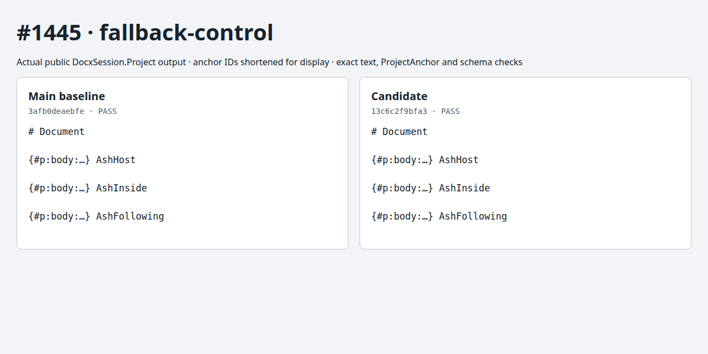 |
| 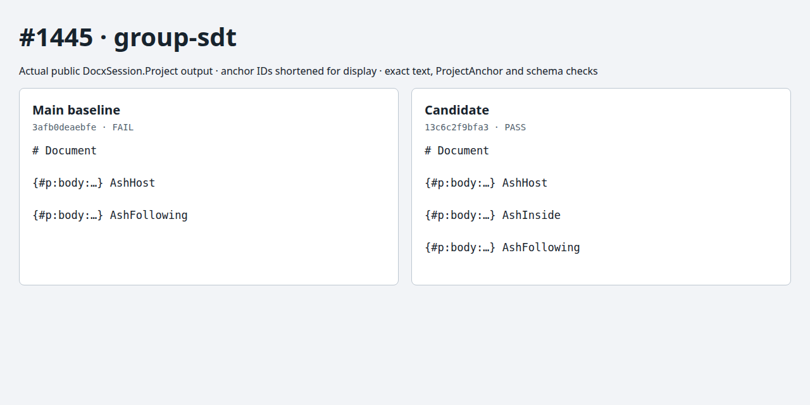 | 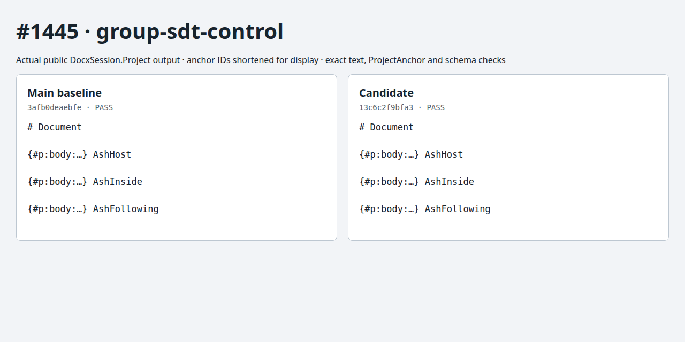 |
| 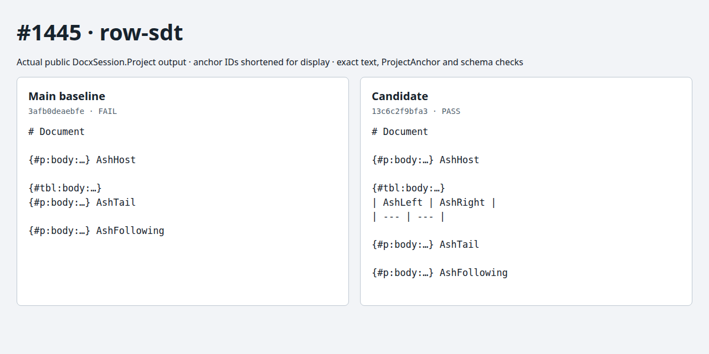 | 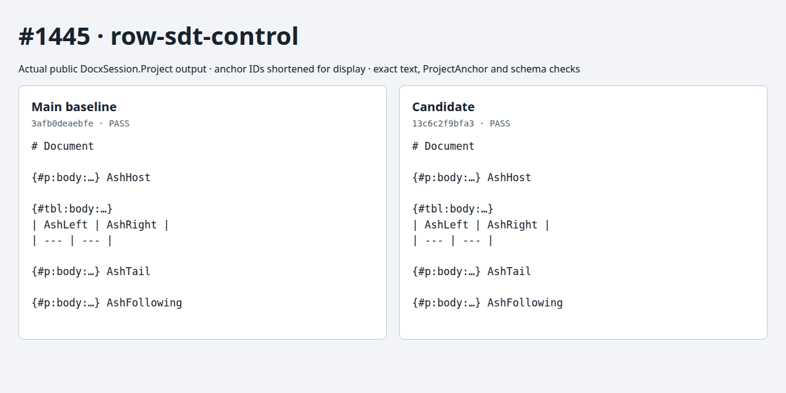 |
| 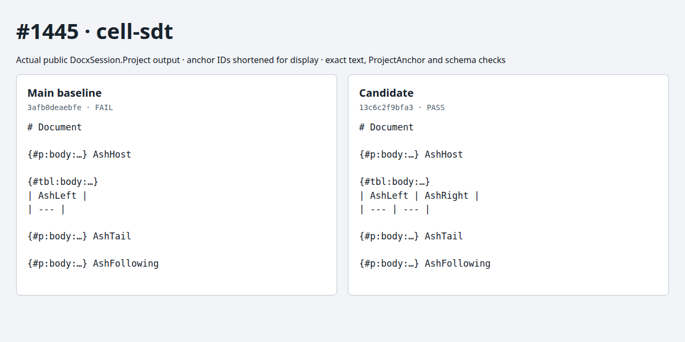 |  |
| 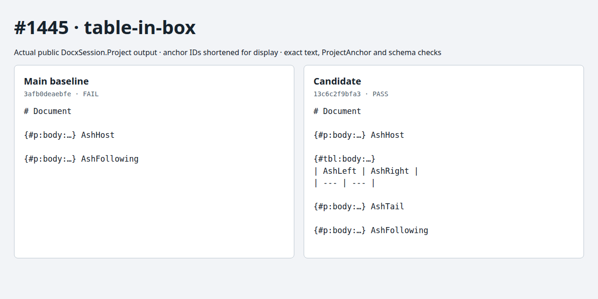 | 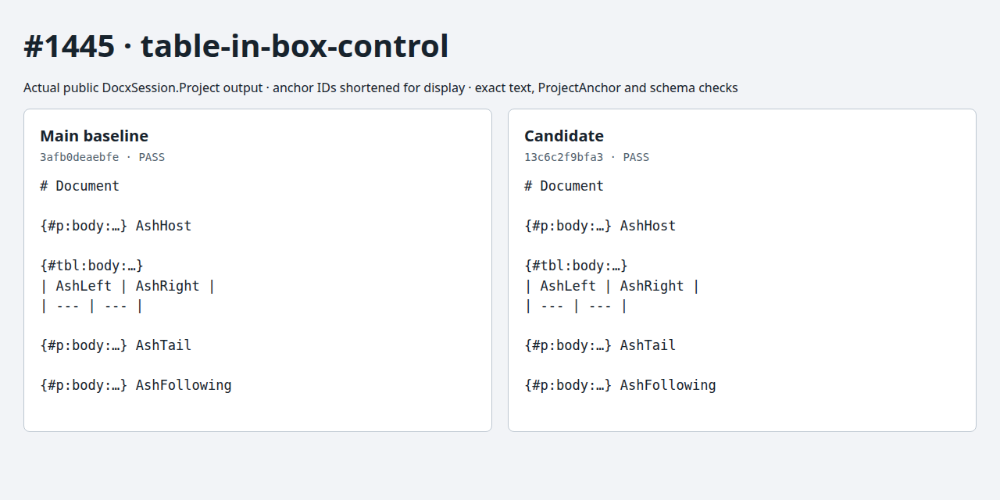 |

To reproduce against a clean checkout at an exact commit:

```bash
python3 -m bench.projection build --source /path/to/Docxodus --commit FULL_SHA --out runs/projection-build
python3 -m bench.projection run --build runs/projection-build --output runs/projection.json
python3 -m unittest discover -s tests -p test_projection.py -v
```

The build output directory must not already exist. The runner verifies the compiled DLL hashes, source identity, adapter recipe, and byte-for-byte fixture regeneration before invoking the public APIs. A failed case exits nonzero. Mutation tests cover dropped/duplicated/unexpected text, incorrect paragraph selection and schema findings.
