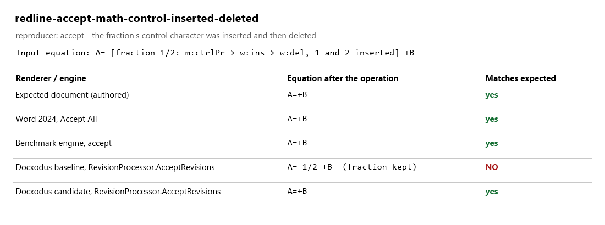
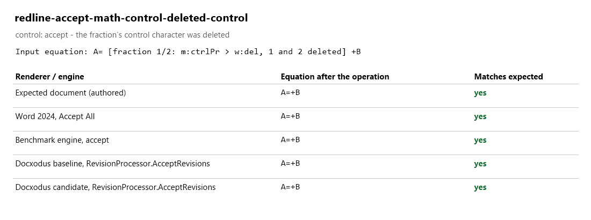
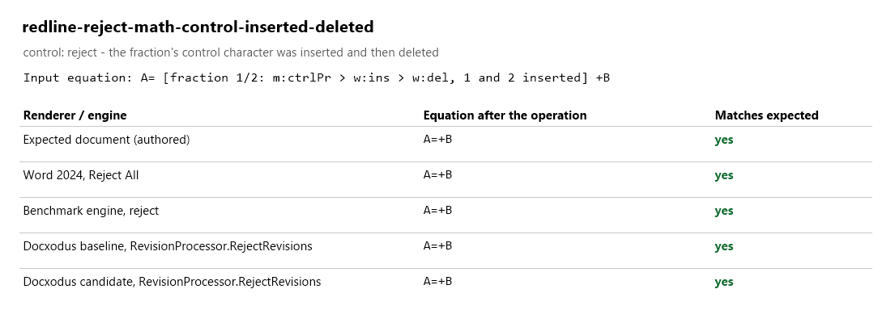

# Math objects inserted and then deleted

Docxodus #1189. Word tracks the insertion or deletion of a math object (a fraction, radical,
delimiter and so on) with a mark on the object's control character, `m:ctrlPr`. A control
character that was inserted and later deleted carries the deletion inside the insertion,
`m:ctrlPr > w:ins > w:del`. Before the fix, `RevisionProcessor.AcceptRevisions` looked for the
deletion only directly under `m:ctrlPr`, so it kept the deleted fraction. `DocxSession` refused
Accept All and Reject All on the same document.

Word 2024 lists the nested form as two revisions of the one object, a deletion and an insertion.
Accept All carries out the deletion and Reject All undoes the insertion, so both remove the
fraction with its text.

| Case | Kind | Word 2024 | Baseline | Candidate | Expected |
| --- | --- | --- | --- | --- | --- |
| `redline-accept-math-control-inserted-deleted` | reproducer | `A=+B` | `A=` fraction 1/2 `+B` | `A=+B` | `A=+B` |
| `redline-accept-math-control-deleted-control` | control | `A=+B` | `A=+B` | `A=+B` | `A=+B` |
| `redline-reject-math-control-inserted-deleted` | control | `A=+B` | `A=+B` | `A=+B` | `A=+B` |

Baseline is Docxodus main `1aab1f44`; candidate is the fix branch `44ec8bca`. Each Docxodus
column is the equation in the package the named `RevisionProcessor` call returned for the fixture.
Word opened the unmodified fixtures (16.0 build 20326, Windows 11); the object model applied
`Revisions.AcceptAll` or `RejectAll`, and the result was read from `Document.Content.WordOpenXML`.
The benchmark's own engine reaches the expected document for all three; before this change it
kept the inserted text of the reproducer on accept. LibreOffice and validator checks were not run
locally; they run in CI. `evidence.json` holds the values behind the cards.

The images are measurement cards, not page renders. Word's save and PDF export did not return on
the capture machine, so results come from the object model.

### redline-accept-math-control-inserted-deleted

### redline-accept-math-control-deleted-control

### redline-reject-math-control-inserted-deleted

