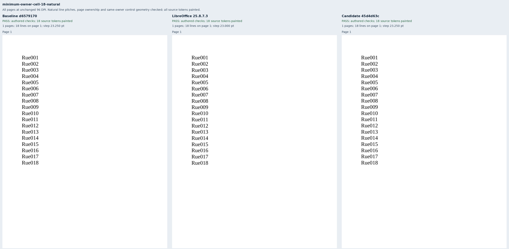
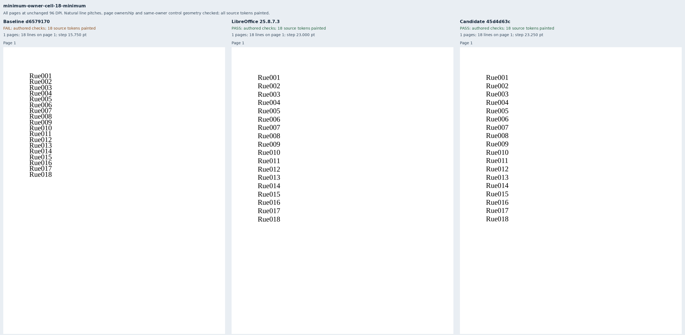
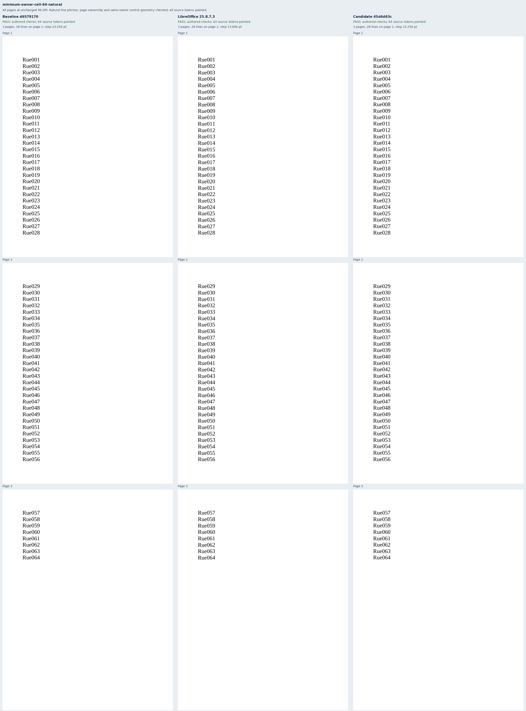
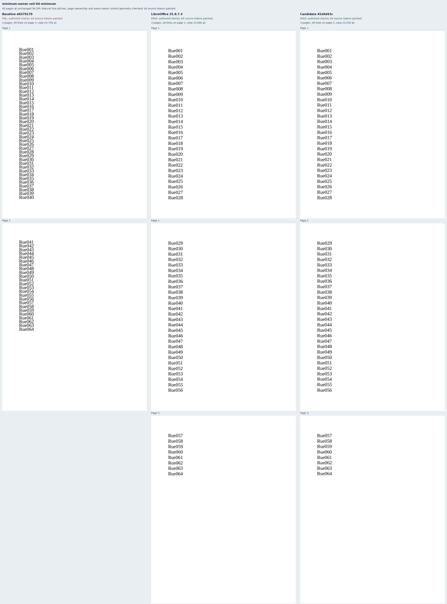
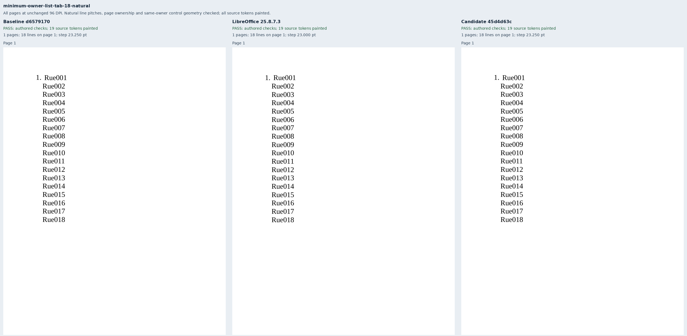
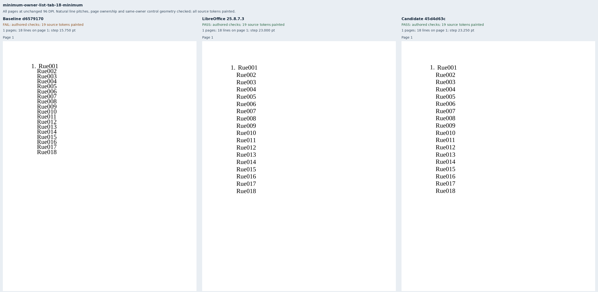
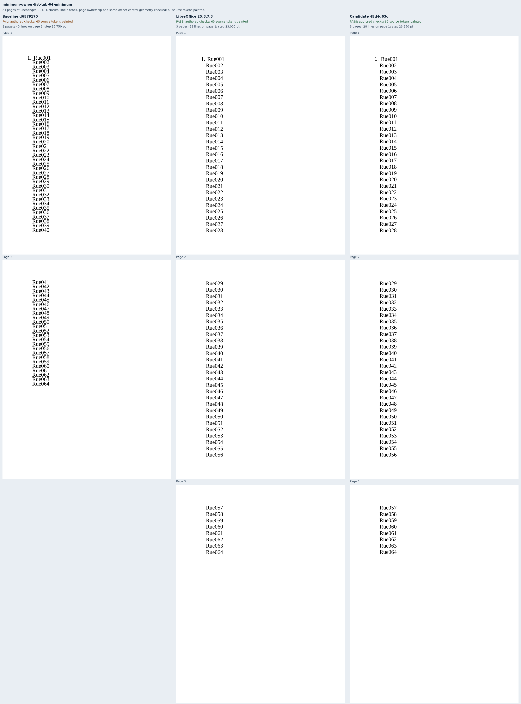
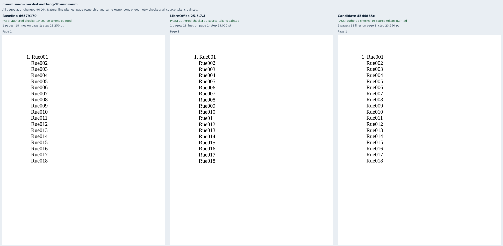
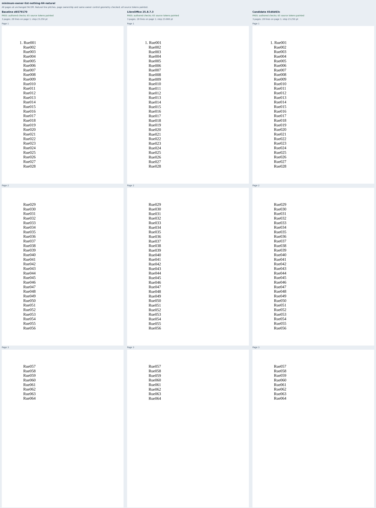
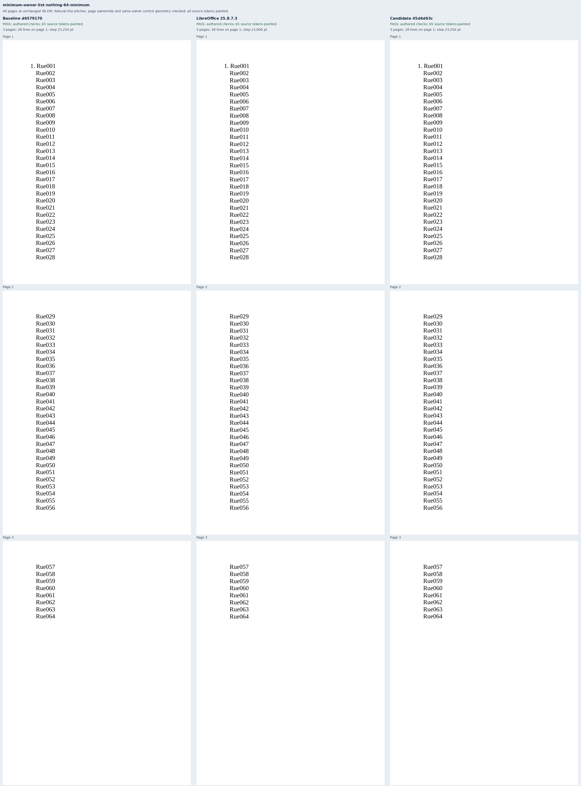

# Natural minimum spacing in cells and numbered paragraphs

Twelve original Rue documents isolate uniform 20pt Liberation Serif in a fixed-width
cell, a tab-suffixed numbered paragraph, and a numbered paragraph with no suffix.
Each owner has eighteen- and sixty-four-line natural/16pt-minimum pairs. Only the
spacing rule and value change within each pair. Long cases require three pages
with 28/28/8 labels, derived from the source font pitch `2355 / 2048 × 20` and the
648pt body height. No explicit line breaks are authored.

The LibreOffice references and unchanged baseline preserve all no-suffix controls. Baseline
cell and tab-suffixed minima compress the text to 16pt; their long cases fit incorrectly
on two pages. This supports the below-natural owner extension for
[Docxodus #1566](https://github.com/JSv4/Docxodus/issues/1566), not the unresolved
above-natural, mixed-font, note, header or frame policies. No new Word capture was made.

Contracts require complete painted token inventories, source order, exact page counts,
line ownership, every consecutive and accumulated natural pitch, and unchanged geometry
against the corresponding natural control. Candidate natural controls must also preserve
the retained baseline control's complete ordered word geometry within 0.02pt, closing an
adversarially found gap where both a control and its minimum partner could shift together.
Half-point line-slot tolerance and 0.75pt pitch tolerance cover raster-origin quantization.
The common generator initially replaced the intended 0.5pt tolerance with 0.0001; the
initial manifest/native observations are retained. Applying the intended tolerance after
the shared helper changes no inputs. All 12 packages pass Open XML SDK validation.

The reference and assertion freeze precedes candidate capture. The retained pre-baseline
freeze records the earlier checkers; review added only the stronger baseline-control pin
and paired-shift negative controls before candidate capture. Inputs, primary assertions,
tolerances and native references stayed unchanged.

Exact baseline `d657917072ac19b0a4084ac7c84d952a96b830d4` passes eight cases; exact
candidate `45d4d63c0fd5c930096d3cdd75888b6346391ee6` and native references pass all twelve.
[Retained evidence](evidence.json) binds 36 PDFs, 70 pages, 1,500 painted source words,
24 strict-font reports and twelve comparison sheets. Both renderer builds retain verified
inventories of nineteen build files and forty-five runtime assets.

All [186 negative controls](mutations.json) are rejected, covering missing/duplicate/unpainted
text, wrong line pitches and pages, added or lost pages, reading order, number geometry,
common baseline moves and paired control/output shifts. After capture, two mutation setup
errors were corrected: the within-slot common baseline move is 0.1pt instead of 0.2pt
(the existing slot headroom is 0.165pt), and wrong-page mutations use long cases with an
existing destination page. No passing contract, tolerance, input or output changed.

Capture exact separately built sources with the public strict-font API:

```sh
node docs/results/export-reliability/Capture.mjs SOURCE RUN/manifest.json RUN/candidate RUN/environment.json --html
python3 docs/results/minimum-owners/Compose.py RUN BASELINE_SOURCE CANDIDATE_SOURCE
python3 docs/results/minimum-owners/Mutations.py
python3 -m unittest discover -s tests -v
node --test tests/test-adapter.mjs
python3 -m bench.audit
```

System Chromium and LibreOffice 25.8.7.3 outputs are diagnostic evidence, not a pinned-runtime
score or a full-suite Word-parity claim. Comparison sheets contain every unchanged 96 DPI
page raster, labeled by input and renderer.






















