# Natural minimum spacing in running stories and notes

Sixteen original Poppy documents isolate uniform 20pt Liberation Serif in headers,
footers, footnotes and endnotes. Each owner has natural/16pt-minimum pairs that
change only the paragraph spacing rule and value. Short stories contain eight lines;
long headers/footers repeat eighteen lines on three authored body pages, while long
notes continue sixty-four lines. The note reference occupies a separate paragraph:
raised or linked references in the text paragraph are outside this contract.

The source page width, margins, paragraph indent and font yield a 96pt line width
and natural pitch `2355 / 2048 × 20`. The checker validates that scaffold and rejects
run-level font overrides. Every source label must appear in order, on the appropriate
running page or corresponding natural-control continuation, with both consecutive
and accumulated natural pitch. Complete painted inventories include the body labels
and both note markers. Natural-control geometry is pinned to the unchanged baseline
within 0.02pt so paired control/output drift cannot pass. Minimum/natural geometry
uses 0.5pt for running stories (paint-origin quantization) and 0.02pt for notes.

These are scoped controls for [Docxodus #1566](https://github.com/JSv4/Docxodus/issues/1566).
LibreOffice and Chromium place a few words of long natural notes on different pages;
this pre-existing difference remains. The primary checker evaluates actual native-versus-
renderer correctness for page count, paper geometry, font family, exact inventory and
authored body pages. It makes no native label-page claim for continued notes. Each
renderer must preserve its own natural continuation. Full per-page story inventories
are retained in the evidence. No new Word reference or broad note-layout parity is claimed.

Adversarial review caught an initial self-comparison that concealed those native page
assertion mismatches. The declared scope and primary correctness call were corrected
before candidate capture. It also required source-scaffold validation and binding the
refusal record to its input, error code and phase. Earlier declarations and native
observations are retained; inputs and native PDFs never changed. An earlier repeated-
marker declaration was also corrected because the shared marker assertion requires
unique labels; repeated content is checked by its full per-page source inventory.

The frozen source contracts and native controls precede candidate capture. The first
candidate restored line height but failed two running-story geometry checks: HTML
minimum text retained browser kerning while its natural control used fitted vector
text. `Poppy011` was 0.742pt narrower. The retained first capture demonstrates that
failure. The core fix now marks a successfully recovered minimum as equivalent to
single spacing so the existing fitter and painter handle it consistently; the authored
minimum remains. No benchmark assertion or tolerance changed after candidate capture.
All eight unchanged body-minimum cases are replayed because the shared paint correction
also applies to eligible body paragraphs. Candidate
`f565bf54a23675d2d96686e581aabc23df9974e0` is compared with unchanged baseline
`7c0a32b12e0ec60cda8bb58141f505cbfcd2d19f`. All sixteen packages have zero Open XML SDK
findings. The benchmark preserves all 978 previous inputs and contracts; core-v133 adds
only these sixteen cases and refreshed generator provenance.

The final candidate and native controls pass all sixteen cases; the baseline passes eight
natural controls, fails six minimum geometry checks, and refuses two minimum footnotes.
[Evidence](evidence.json) binds 46 produced PDFs, 91 pages, 1,650 painted words,
30 strict-font reports and sixteen comparison sheets. Both renderer builds verify nineteen
build files and forty-five runtime assets. All [240 corrupted observations](mutations.json)
are rejected. The [eight unchanged body cases](body-regression/evidence.json) also pass,
covering sixteen additional candidate PDF pages under their original frozen contracts.
The [first rejected capture](first-candidate/failure.json) retains its build, reports,
PDFs and input hashes.

Capture and verify separately built public renderer revisions:

```sh
node docs/results/export-reliability/Capture.mjs SOURCE RUN/manifest.json RUN/candidate RUN/environment.json --html
python3 docs/results/minimum-stories/Compose.py RUN BASELINE_SOURCE CANDIDATE_SOURCE
python3 docs/results/minimum-stories/Mutations.py
python3 -m unittest discover -s tests -v
node --test tests/test-adapter.mjs
python3 -m bench.audit
```

System Chromium and LibreOffice 25.8.7.3 outputs are diagnostic evidence, not a pinned-
runtime score or full-suite Word-parity result. Sheets include every unchanged 96 DPI
PDF page and explicitly label the baseline footnote export refusals.

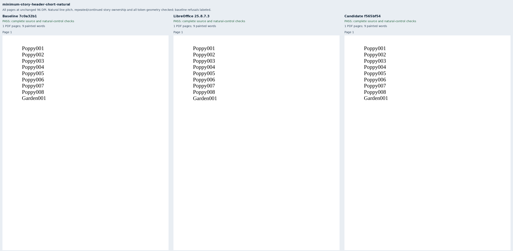

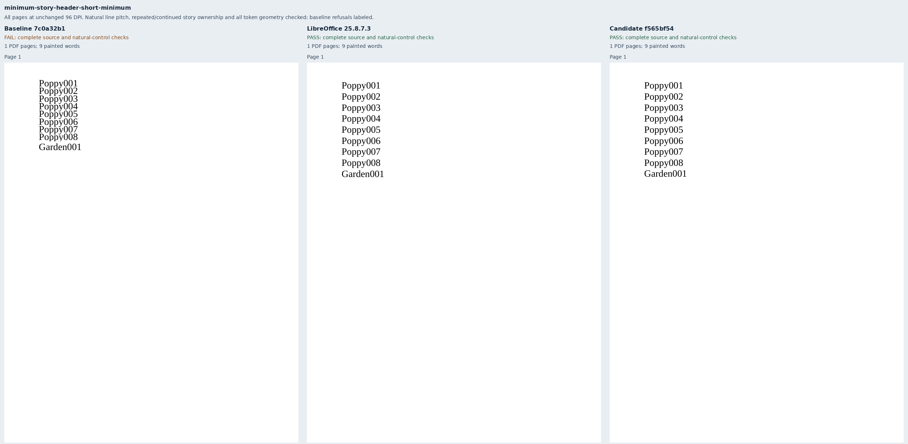

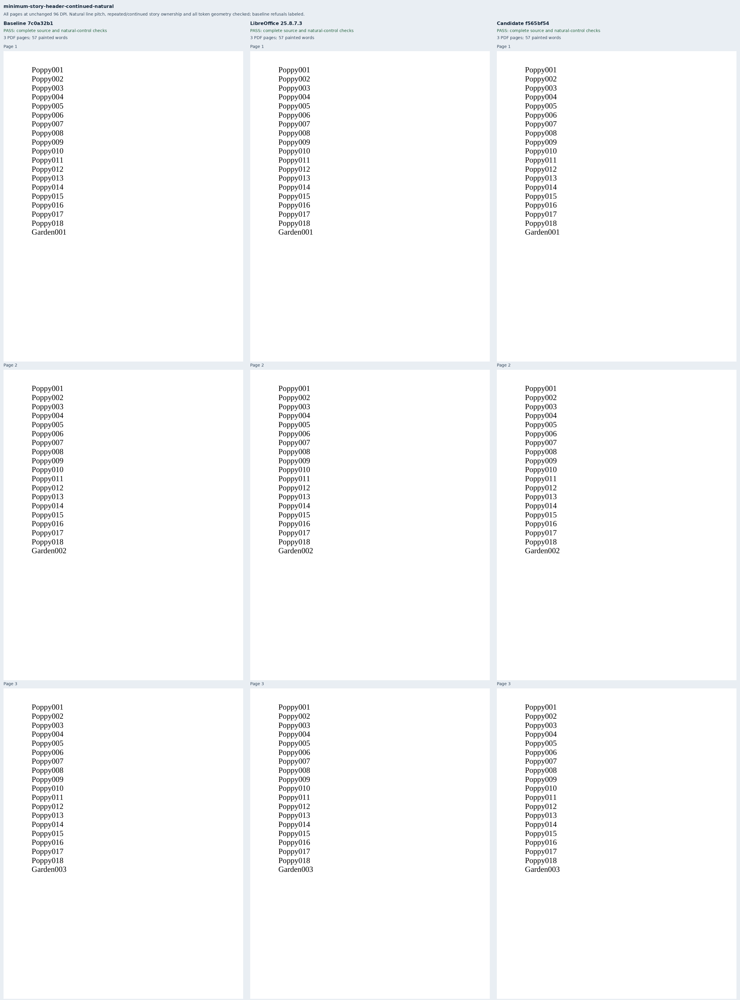

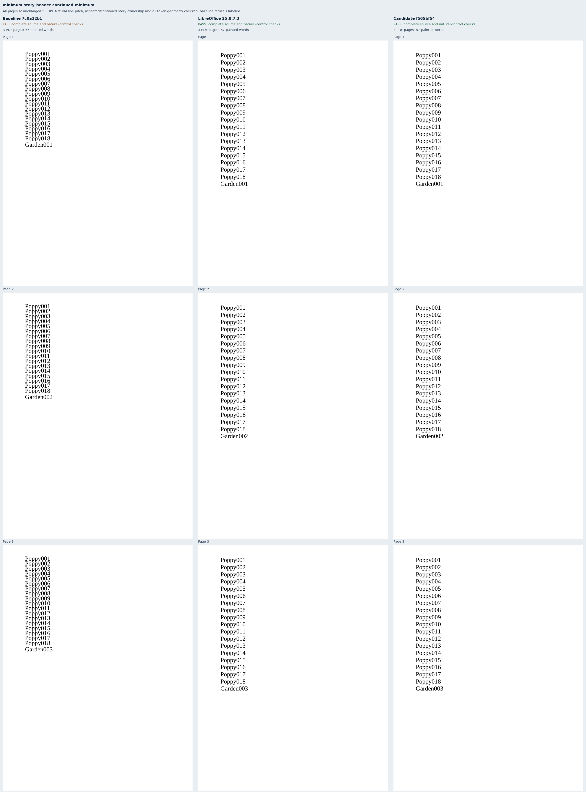

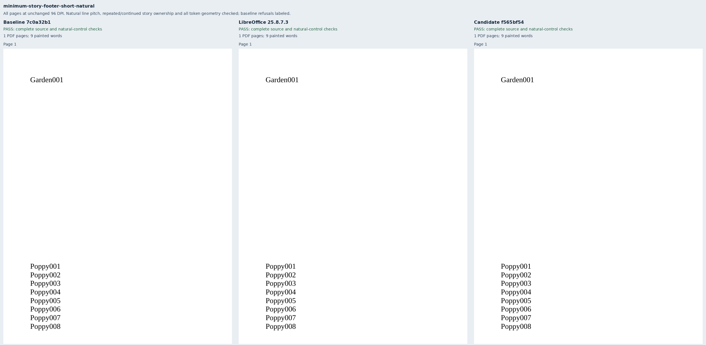

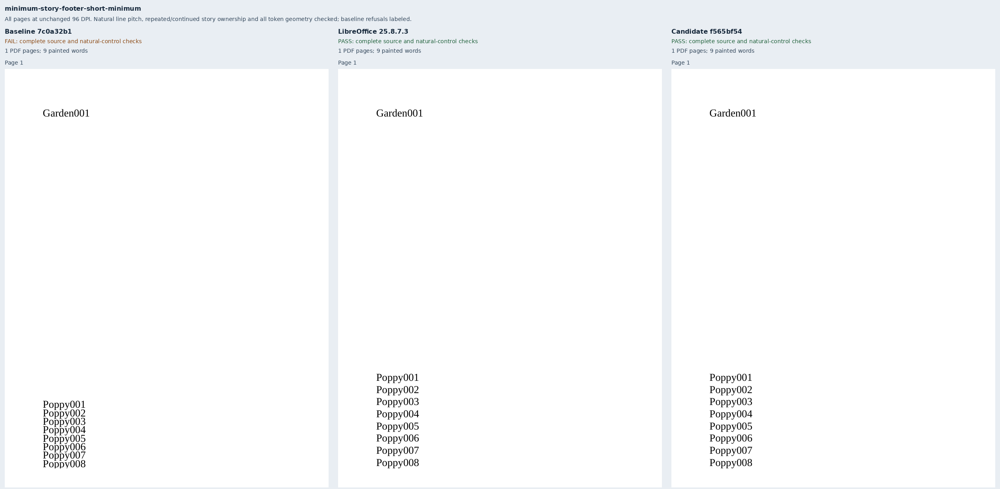

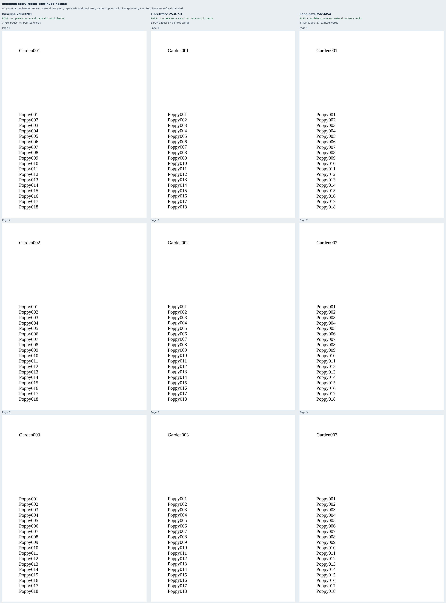

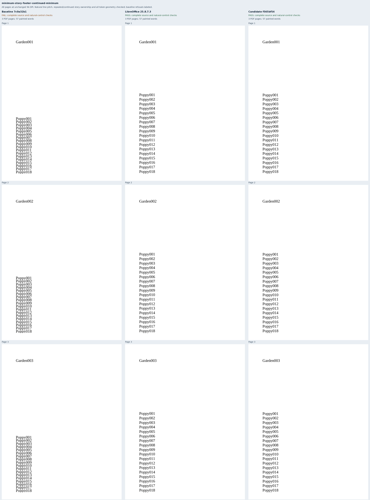

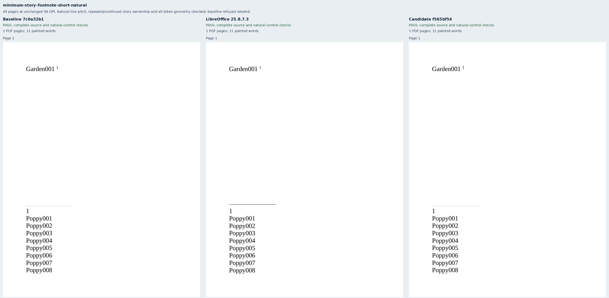

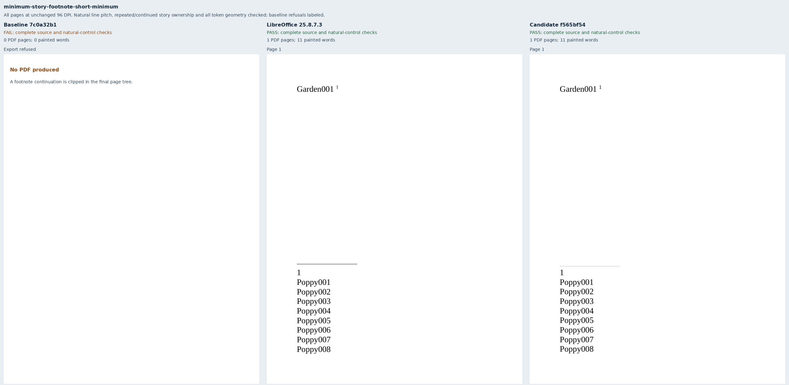

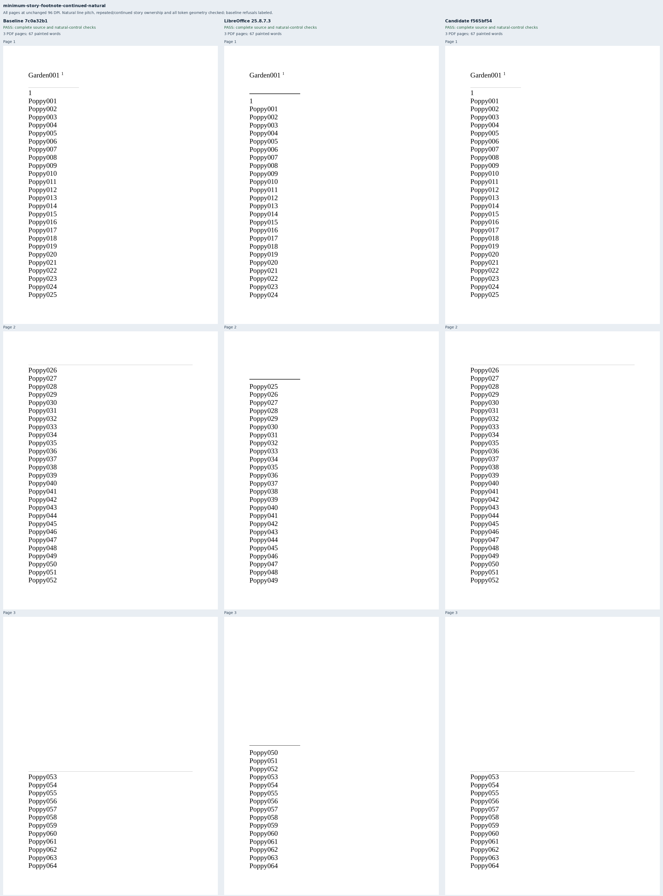

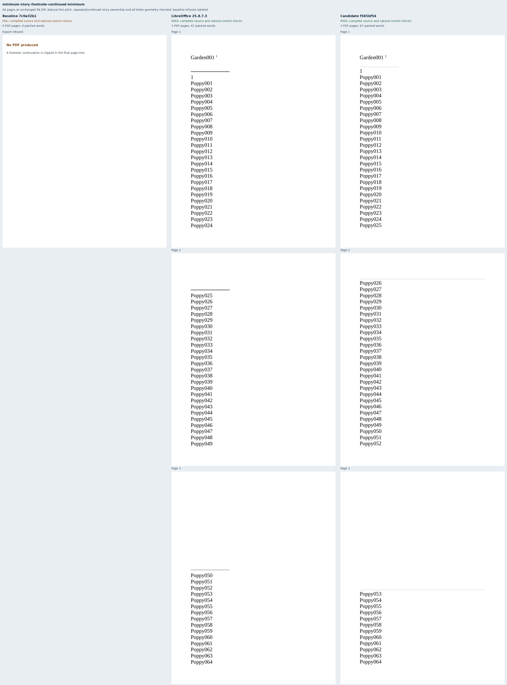

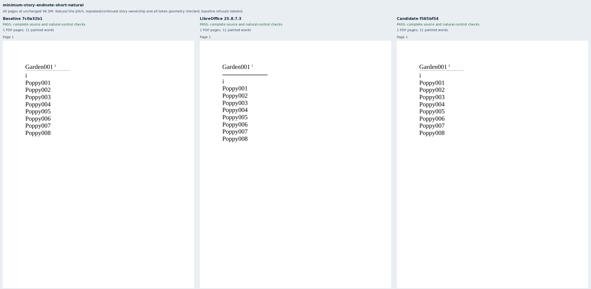

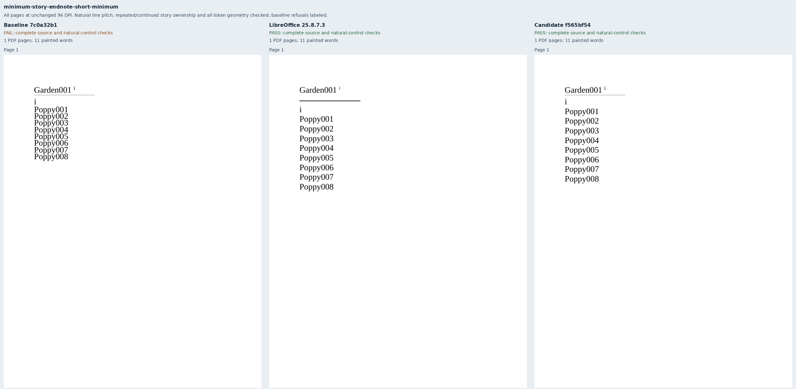

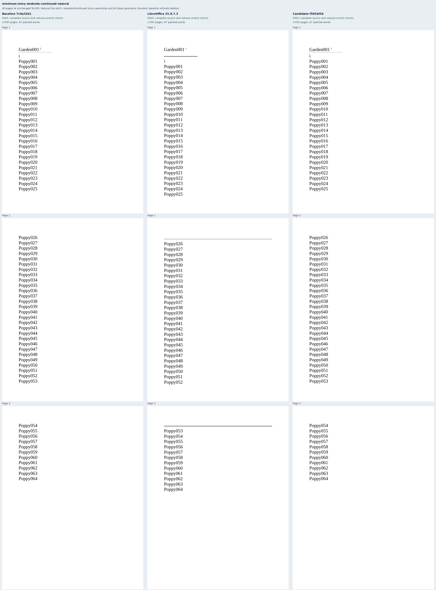

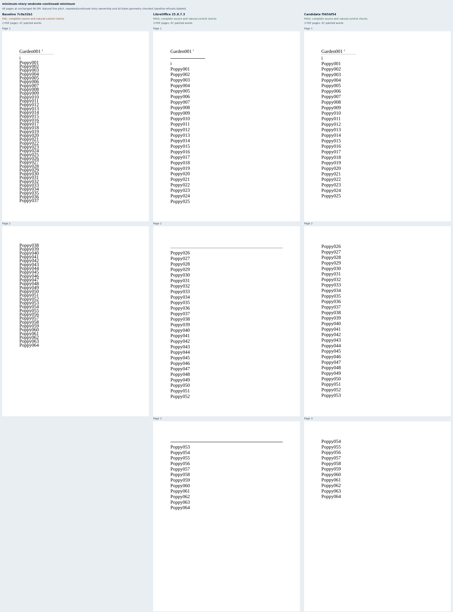
