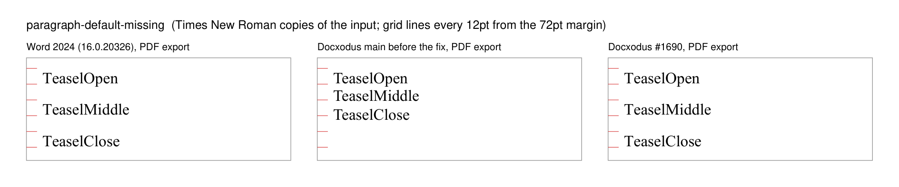
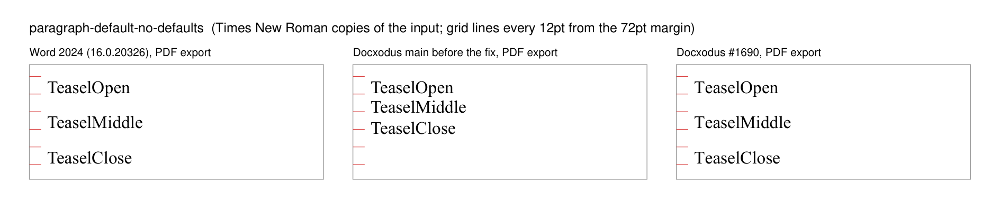
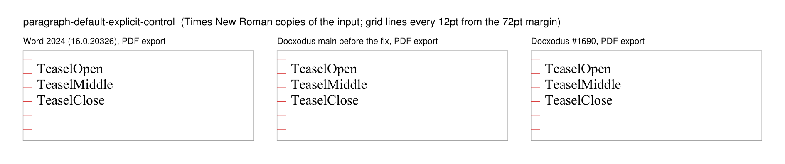

# A styles part without `w:pPrDefault`

Six original Teasel cases accompany [Docxodus #1652](https://github.com/JSv4/Docxodus/issues/1652).
Word 2024 lays out a document whose styles part has no `w:pPrDefault` with 8pt after and 1.16
lines (`w:after="160" w:line="278"`), not with the schema defaults. A `w:pPrDefault` that is
present, even empty, is taken as written.

## PDF track (`core-v167`)

Each input is three one-line paragraphs of 12pt Liberation Serif with no spacing of their own.
Only the styles part differs.

| Case | Styles part | Word 2024 label tops (pt) | Docxodus before | Docxodus with the fix |
|---|---|---|---|---|
| `paragraph-default-missing` | `w:docDefaults` holds only `w:rPrDefault` | 72.5, 96.5, 120.5 | 72.6, 86.1, 100.3 | 72.5, 96.5, 120.5 |
| `paragraph-default-no-defaults` | no `w:docDefaults`; run properties on `Normal` | 72.5, 96.5, 120.5 | 72.6, 86.1, 100.3 | 72.5, 96.5, 120.5 |
| `paragraph-default-empty-control` | `<w:pPrDefault/>` | 72.5, 86.3, 100.1 | 72.6, 86.1, 100.3 | 72.6, 86.1, 100.3 |
| `paragraph-default-explicit-control` | `w:after="0" w:line="240"` | 72.5, 86.3, 100.1 | 72.5, 86.3, 100.1 | 72.5, 86.3, 100.1 |

The Docxodus columns are PDF exports of the same Times New Roman copies with installed fonts, from a
`main` build before the fix and from JSv4/Docxodus#1690. Before the fix all four inputs printed
single-spaced; with it the two reproducers land within 0.1pt of Word and the controls do not move.

The marker regions are Word 2024's PDF word boxes (16.0.20326, PDF export) for these exact inputs
with the font renamed to its metric twin Times New Roman, widened by 1pt on each side. The middle
and last regions of the reproducers and the controls do not overlap, so single spacing fails the
reproducers and Word's spacing fails the controls.

The values are built into Word. The same documents measured the same in a Word instance started
with `/a` (no Normal template), and in one whose user-templates folder held a copy of `Normal.dotm`
changed to 20pt after and double spacing. Compatibility modes 12, 14 and 15 and a Calibri-era theme
part gave the same result.

## Redline track (`redline-v40`)

The original declares 200/276 default spacing; the revised document differs by one word.

| Case | Revised document | Accept All | Reject All |
|---|---|---|---|
| `redline-default-spacing-missing-default` | `w:docDefaults` without `w:pPrDefault` | 160/278 | 200/276 |
| `redline-default-spacing-stated-default-control` | `w:pPrDefault` states 160/278 | 160/278 | 200/276 |

Before the fix Docxodus recorded single spacing (0/240) on `Normal` for the reproducer, so the
redline accepted to single spacing while Word shows the revised document itself at 8pt / 1.16.
Word 2024 opened the candidate's redlines for both directions (`Range.Information`, Times New Roman
copies): review and Accept All gave the revised document's tops (72, 96, 120 for the missing
default) and Reject All the original's (72, 98, 123.5).

## Review sheets

Each sheet shows the top of page 1 of the Times New Roman copy as printed by Word 2024 and as
exported by Docxodus before and with the fix. The red ticks are 12pt apart from the 72pt margin.

### paragraph-default-missing

### paragraph-default-no-defaults

### paragraph-default-empty-control

### paragraph-default-explicit-control

The two redline cases have no sheet: their evidence is the `Range.Information` positions above.

## Limits

LibreOffice reference captures and candidate scoring are pending. This machine has no pinned
LibreOffice and no Liberation Serif, so no reference bundle is included, no eligibility or fidelity
score is claimed, and the sheets show Times New Roman copies, not the registered inputs. All prior
input hashes are unchanged.
