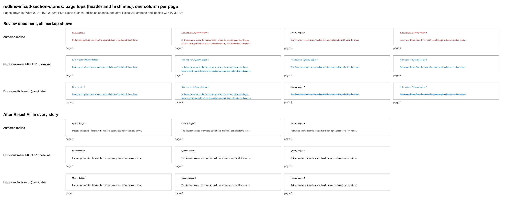
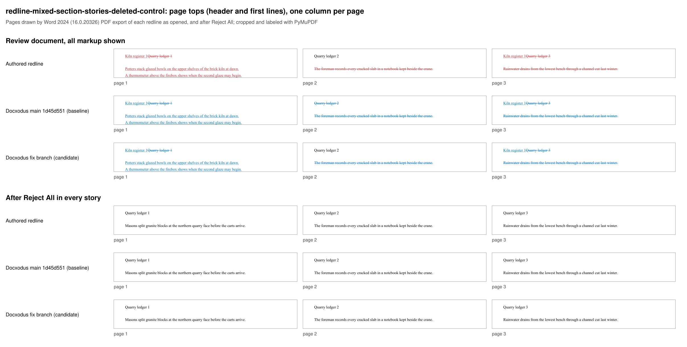

# Section breaks both deleted and inserted

Docxodus #1757 compared an original whose sections each have their own header with a revision
that replaces the whole body with fewer sections. Once the comparison both deleted some of the
original's section breaks and inserted some of the revision's, Docxodus paired headers by section
number instead of by the sections each part of the redline came from, so rejecting the redline put
original sections under other sections' headers.

| Case | Kind | Failed checks, baseline | Word 2024 reject, baseline | Failed checks, candidate | Word 2024 reject, candidate |
| --- | --- | --- | --- | --- | --- |
| `redline-mixed-section-stories` | reproducer | `markup-rejected`, `assertion-section-stories` | Quarry ledger 2, 3, 3 | none | Quarry ledger 1, 2, 3 |
| `redline-mixed-section-stories-deleted-control` | control | none | Quarry ledger 1, 2, 3 | none | Quarry ledger 1, 2, 3 |

Baseline is Docxodus main `1d45d551`; candidate is the fix branch `76bf92e4`
([JSv4/Docxodus#1762](https://github.com/JSv4/Docxodus/pull/1762)). Every redline, the authored ones
included, opens in Word 2024 (16.0.20326); after Reject All or Accept All on every story range no
revision remains, and Accept All gives `Kiln register 1`, `2` (reproducer) or `Kiln register 1`
(control) under the revised text. The authored redlines pass every check and give the same Word
results as the candidate.

Word 2024's own compare of each pair (`Application.CompareDocuments`, headers compared) leaves the
header of a section that holds only deleted text unchanged, with no revision marks; only sections
whose text survives into the revision show a header diff. The authored redlines and the candidate
do the same. The baseline marks those headers deleted, and in the reproducer also shows the next
section's header there beside the revision's last one.

"Failed checks" are those of the bench's own markup engine and assertions, run on this machine.
The pinned SDK validator found nothing in any input, authored redline or Docxodus output.
LibreOffice was not available; its comparisons run in CI. `evidence.json` holds the per-check and
Word results.

Each image shows the top of every page (header and first lines) of Word 2024's PDF export of each
redline as opened, with all markup, and after Reject All. Rows are the authored redline, the
baseline and the candidate. Word substitutes its default serif for Liberation Serif, which the
capture machine does not have.

### redline-mixed-section-stories

### redline-mixed-section-stories-deleted-control

