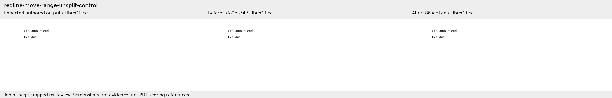
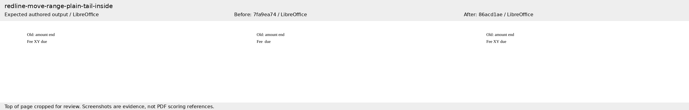
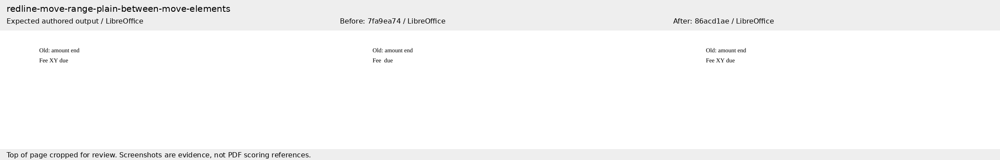
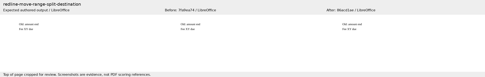
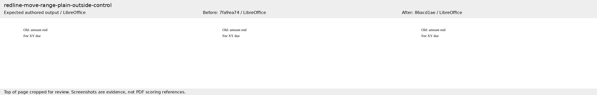
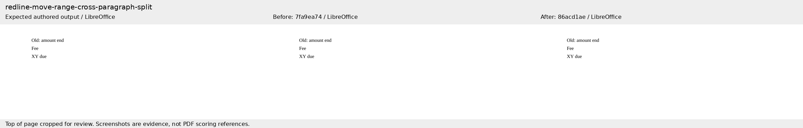

# Live content inside move ranges

Companion to [Docxodus #1366](https://github.com/JSv4/Docxodus/pull/1366), fixing #1340. The six original literal-OOXML reject cases use the benchmark’s styles and page defaults. Their expected paragraphs follow independent native Word for the web observations on the corresponding original core probes; the [core fixture manifest](https://github.com/JSv4/Docxodus/blob/86acd1aed2ee30b5f1b7dfcb3b71c8d88f160f05/TestFiles/RP/MoveRangeMembership/word-endpoints.json) records exact Word source and endpoint hashes.

These are focused diagnostic runs, with no complete suite score. The baseline is core `7fa9ea7449fa4be15915085786a1dc8286bcad46`; the reviewed fix is `86acd1aed2ee30b5f1b7dfcb3b71c8d88f160f05`. Both runs use the same suite, environment, validator and adapter source contract. All six LibreOffice output comparisons apply. All 12 new input/expected packages have zero Open XML SDK 3.5.1 Microsoft365 findings. All 976 prior DOCX files are byte-identical.

| Case | Before | After |
|---|---:|---:|
| unsplit-control | 100 | 100 |
| plain-tail-inside | 0 | 100 |
| plain-between-move-elements | 0 | 100 |
| split-destination | 100 | 100 |
| plain-outside-control | 100 | 100 |
| cross-paragraph-split | 100 | 100 |

The stateless processor already handled split destination ranges; the core tests separately cover their formerly refused session listing and bulk/selective resolution. The benchmark measures stateless rejection only. Native Word PDFs are not registered as scoring references for these differently serialized benchmark inputs.

Each screenshot shows the independently authored expected output, baseline output and fixed output, rendered by LibreOffice. The top of each page is cropped only for this review preview. PDF geometry is not scored from these screenshots. Package/PDF/image hashes, renderer versions and individual checks are in [evidence.json](evidence.json).

## unsplit-control

## plain-tail-inside

## plain-between-move-elements

## split-destination

## plain-outside-control

## cross-paragraph-split

