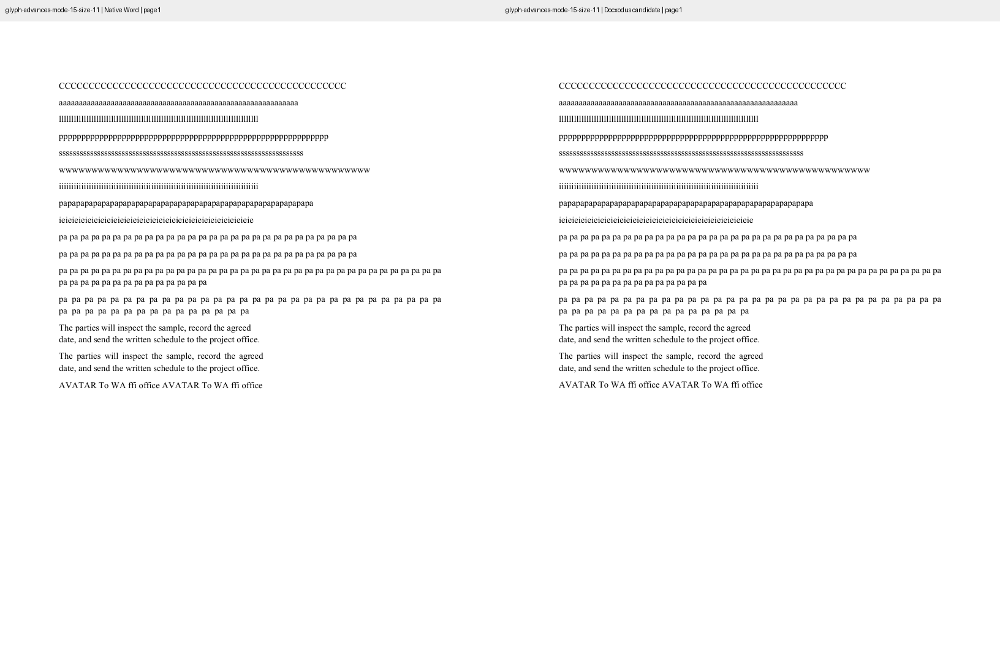
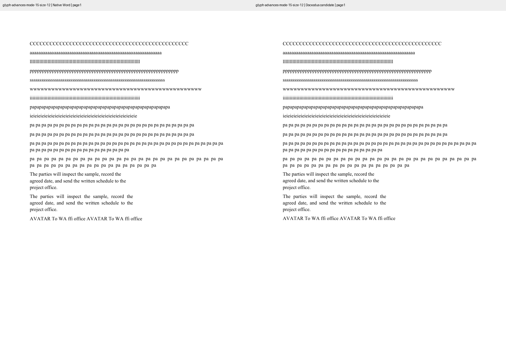
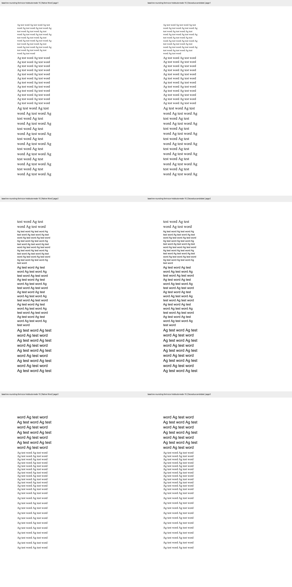
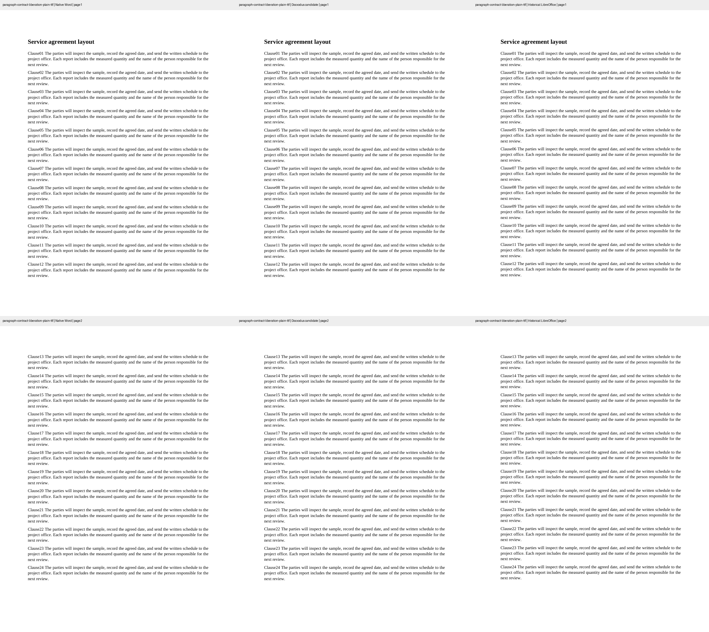

Three original inputs captured in Word for the web before this follow-up reproduce two precision losses behind [Docxodus #1124](https://github.com/JSv4/Docxodus/issues/1124). The 11pt and 12pt glyph/word controls cover natural advances, fitting final lines, single/repeated spaces, narrow prose and kerning. The eight long paragraphs cover Times New Roman and Arial at 10/13/16pt with 1.15 spacing, plus 12pt Times New Roman single/1.5 controls. Their paragraph marks explicitly carry the same font and size as their runs.

All three generated inputs match the captured source bytes and have zero Open XML SDK findings. `core-v71` contains 384 cases; all 381 preceding input hashes and declarations except generator hashes remain unchanged. No metric, inventory waiver, normalization, historical reference, CI suite or tolerance changes.

`native-word.json` records input/PDF/returned-DOCX identities and raw inspections. `candidate-proof.json` binds the public exports to core [`7954e593`](https://github.com/JSv4/Docxodus/commit/7954e593614574a094bd0c0104c332d24377f444) source and artifact hashes, and retains full native line/page inventories. Core regressions check relative native baseline pitch, independently derived font-table word advances, complete text, inline geometry and PageMap continuity. Word's PDF coordinate quantization remains a measured residual; the tests fit no arbitrary grid or positional offset.

These local exports are unscored diagnostics: the host cannot satisfy the strict benchmark user-namespace preflight. The original agreement's paired PDFs and historical 92.0731 result remain unchanged. A separate exact-outline/advance embedded Liberation Serif Word capture improves under the precision change while the original LibreOffice raster comparison declines. Both results are retained; this evidence does not exempt any case from the existing CI regression gate.

Every new case and every physical page is shown below at the same scale, labelled by renderer. Native font family checks pass with the existing contract; that is not proof of identical native/local font versions, outlines, hinting or rasterization. Word's reported build was unavailable.

| Case | Pages each | Native Word left, Docxodus right |
| --- | ---: | --- |
| `glyph-advances-mode-15-size-11` |1|  |
| `glyph-advances-mode-15-size-12` |1|  |
| `baseline-rounding-font-size-holdouts-mode-15` |3|  |

The same-font agreement comparison retains unretouched full pages below. The unchanged 96DPI metric-v3 raw diagnostic improves from 84.1366 to 95.6848 against native Word, while the original LibreOffice comparison falls from 92.0731 to 81.7414. These are local raw diagnostics, not calibrated new benchmark scores. Used embedded glyph outlines, bearings, advances and instructions match the original Liberation Serif files; global `gasp` identity is not asserted. Word uses embedded subset aliases, which the current family-name eligibility check rejects. This diagnostic remains separate from registered eligible references; no alias normalization or family-check waiver is added.

