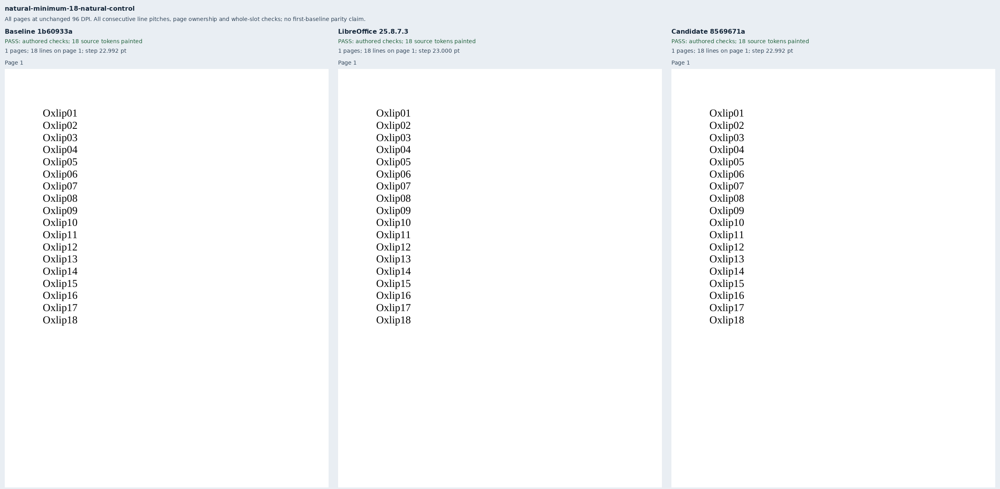
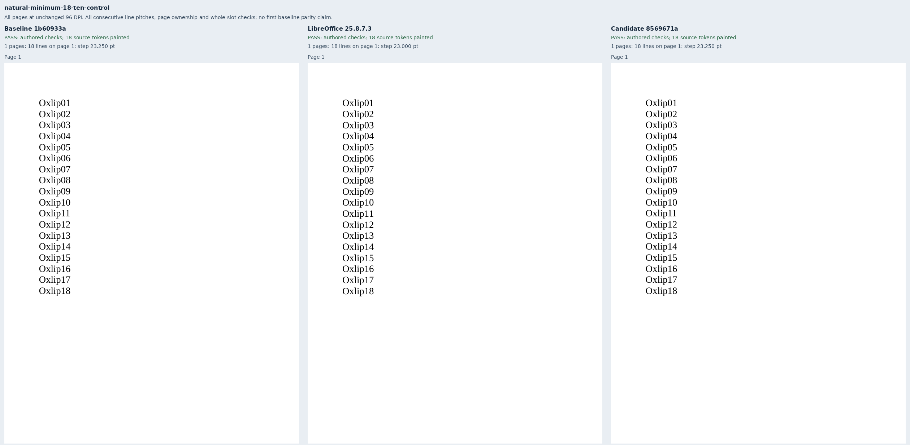
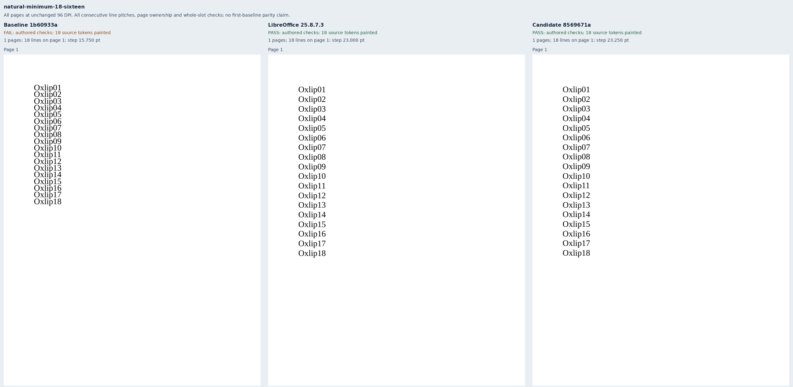
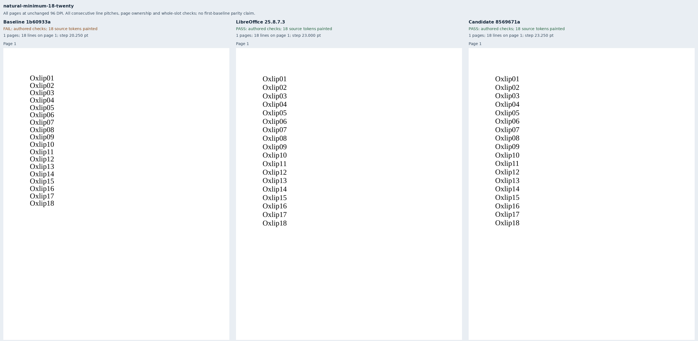
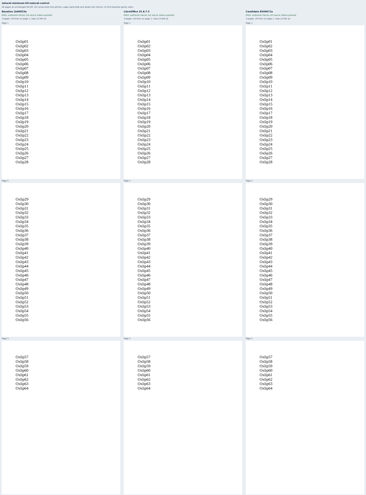
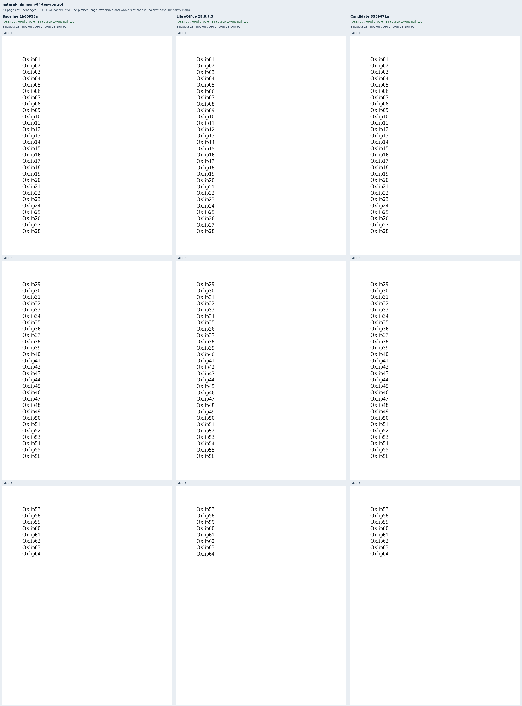
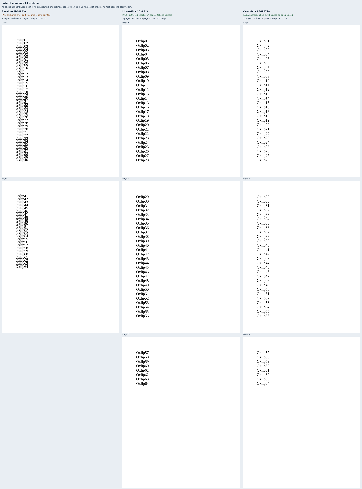
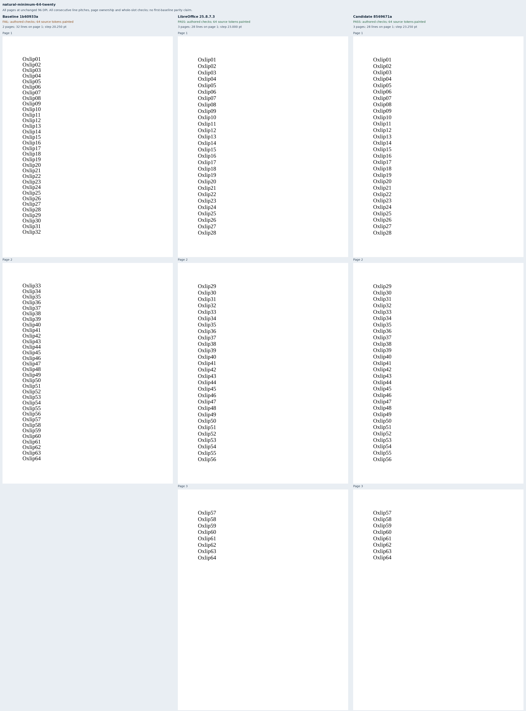

# Natural lines above a smaller minimum

Eight original Oxlip documents isolate uniform 20pt Liberation Serif text whose natural
line height is approximately 23pt. Each group contains natural single spacing, a 10pt
minimum control, and 16pt and 20pt minima. The groups contain eighteen and sixty-four
distinct words, respectively. A 96pt text column wraps one word per line without explicit
breaks. Within each group, only the spacing rule and its value change.

These cases address the below-natural uniform-text part of
[Docxodus #1566](https://github.com/JSv4/Docxodus/issues/1566). Every line has an authored
page and line-slot assertion. The source font's pitch is `2355 / 2048 × 20` points;
the 648pt body accommodates 28 lines. The long cases therefore require three pages,
with 28/28/8 labels. Consecutive-pitch checks cover every pair, including page ownership
at each boundary. The source-derived page count also rejects extra blank pages.
Complete source inventories, visible ink and page geometry are required.

The first capture exposed an OOXML child-order mistake in the fixture generator; spacing
now precedes indentation, and fresh v2 captures use eight packages with zero Open XML SDK
findings. Unchanged 10pt-minimum controls then exposed a 0.335pt line-slot overrun from
Chromium's 0.75pt glyph-origin quantization. The retained calibration preserves the v2
0.1pt assertions and native observations. Final v3 slots allow 0.5pt for every renderer;
each consecutive pitch allows 0.75pt for independently rounded origins. No first-glyph
baseline parity is claimed. All eight native references meet the final contract.

Exact baseline build `1b60933a8cd66c78a36dc5cc8777d74fcb883402` passes four controls
and fails the four reproducer cases. Exact candidate build
`8569671a3b65f4a5fa7f52d8a46f84d94a615bbd` passes all eight. The
[retained evidence](evidence.json) binds 24 PDFs, 984 painted source words on 46 pages,
16 strict-font production reports and all eight comparison sheets. Both builds retain
verified inventories of nineteen build files and forty-five runtime assets. The baseline
checkout was restored to its actual build commit; its published reparent has an identical
source tree. The candidate was fully built from the recorded commit.

All [76 corrupted observations](mutations.json) are rejected: upward/downward line moves,
missing/duplicate/unpainted/extra words and an extra blank page in each case, plus wrong-page
words, lost final pages and duplicated page contents in each long case. A separate 0.8pt
line shift still satisfies the whole-slot checks but fails the consecutive-pitch checks
in all eight cases. Fixture-pair and mutation checks
run in the Python suite. The public API exports use sandboxed system Chromium
157.0.8103.38 with strict font verification. This is diagnostic evidence, not a
pinned-runtime score or a full-suite parity claim. No new Word capture was made.

Larger minima, mixed-font lines, explicit breaks, blank paragraphs and other paragraph
owners remain outside this bounded rendering change.

## Reproduction

Generate `core-v127`, select `natural-minimum-*`, validate the packages and capture native
references. Freeze the manifest before capturing either renderer. Build the exact commits
with `python3 -m bench build-docxodus`, or verify the retained artifact inventories against
their original build records. Capture each source into `RUN/baseline` or `RUN/candidate`:

```sh
node docs/results/export-reliability/Capture.mjs SOURCE RUN/manifest.json RUN/candidate RUN/environment.json --html
python3 docs/results/natural-minimum/Compose.py RUN BASELINE_SOURCE CANDIDATE_SOURCE
python3 docs/results/natural-minimum/Mutations.py
python3 -m unittest discover -s tests -v
node --test tests/test-adapter.mjs
python3 -m bench.audit
```









