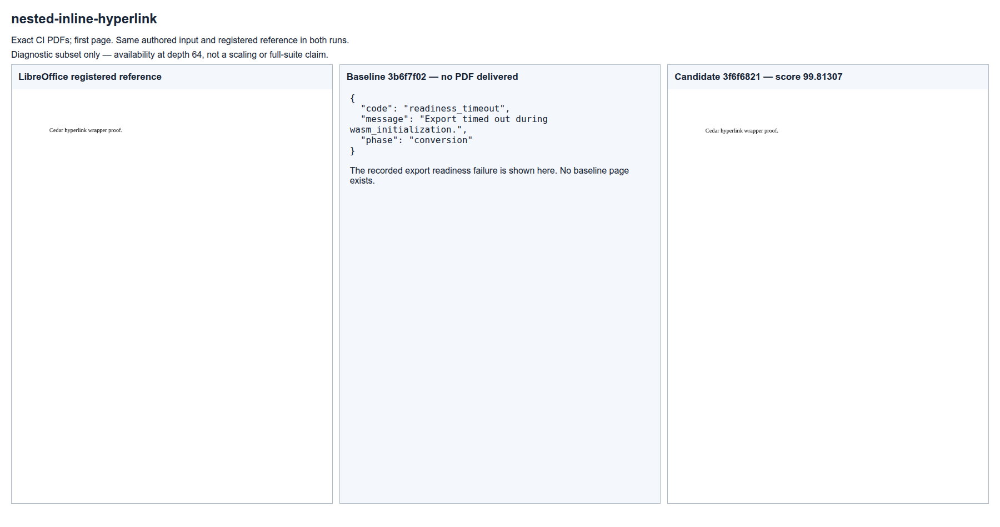
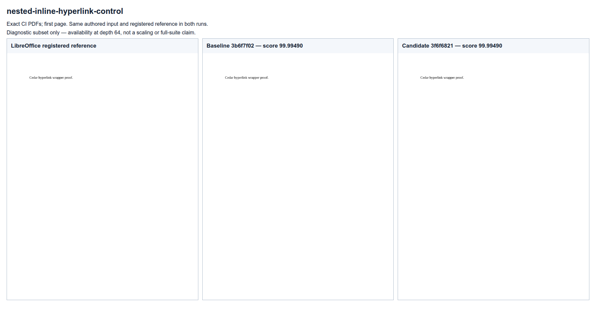
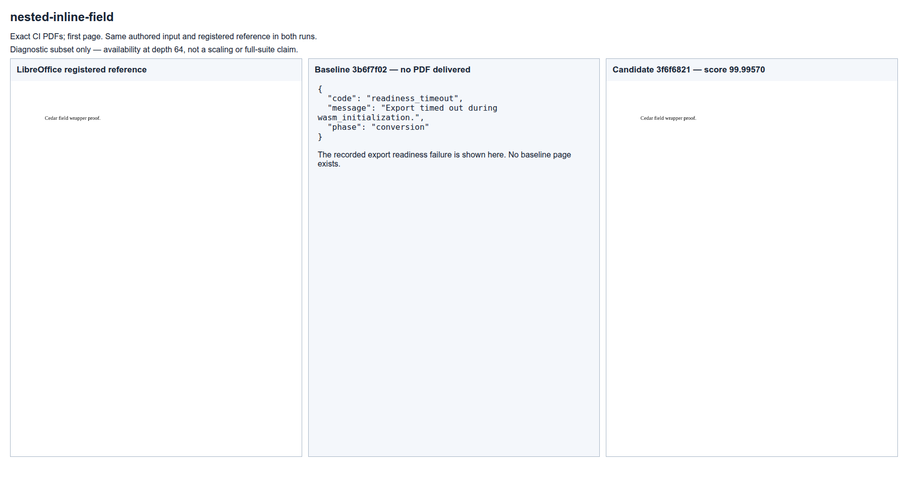
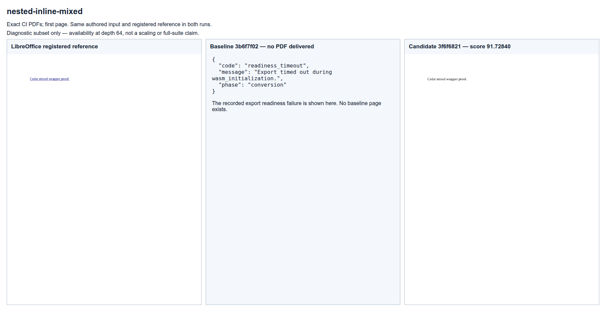
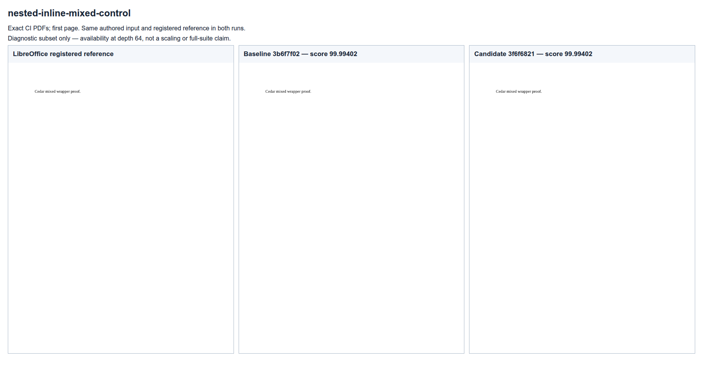

# Nested inline conversion availability

Six independently authored inputs pair 64 nested hyperlinks, simple fields, or mixed
hyperlink/custom-XML/content-control wrappers with flat text. All six packages have zero
Open XML SDK findings. The same LibreOffice 25.8.7.3 reference and its 100-point calibration
are reused in both runs under the unchanged 120-second export deadline.

[Baseline CI](https://github.com/JSv4/docx-fidelity-bench/actions/runs/40925979882)
(`3b6f7f02`) measures all six cases: three nested inputs fail export readiness, while three
flat controls pass mandatory checks. The error's reported `wasm_initialization` phase does
not independently locate the timeout inside initialization.
[Candidate CI](https://github.com/JSv4/docx-fidelity-bench/actions/runs/40928532433)
(`3f6f6821`) delivers all six PDFs and passes every mandatory check. Flat-control scores
and first-page rasters are unchanged; PDF file hashes differ between the two CI runs. The focused mean rises from 49.99744 to 98.58696;
close-match rate rises from 3/6 to 5/6. The mixed case scores 91.72840, so this is not a
perfect-fidelity result. These fixed-depth cases demonstrate conversion availability, not
linear scaling, Word parity, or a full `core-v73` score.

`outcomes.json` retains individual checks and exact source/run identities. `capture.json`
binds inputs, reports, delivered PDFs, original page rasters, capture scripts and labeled PNGs.
`Capture.py` and `Capture.mjs` produce the offline sheets from actual CI rasters. Each sheet
shows the registered reference, baseline and candidate. When no baseline PDF was delivered,
it displays the recorded error instead of a page. No document or asset came from the renderer.

| Case | Baseline | Candidate |
|---|---:|---:|
| nested-inline-hyperlink | 0.00000 | 99.81307 |
| nested-inline-hyperlink-control | 99.99490 | 99.99490 |
| nested-inline-field | 0.00000 | 99.99570 |
| nested-inline-field-control | 99.99570 | 99.99570 |
| nested-inline-mixed | 0.00000 | 91.72840 |
| nested-inline-mixed-control | 99.99402 | 99.99402 |

### nested-inline-hyperlink

### nested-inline-hyperlink-control

### nested-inline-field

### nested-inline-field-control

### nested-inline-mixed

### nested-inline-mixed-control

