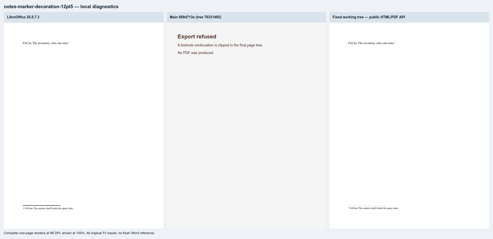
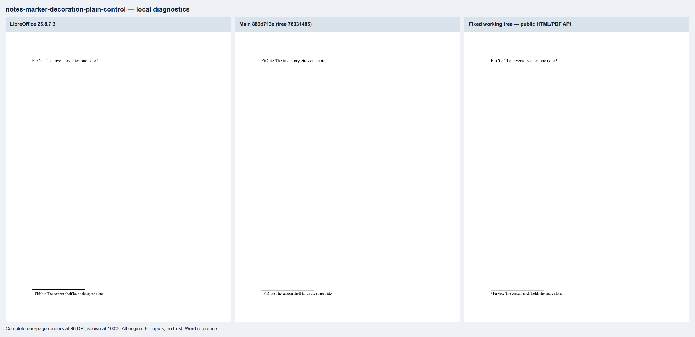
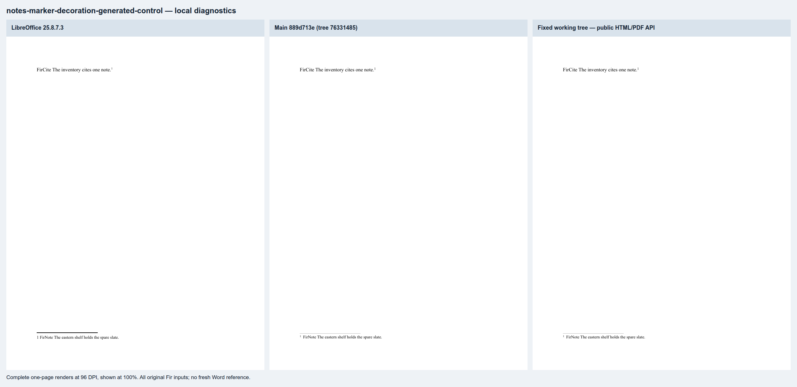

# Nested note-marker decoration (#1493)

Six original Fir documents cover inherited font revisions on a superscript source note marker.
The note uses 10 pt Times New Roman. Arial separator sizes of 11, 11.5, 12 and 12.5 pt expose
rounding at the note-band boundary; unrevised and generated-marker cases are controls.

These are **local public `renderDocxArtifacts` captures**, using pinned Chromium 143 and
LibreOffice 25.8.7.3. They are not production CI results or a fresh Word reference.
`capture.json` binds original inputs, both runtime asset graphs, changed candidate sources,
PDF/HTML hashes, full-page rasters, checks and sheet hashes. The candidate was captured before committing; all recorded source hashes match
`ac4e6a329a2204d40cb00d3b753f1e35b8ddb528`, based on `76331485`. Main `889d713e` has
exactly the same tree as that baseline.

| Case | Main | Fixed candidate | LibreOffice |
|---|---|---|---|
| 11 pt separator | Refuses clipped continuation | All declared checks pass | All declared checks pass |
| 11.5 pt separator | Refuses clipped continuation | All declared checks pass | All declared checks pass |
| 12 pt control | All checks pass | Identical full-page raster | All declared checks pass |
| 12.5 pt separator | Refuses clipped continuation | All declared checks pass | All declared checks pass |
| Unrevised control | All checks pass | Identical full-page raster | All declared checks pass |
| Generated-marker control | All checks pass | Identical full-page raster | All declared checks pass |

The checks retain complete tokens (including both note numbers), one-page ownership, fonts,
physical PDF geometry and a note-region bound. They establish successful complete export;
they do not claim exact LibreOffice visual equivalence. Separator paint and superscript
placement differ visibly between renderers. The dotted revision decoration may still be cut
at the note band's edge when every glyph fits.

Each sheet shows every page at 96 DPI and 100% scale; failure panels are labeled explicitly.

