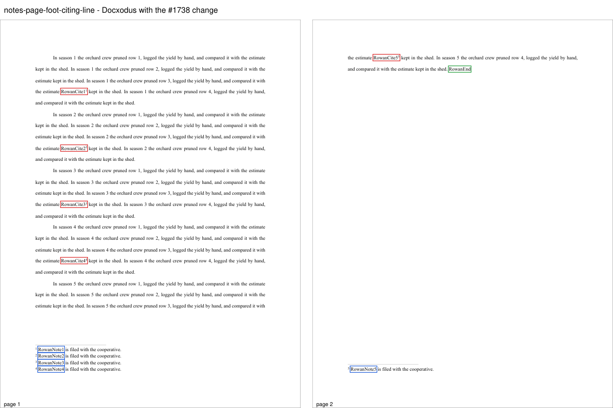
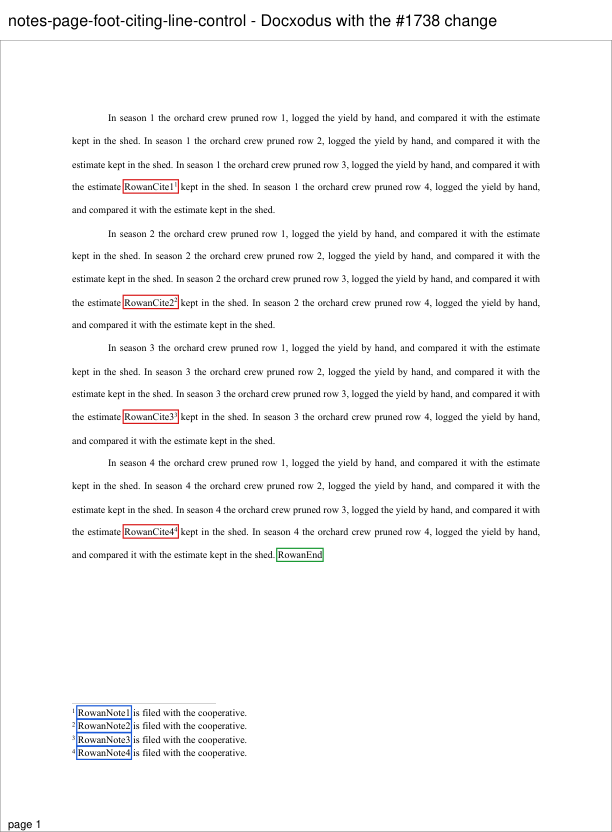
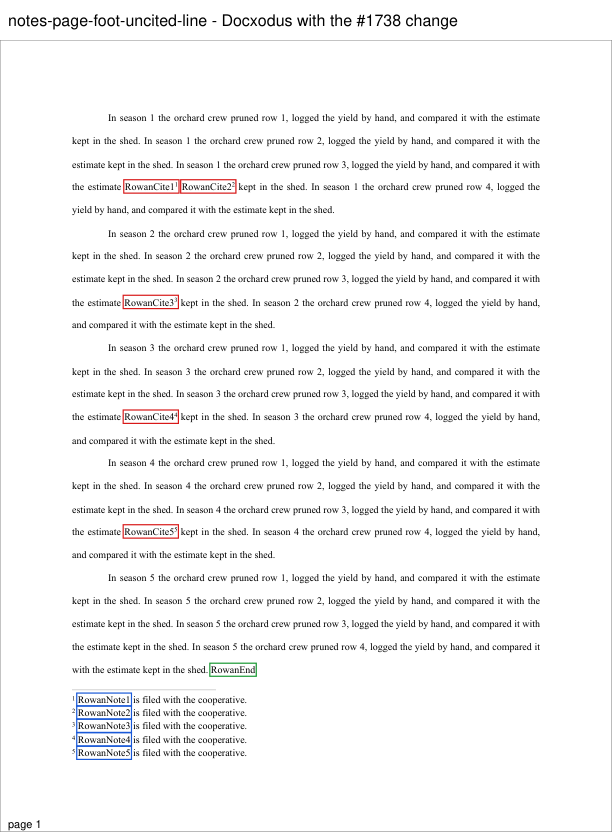
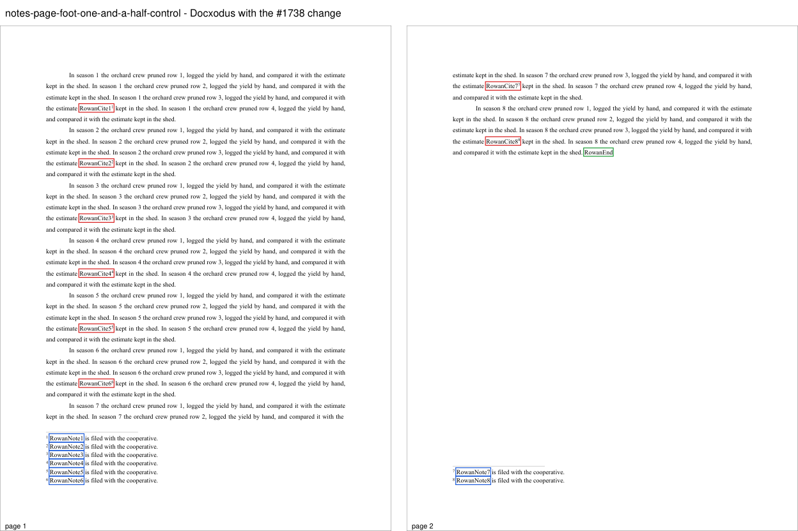
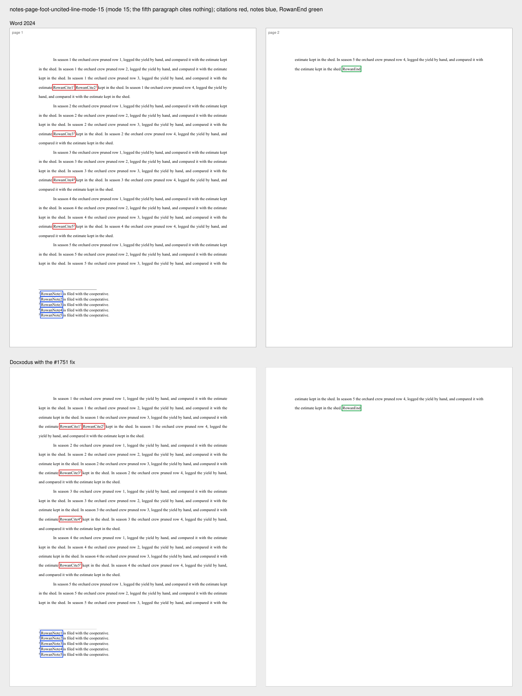
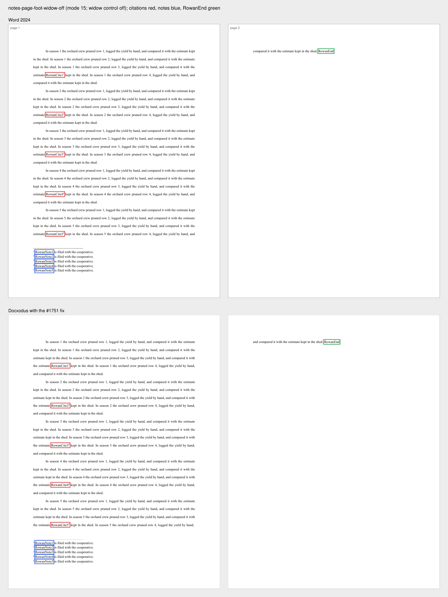
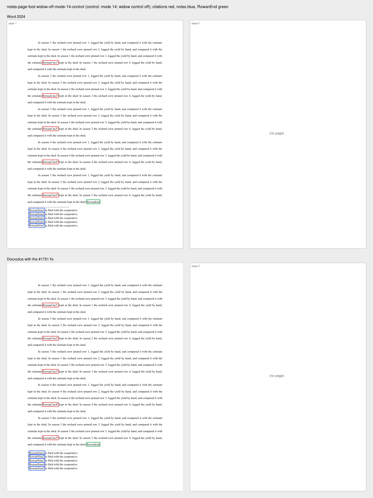

# Notes at a page foot

Four original Rowan cases accompany [Docxodus #1738](https://github.com/JSv4/Docxodus/issues/1738).
Each paragraph is 10pt Liberation Serif, justified and double-spaced (`w:line="480"`), and cites a
one-line footnote about 70% of the way through, after a `RowanCite` label. Each note opens with its
`RowanNote` label. The document defaults state `w:line="278"`, so a note line is 1.158 lines.
`RowanEnd` closes the last paragraph.

| Case | Input | Word 2024 | Docxodus `main` at `a8b1d6ce` |
|---|---|---|---|
| `notes-page-foot-citing-line` | five paragraphs; the fifth would end page 1 | page 1: 23 lines, notes 1–4; page 2: the fifth paragraph's citing line and last line, note 5 | export fails: "A footnote continuation is clipped in the final page tree" |
| `notes-page-foot-citing-line-control` | the first four paragraphs alone | one page, notes 1–4 | as Word |
| `notes-page-foot-uncited-line` | the first paragraph cites two notes, the fifth none; compatibility mode 14 | one page: 25 lines, notes 1–5 | export fails, as above |
| `notes-page-foot-one-and-a-half-control` | eight paragraphs at `w:line="360"` | page 1: notes 1–6; page 2: notes 7–8 | as Word |

`marker-region` assertions put each `RowanNote` label and `RowanEnd` on the page Word prints them
on; `same-page` assertions keep each `RowanCite` label with its note.

Word 2024 (build 16.0.20326) printed these exact inputs with the font renamed to Times New Roman
(`SaveAs2` to PDF), and every marker landed on the page its region names. Under widow control Word
keeps a paragraph's leading beside the notes it brings, so the fifth paragraph breaks before its
citing line and that line moves to page 2 with its note. Before compatibility mode 15, a paragraph
that brings no note may end the page with its leading under the note band. In mode 15, which the
other three inputs use, Word keeps that leading above the band: the same uncited input in mode 15
prints 23 lines and moves the last two to page 2. The `core-v172` cases below pin that mode 15
behaviour. The `main` column is from these inputs printed through its PDF
export. A build of the Docxodus change for #1738 puts every marker on its page, by the word boxes
read with PyMuPDF; the bench's own inspection was not run here.

| Case | Docxodus with the #1738 change |
|---|---|
| `notes-page-foot-citing-line` |  |
| `notes-page-foot-citing-line-control` |  |
| `notes-page-foot-uncited-line` |  |
| `notes-page-foot-one-and-a-half-control` |  |

## Compatibility mode 15 (Docxodus #1751)

Three more cases use the same paragraphs. In compatibility mode 15 Word keeps the full line box of a
page's last body line above a note band that holds notes; only at the foot of a page without notes
may the leading run past. Before mode 15 the leading may also run under the band.

| Case | Input | Word 2024 | Docxodus `main` at `0af51ef5` |
|---|---|---|---|
| `notes-page-foot-uncited-line-mode-15` | `notes-page-foot-uncited-line` in mode 15 | page 1: 23 lines, notes 1–5; page 2: 2 lines with `RowanEnd` | one page, as mode 14 |
| `notes-page-foot-widow-off` | five paragraphs citing one note each, widow control off, mode 15 | page 1: 24 lines, notes 1–5; page 2: 1 line with `RowanEnd` | one page, as mode 14 |
| `notes-page-foot-widow-off-mode-14-control` | the same in mode 14 | one page: 25 lines, notes 1–5 | as Word |

Word 2024 (16.0.20326) laid these exact inputs out with the font renamed to Times New Roman; the
line counts are the distinct vertical positions of the words on each page (`Range.Information`),
and every marker landed on the page its region names. The mode 14 counterpart of the first case is
`notes-page-foot-uncited-line` above. The `main` column comes from Docxodus's own test of the same
paragraphs in mode 15 (the first CI run of Docxodus #1754, before its fix), which lays out one page.
A build of that change exports these exact inputs, with the same font renaming, to Word's pages:
every marker lands on the page its region names, by the word boxes read with PyMuPDF. Each image
shows Word's pages above Docxodus's.

| Case | Word 2024 and Docxodus with the #1751 change |
|---|---|
| `notes-page-foot-uncited-line-mode-15` |  |
| `notes-page-foot-widow-off` |  |
| `notes-page-foot-widow-off-mode-14-control` |  |

LibreOffice reference captures and candidate scoring are pending. This machine has no pinned
LibreOffice, so no reference bundle is included and no eligibility or fidelity score is claimed.
All prior input hashes are unchanged.
