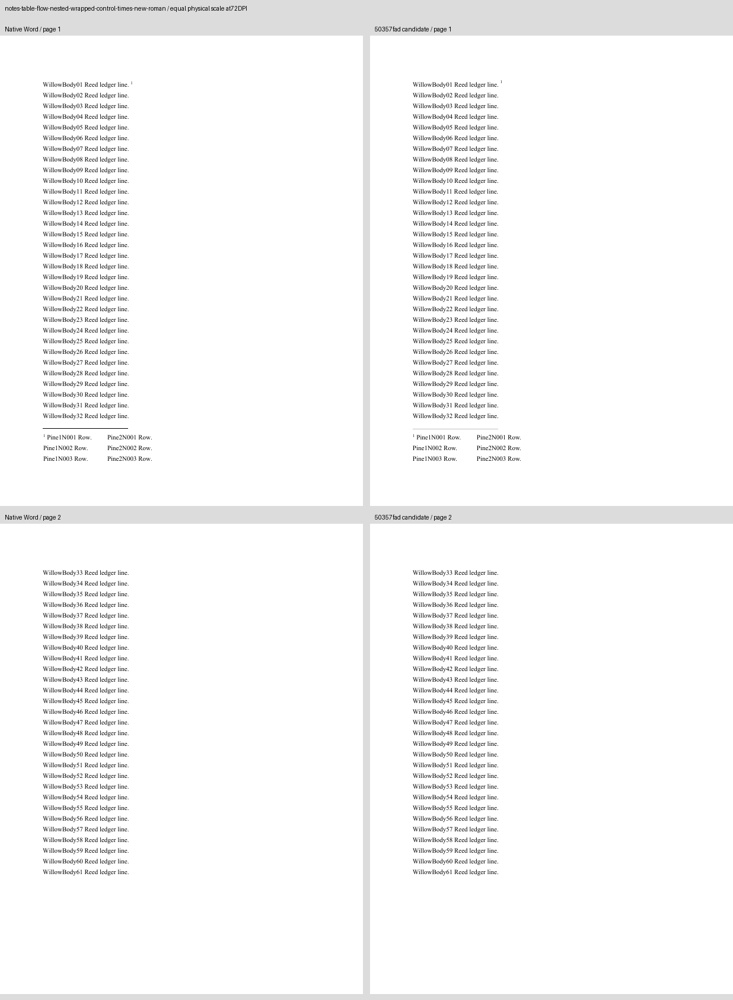
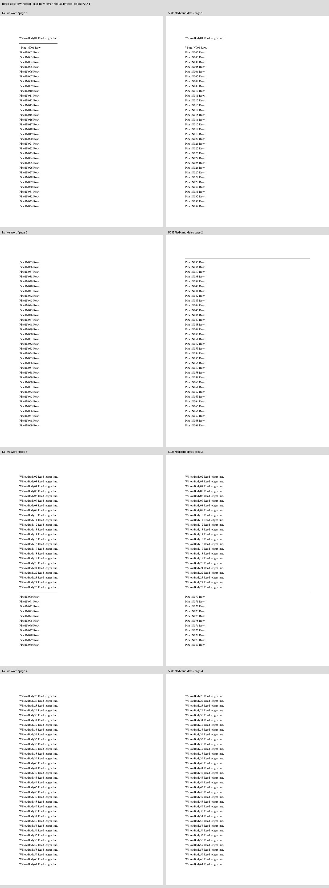
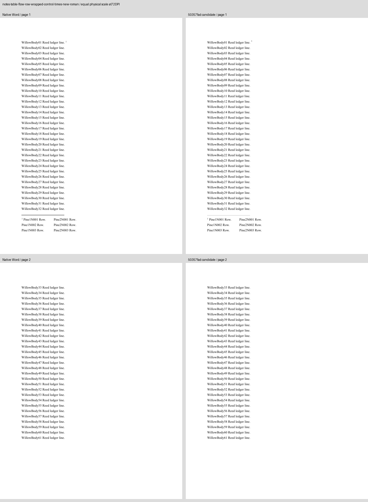
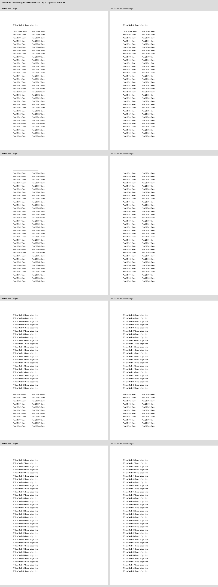
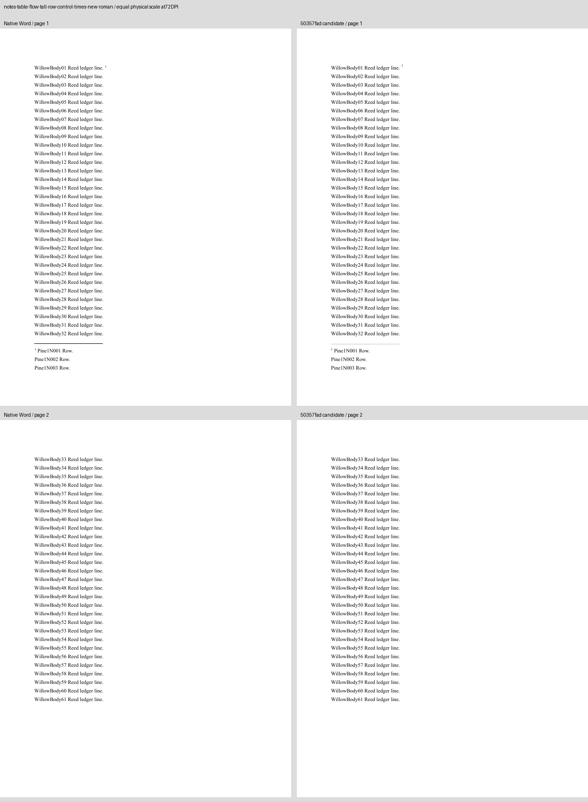

# Note tables across pages in Word

Eight original Times New Roman cases cover Docxodus #1217's nested and oversized note-table rows.
They reuse the author's `80ac8d7` fixture construction, changing only the declared font family so
native Word exports the requested family. Every generated input exactly reproduces its preserved
Word input hash; all 1,024 earlier DOCX files remain byte-identical. The corpus is `core-v67` /
346 PDF cases; `redline-v17` and the original 12-case `core-ci-v2` selection are unchanged.

Four long-row/nested cases fail strict public PDF export on main `eab28ea9` with a clipped
footnote-continuation error. Candidate `50357fad` exports all eight, preserving all body/note text,
with the same page count and every marker on Word's page. The four fitting/whole-row controls
retain identical extracted geometry, words and fonts. Reviewed candidate `d32da555`, including
merged source-space handling, the editor-only deferral fix and direct-HTML text preservation, has
identical PDF measurements and all 26 page PNGs are byte-identical at 72 DPI. The comparison sheets below show `50357fad` and
native Word at the same physical scale; every page was inspected.

## Native evidence and checks

The exact inputs were opened in an authenticated Word for the web session and exported with
**File > Export > Download as PDF**, without content edits. Original PDFs and returned DOCX files
remain in the archived issue-1217 fixture evidence. [Capture hashes and complete PDF inspections](native-word.json)
retain the provider's words, fonts and physical page boxes. Word did not report its server build.
The family is Times New Roman; cloud/local font binaries and rasterization are not asserted to be
identical. The plain Liberation Serif author inputs remain in the prior prototype/evidence pack;
they are not substituted for the registered font-aligned inputs.

Every native capture passes its own complete token/font/geometry and declared-layout checks.
The long cases place note lines 1–34 on page 1, 35–69 on page 2 and 70–80 on page 3, with the
body returning on page 3 and ending on page 4. The short controls keep all three note lines on
page 1 and end the body on page 2. All 61 body markers and every note marker have explicit
Word-adjudicated page-region assertions. The established adjudication policy keeps LibreOffice's
reference eligibility/calibration separate; the assertions bind every candidate and Word reference.
No scorer, tolerance or historical input is changed. Contract tests reject a lost final row and a
wrong continuation page even when the first citation/row and overall page count survive.

[Candidate measurements](candidate-proof.json) retain the exact source revisions, PDF hashes,
pre-change failures and output-equivalence checks. These public-export diagnostics are **unscored**:
the host still fails the strict benchmark's unprivileged-user-namespace preflight. They use a
caller-provided pinned Chromium with its process sandbox enabled and the installed root-owned
helper. No preflight or export clipping verification was weakened.

Page placement and completeness are the claims here. The existing continuation-separator length/
colour and small glyph/baseline differences remain visible in the raw sheets; no close raster
score is claimed. The missing original carried-note reproducer, keep-chain cases and oversized
kept-note PDF behavior remain separate outstanding parts of Docxodus #1217. The editor-specific
kept-note deferral is covered by separate DOM and actual-DOCX regressions in the core PR.

## Every new case

| Case | Native/candidate pages | Native Word (left), candidate (right) |
| --- | ---: | --- |
| `notes-table-flow-nested-wrapped-control-times-new-roman` | 2 |  |
| `notes-table-flow-nested-wrapped-times-new-roman` | 4 |  |
| `notes-table-flow-nested-times-new-roman` | 4 |  |
| `notes-table-flow-row-wrapped-control-times-new-roman` | 2 |  |
| `notes-table-flow-row-wrapped-times-new-roman` | 4 |  |
| `notes-table-flow-rows-control-times-new-roman` | 4 |  |
| `notes-table-flow-tall-row-control-times-new-roman` | 2 |  |
| `notes-table-flow-tall-row-times-new-roman` | 4 |  |
