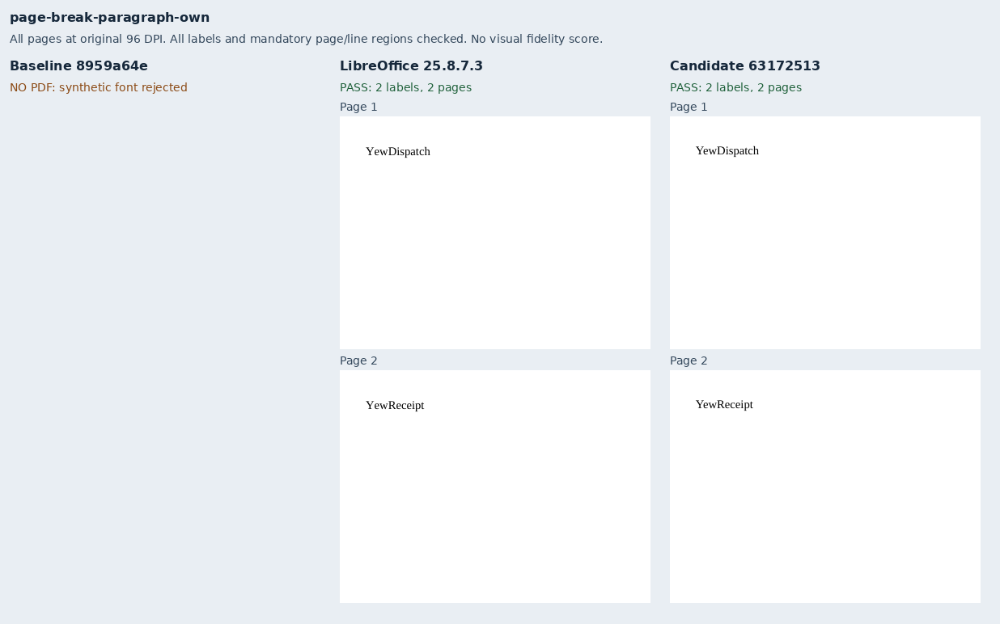
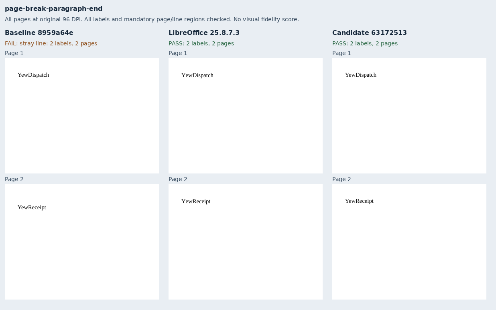
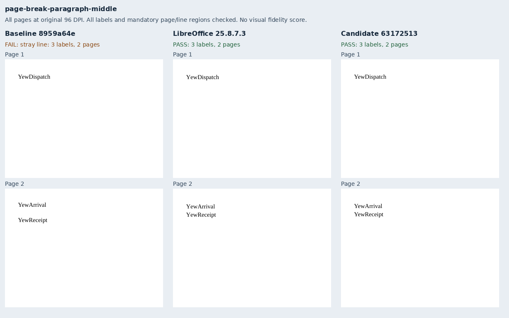
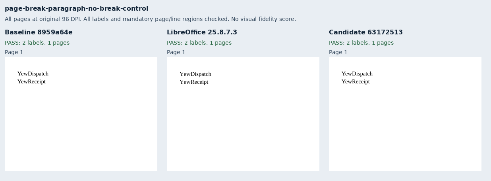
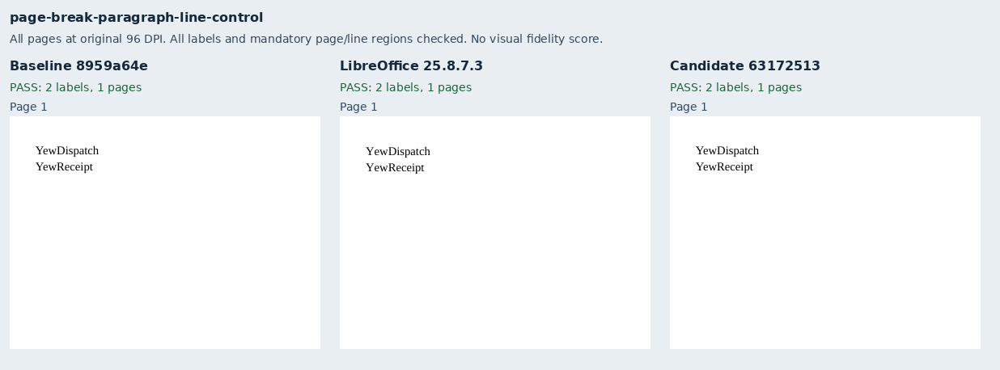
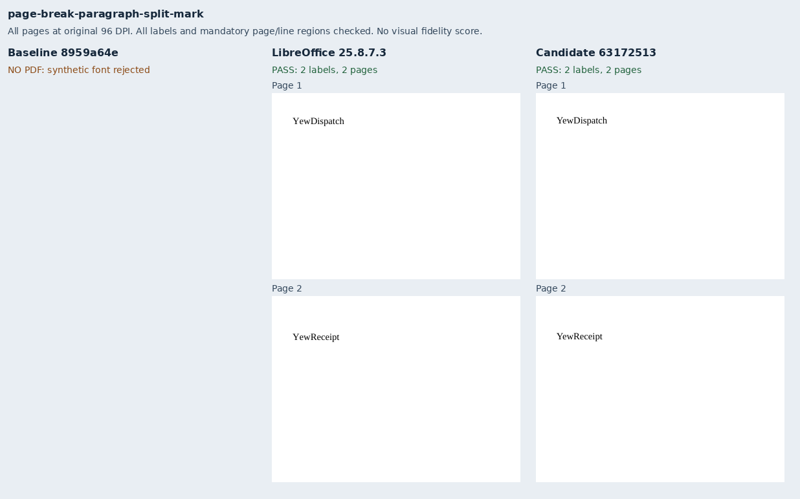
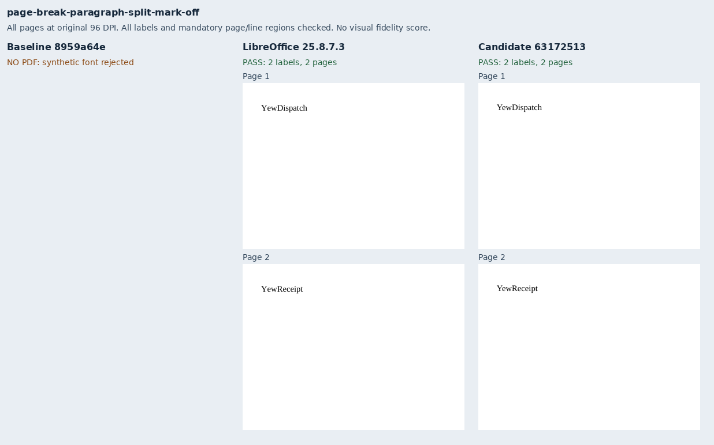

# Page breaks and paragraph lines

Eight original Yew dispatch notes exercise a page break in its own paragraph, at the end of text,
and in the middle of a paragraph. No-break, authored blank-paragraph and ordinary line-break
controls preserve their intended lines. Two additional cases explicitly enable or disable
`splitPgBreakAndParaMark`. The packages use 11pt Liberation Serif, an exact 15pt pitch, zero
paragraph spacing and a 288×216pt sheet with 24pt margins. No renderer fixture or helper is imported.

The production baseline `8959a64eab3ac15f69eef806fd394b8fbf06ca43` passes the three controls.
The own-paragraph and explicit-flag cases fail strict font policy because a synthetic placeholder
requests a fallback face. End/middle breaks deliver PDFs but fail the declared line regions.
Candidate `631725137ec24c88a3ca95a900669c3d400a70a3` passes all eight with strict fonts and no warnings. The retained evidence checks 45 labels across
21 delivered PDFs and 33 pages.
LibreOffice 25.8.7.3 supplies eight eligible native references, including the explicit flag's
intentional extra line. Every package validates with Open XML SDK 3.5.1 against Microsoft 365.

The issue author's [mode-15 Word results](https://github.com/JSv4/Docxodus/issues/1570#issuecomment-6701330047)
confirm the default zero-gap rule. These authored benchmark packages have no Word references.
The explicit-flag case is checked against LibreOffice and the documented OOXML semantics; its
Word print remains pending. No pinned-browser or full-suite fidelity claim is made. Captures use
separately provisioned Chromium with its sandbox enabled and strict font verification.

Full-page sheets retain every delivered page at original 96 DPI. Complete reports, PDF inspections
and the native reference bundle are retained as deterministic gzip files. `evidence.json` binds
both compressed and uncompressed hashes, input packages, exact source/build identities, runtime
asset manifests, PDF hashes and page rasters. Mandatory checks cover complete token inventories,
page membership and absolute line regions. No metric or tolerance changes are made.

The suite advances to `core-v110` (784 inputs); the preceding 776 declarations and packages retain
their bytes apart from the generator provenance hash.

```sh
python3 -m bench reference libreoffice --manifest MANIFEST --out REFERENCE
node docs/results/export-reliability/Capture.mjs SOURCE MANIFEST OUTPUT ENVIRONMENT
python3 docs/results/page-break-paragraphs/Compose.py runs/page-breaks
```

The composer verifies all source/build bindings and label assertions before producing evidence.
Pillow is used only to arrange unchanged page rasters with renderer and case labels.









