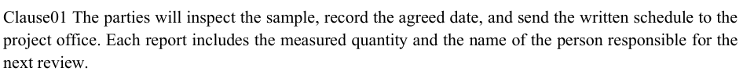
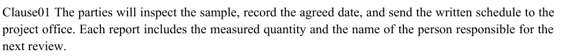
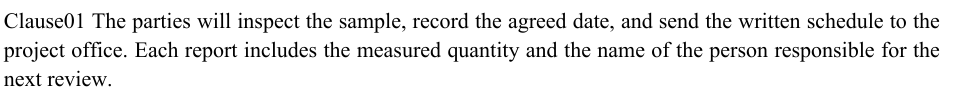

# Agreement justification against Word

Bench [#33](https://github.com/JSv4/docx-fidelity-bench/issues/33) now has an independently captured Word reference and measured Docxodus comparison for `paragraph-contract-times-new-roman`. The `core-v34` case changes only the font requested by the original agreement. All 149 earlier DOCX inputs remain byte-identical. On this case, Docxodus's horizontal word positions are closer to Word on average than LibreOffice's are. This supplies the missing adjudication evidence for [Docxodus #1124](https://github.com/JSv4/Docxodus/issues/1124); it does not claim that the renderer's remaining placement differences are fixed.

## Capture and eligibility

On October 18, 2026, the exact registered inputs were uploaded to an authenticated Word Online session and exported through **File > Export > Download as PDF**, without comments. Playwright was used only for this one-time capture. No automation, sign-in, or Office service is required by the harness or tests. No content edits or repair prompts occurred. The browser was Google Chrome 155.0.8059.84 on Linux; Word did not report a build number.

| Input | Input SHA-256 | Word PDF SHA-256 | Reference eligibility |
| --- | --- | --- | --- |
| `paragraph-contract` | `6b2926adc3bec2bb319d74097a834bace936d207f833791710ab3ce55b955c6b` | `ea6de4ca614688a3c004eca23d37b254593b6d725e9e0997cfd7878c4f066f01` | Ineligible: Word substitutes Times New Roman for Liberation Serif |
| `paragraph-contract-times-new-roman` | `21678437bf10ef33ab88307952f6f2ed9df0f5f91aab372403bf443abf92541d` | `4182c852bd66169443b90e31eb73bed6ca87c81e186feec35cf3a0f576f0f03e` | Eligible: declared fonts, full 891-token inventory, and physical geometry pass |

Both Word PDFs have two 612 by 792pt pages. The new capture embeds `TimesNewRomanPSMT` and `TimesNewRomanPS-BoldMT`. The editor's font-name control was not accepted as evidence of the exported font: it also displayed Liberation Serif for the original, substituted capture.

Word embeds Times New Roman 7.11. The local Core Fonts files are 2.82, with their four style hashes recorded alongside the four Liberation Serif hashes in the capture metadata. The embedded subsets' 24 bold and 49 regular character advance widths agree with the corresponding local font values. This does not prove identical outlines, kerning, shaping, or rasterization. Family eligibility under the existing contract is not an assertion that the cloud and local font binaries are identical.

## What the coordinates establish

`pdftotext -bbox-layout` preserves all 73 line breaks and page assignments across Word, LibreOffice and Docxodus. The first clause's justified lines contain 18 and 17 words, respectively. Their final word is `the`, and the page's right body margin is 540pt.

| Provider and font | Line 1 final word X | Line 1 word end | Line 2 final word X | Line 2 word end |
| --- | ---: | ---: | ---: | ---: |
| Word Online, Times New Roman 7.11 | 526.215 | 539.602 | 526.358 | 539.745 |
| LibreOffice 25.8.7.3 `580(Build:3)`, Times New Roman 2.82 | 525.938 | 539.358 | 525.289 | 538.709 |
| Docxodus `3850e0f`, Times New Roman 2.82 | 526.558576 | 539.988755 | 526.558576 | 539.988755 |

These are extracted word advance bounds, not measurements of the rightmost painted pixel. Word's line ends also fall short of 540pt: by 0.398pt and 0.255pt. Thus reaching exactly 540pt does not by itself establish Word-faithful placement, and LibreOffice's end positions are not automatically Word targets.

Across all 48 justified lines (840 words), the mean absolute differences in extracted word starts from Word are:

| Candidate | Horizontal difference | Vertical difference |
| --- | ---: | ---: |
| Docxodus `3850e0f` | 0.117pt | 0.896pt |
| LibreOffice 25.8.7.3 | 0.438pt | 0.914pt |

These diagnostics match words by their unchanged line text and page; they do not align or adjust coordinates. LibreOffice is closer for the first line's final word, but Docxodus is closer on average across the justified lines. Copying LibreOffice's positions is therefore not supported by this Word capture. Neither renderer exactly matches Word, and whole-page raster loss cannot be attributed solely to horizontal justification: vertical placement and font-version differences also remain potential contributors.

Two claims in the earlier issue discussion need qualification. The first line contains **17 inter-word gaps**, not 15. The fixture declares **no marker-region or marker-position assertions**. Its mandatory checks cover inventory, fonts, page count and physical geometry; the raster score measures the word-position differences. The new variant preserves that policy rather than adding a provider-specific tolerance.

## Measurements and evidence

| Candidate | Reference | Agreement font | Case score | Mandatory checks |
| --- | --- | --- | ---: | --- |
| Docxodus `3850e0f` | Word Online | Times New Roman | **83.9328** | All five pass |
| LibreOffice 25.8.7.3 | Word Online | Times New Roman | **80.2149** | All five pass |
| Docxodus `3850e0f` | LibreOffice 25.8.7.3 | Times New Roman | **92.0286** | All five pass |
| Docxodus `3850e0f` | LibreOffice 25.8.7.3 | Liberation Serif (original) | **92.0731** | All five pass |
| LibreOffice 25.8.7.3 | Repeated LibreOffice export | Both cases, separately | **100** each | All five pass |

These are focused case measurements; missing captures for the other suite members leave the suite incomplete, with no headline score. None of the Docxodus comparisons meets the existing close-match threshold. The Times New Roman candidate rasters are identical across its two independently rendered reference-track runs.

Docxodus `3850e0fcc12da58b63f844c61848d40a7e3d6aa6` was built with `bench build-docxodus`, producing a source-bound build record, and measured through the unchanged adapter. Its verified production runtime is Playwright 1.57.0 / Chromium 143.0.7499.4, with Node v24.13.1. The production report confirms the exact registered regular and bold Times New Roman 2.82 file hashes, complete glyph coverage and no warnings. The Word-track candidate PDF SHA-256 is `9ced5ac4084e25971d23c24d773a26064472a3e820bdbb8cf4363fd125890450`.

The host initially denied the namespace probe. Rendering succeeded with a temporary AppArmor allowance attached to a dedicated, byte-identical Node executable; both global AppArmor restrictions stayed enabled. Chromium's own status page confirmed namespace and Seccomp-BPF sandboxes. A short temporary-directory path resolved a separate browser-launch failure. Local font staging copied the eight declared font files into a directory without the installer's symlink aliases; the complete measurement environment contract, including every font hash, remained identical. CI removes only those aliases after installing Core Fonts. None of this setup changes the renderer source, adapter checks or reference eligibility.

The fresh original `paragraph-contract` result reproduces its historical **92.0731** against LibreOffice. The archived core-v31 Docxodus `31655e6` PDF was also re-inspected: its hash matches its adapter record, all five mandatory checks pass, and its first justified line ends at 539.988755pt. This historical comparison is distinct from the newly captured Times New Roman case.

The same physical first-clause crop at 144 DPI, with no alignment or resizing:

| Word Online, Times New Roman 7.11 | LibreOffice 25.8.7.3, Times New Roman 2.82 | Docxodus `3850e0f`, Times New Roman 2.82 |
| --- | --- | --- |
|  |  |  |

The scores above belong to the archived 144-case development registry with digest `901eb06ed4976f945a40b9aef27ed4f236f1b01ff470e33600c189da1effc35b`. Its run files say `core-v32`; this is distinct from the subsequently published 145-case builder suite. The integrated `core-v34` has 150 cases. Both agreement case declarations, apart from their generator hash, and both DOCX inputs are unchanged. The original run files retain their original suite identity; these are not full core-v34 runs.

The same Word PDFs have also been imported against the current suite in the ignored `references/issue33-word-core-v34/` bundle, preserving the original capture metadata and eligibility decisions. The earlier `references/issue33-word-core-v32/` bundle and completed candidate reports in `runs/issue33-review/docxodus-vs-word-final/` and `docxodus-vs-lo-final/` are retained unchanged. The evidence bundle also contains coordinate diagnostics, the source-bound build record, the measured manifest and sandbox verification. Import uses the existing offline command:

```sh
python3 -m bench reference import \
  --metadata runs/issue33-review/capture-core-v32.json \
  --pdf-dir runs/issue33-review \
  --out references/another-new-word-bundle
```

The original substituted capture is retained as ineligible. No reference replacement, scoring relaxation, or change to the original fixture is made. Full core-v34 reference registration and scoring remain pending.

Validation after integration: 216 Python tests, four Node adapter tests, the installed browser-runtime contract, both manifests, actionlint for the rendering workflow, and deterministic regeneration/provenance audit. The new isolation test checks every OOXML part, the unchanged original input hash, both token inventories, and acceptance/rejection of the correct and substituted font families.
