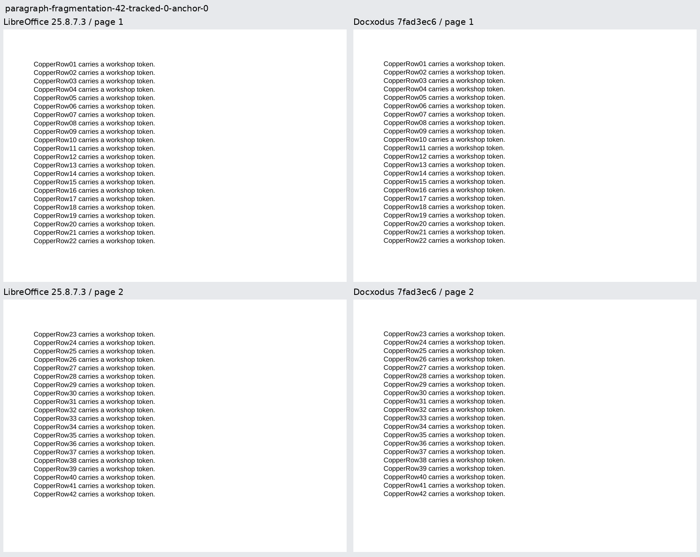
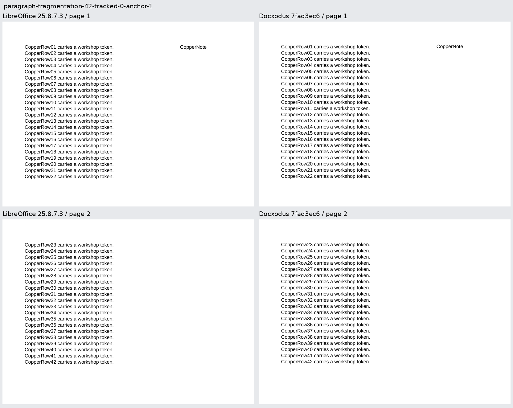
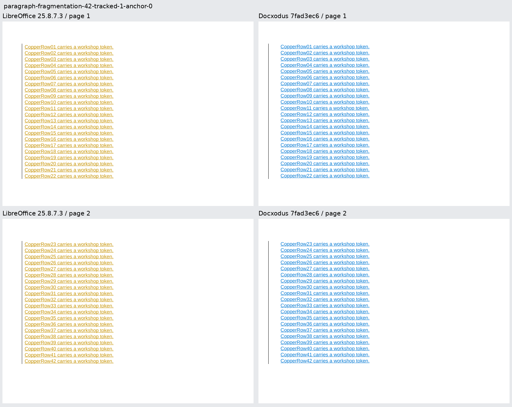
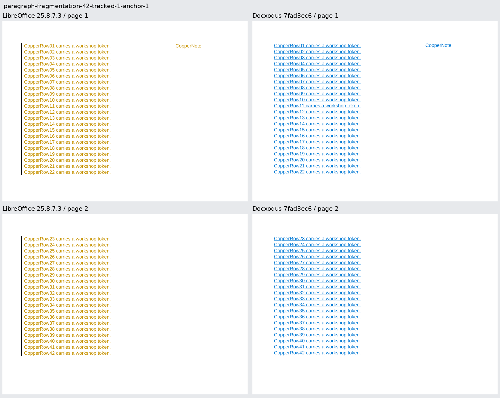
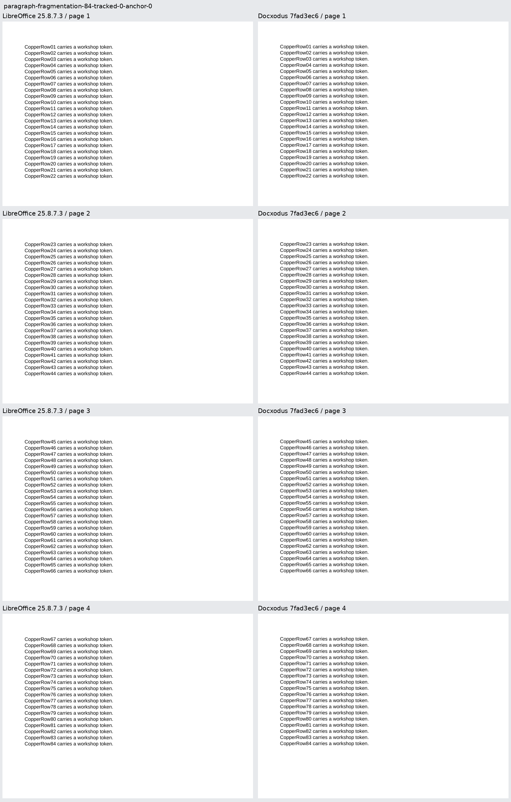
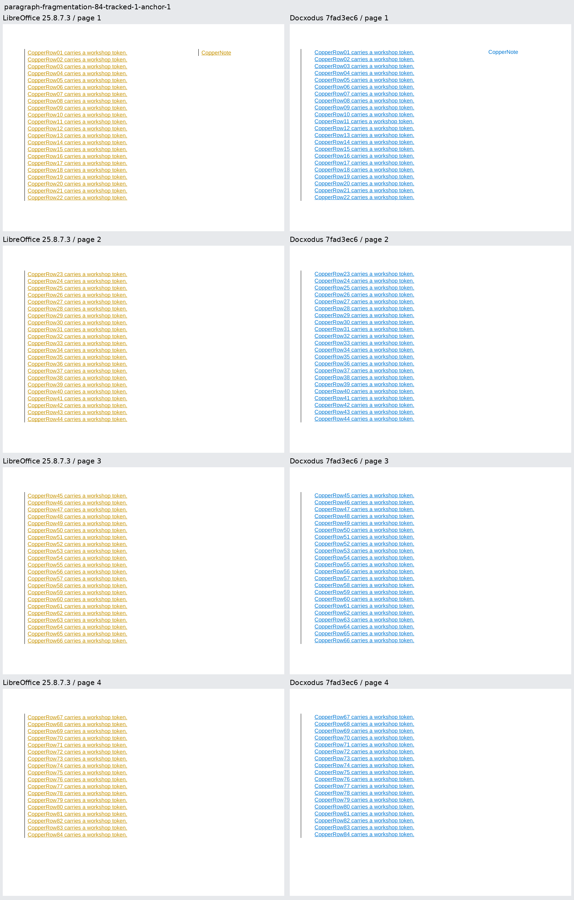

Six original Copper documents reproduce [Docxodus #1521](https://github.com/JSv4/Docxodus/issues/1521): a 42-line paragraph with independently selected insertion tracking and a leading non-wrapping textbox, plus an 84-line ordinary/combined pair. Literal OOXML, exact 15pt lines and 342pt body bands make the page inventory independently checkable. Every numbered line has a declared page and line region; the textbox must occur once at its first-page position. All six inputs pass Open XML SDK 3.5.1 validation.

Current main `10531183` exports both ordinary controls but rejects all four triggered cases as clipped body content. Candidate `7fad3ec6` exports all six and passes all 373 mandatory token, font, page-geometry and marker-region checks. The six LibreOffice 25.8.7.3 references are eligible and their repeat calibration scores 100. The [retained evidence](evidence.json) records input/output hashes, source commits, baseline failures and each candidate check. These are focused diagnostics, not a complete suite score.

The candidate used the unmodified source-bound build recipe and sandboxed Chrome. This host fails the strict user-namespace environment preflight, so local exports remain unscored. Main's WASM build exceeded its 5888 KB wire-size budget by 2 KB; its completed WASM output and separately completed JavaScript/export builds were used only for the labeled baseline diagnostic. No size gate, scorer, inventory, clipping check or tolerance was changed. The candidate's build passed that budget. `core-v102` contains 744 cases; all 738 previous inputs and their declarations except generator hashes remain unchanged.

All 32 rendered provider pages were visually inspected. LibreOffice and Docxodus preserve the same body lines and textbox position. Their author colors, change-bar offsets and textbox revision decoration differ; these previews do not claim native Word raster parity. The core regressions separately verify revision metadata, change bars on every continuation, drawing and paragraph PageMap identities, and rejection of unsupported drawing placements. Adversarial review also pinned preceding images, textless aligned drawings and widow-controlled linked textboxes.

Every new case is shown below at equal physical scale, with LibreOffice on the left and Docxodus on the right.

| Case | Pages per renderer | Every page |
| --- | ---: | --- |
| Ordinary 42-line control | 2 |  |
| 42 lines with textbox | 2 |  |
| 42 tracked lines | 2 |  |
| 42 tracked lines with textbox | 2 |  |
| Ordinary 84-line control | 4 |  |
| 84 tracked lines with textbox | 4 |  |
