# Paragraph text independence

Sixteen original Hazel documents isolate an ordinary paragraph from unrelated bold text,
a table, a list or a link. Ten cases cover justified and unkerned left-aligned paragraphs
beside each content type, including plain controls. Six more resolve an 8 pt or 14 pt kerning
threshold from a run, document defaults or a paragraph style, beside unrelated bold text.
All text is 12 pt Liberation Serif with explicit single spacing and compatibility mode 15.

The widths were chosen from independent font measurements before candidate capture. The
justified prefix advances 502.107421875 pt in a 501 pt column; fitting its last word requires
only ordinary-space compression within the existing measured policy. The kerning prefix
advances 395.173828125 pt unkerned and 384.685546875 pt kerned in a 390 pt column. Its final
word belongs on line two when kerning is absent or its threshold exceeds the text size.
The source paragraphs, column widths and policies remain identical across neighbor variants.

All 330 target words have unique marker assertions binding them to a page and a 14 pt line
band. Horizontal assertion bounds cover the paper because exact glyph X positions are not
part of this contract; native glyph bounds can slightly exceed the declared column edge.
The existing unique-marker rule is unchanged. Exact inventories and companion paint/paper
checks include all 378 source tokens per renderer, including generated list numbers. Tests
move the boundary word up/down one line or remove the first word; all 48 mutations must fail.

Thirteen LibreOffice references meet the authored checks. It also kerns the three 14 pt
threshold cases at 12 pt; those references remain explicitly ineligible. The [issue author's
Word print](https://github.com/JSv4/Docxodus/issues/1562#issuecomment-6701328347) confirms the
absent-kerning behavior. The production change preserves the existing resolved threshold
and bounded-space policies; no new Word capture or broader shaping claim is made.

The scoped manifest was frozen before candidate capture. The exact baseline
`1d9f75c605dce3283caf843499fc126b1629af8d` passes 5/16 authored cases. The candidate is
`fdaf268d543cbf9de45467022c9f2a4d09790d60`, which passes all 16 cases. The 48 retained PDFs
preserve all 1,134 painted tokens. Production reports and build manifests
bind 19 build files and 45 runtime assets per renderer. The public API diagnostics use strict
verified fonts and sandboxed system Chromium; they are not pinned-runtime qualification or
a whole-suite score. All 885 previous fixture inputs and declarations remain unchanged
apart from generator provenance.

Mixed runs within the affected paragraph, implicit line spacing, table/list/note/comment
content, other rendering paths, ligature defaults and `wpJustification` limits remain outside
the production change. Graphics and wrapping content retain their existing flow protections.

## Reproduction

Generate `core-v123`, select `paragraph-text-*` into a scoped manifest, and build both exact
renderer commits with `python3 -m bench build-docxodus`. Capture native references with
`python3 -m bench reference libreoffice`, then both public renderers with
`docs/results/export-reliability/Capture.mjs --html`. Retain build/asset manifests and SDK
validation, then run:

```sh
python3 docs/results/paragraph-text-independence/Compose.py RUN BASELINE_SOURCE CANDIDATE_SOURCE
python3 -m unittest discover -s tests -v
node --test tests/test-adapter.mjs
python3 -m bench.audit
```


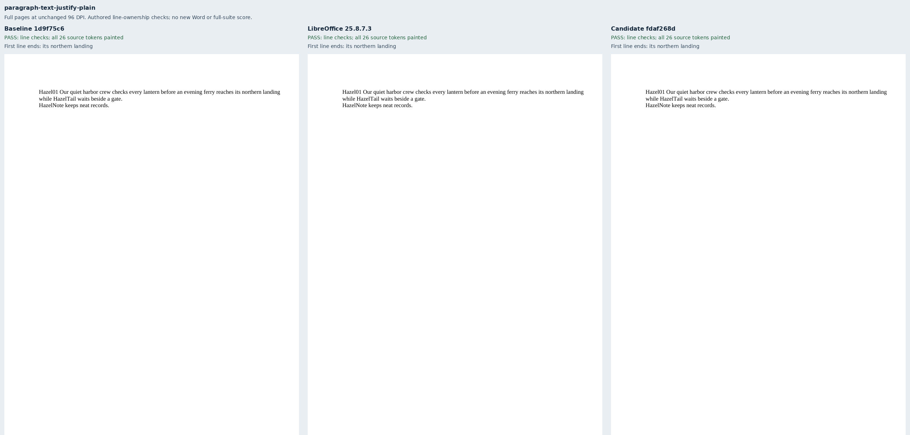


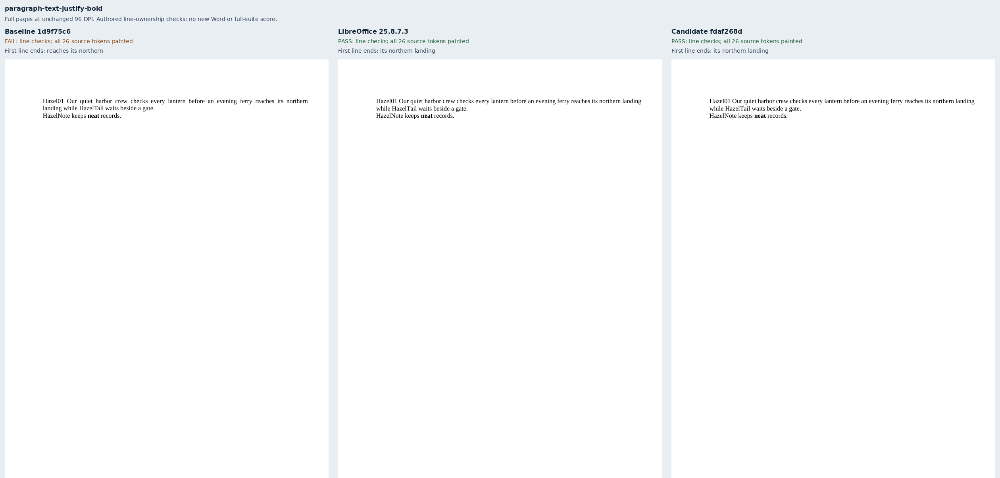


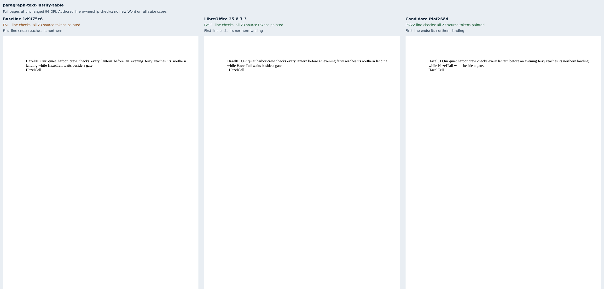


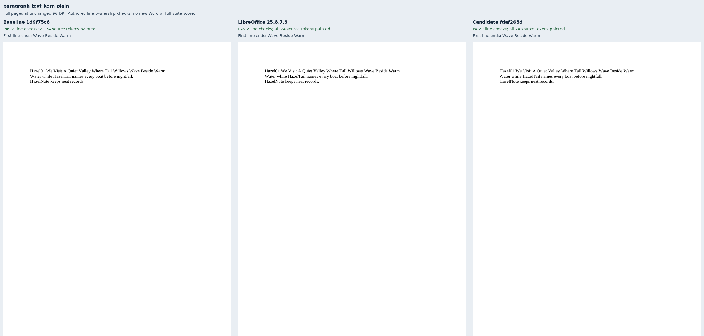


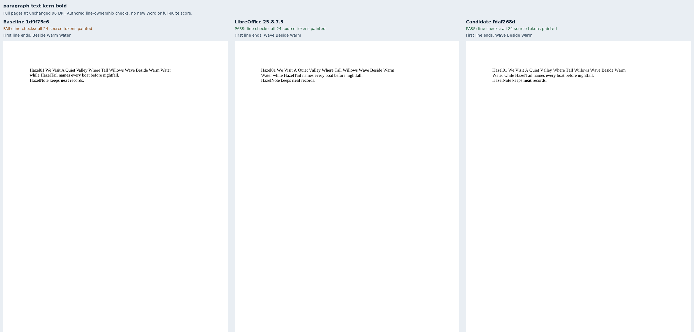


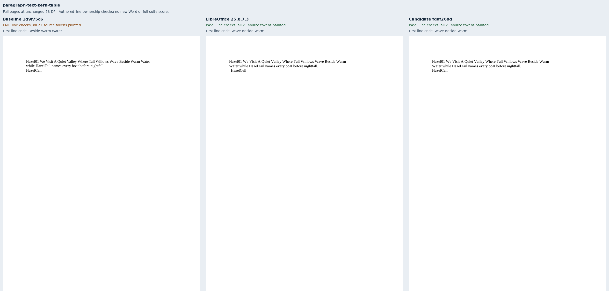


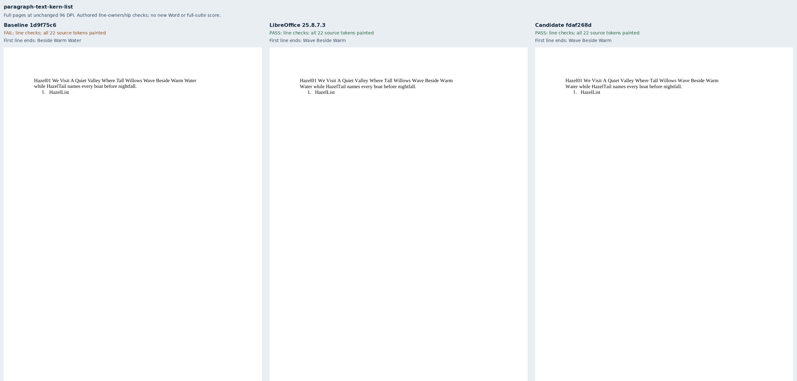


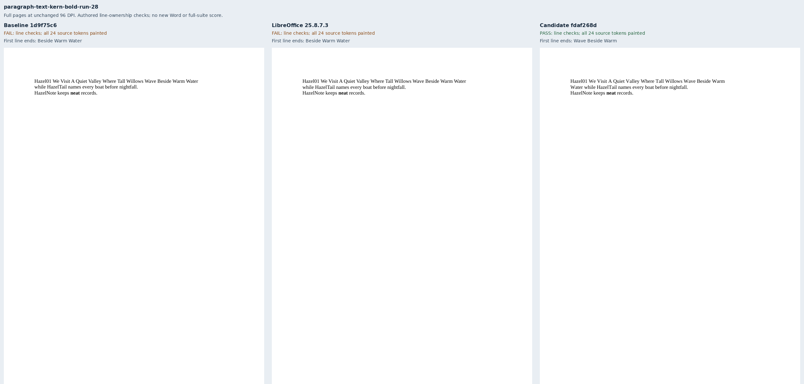


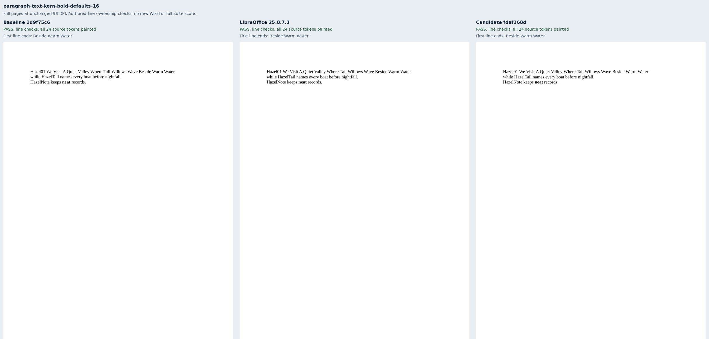


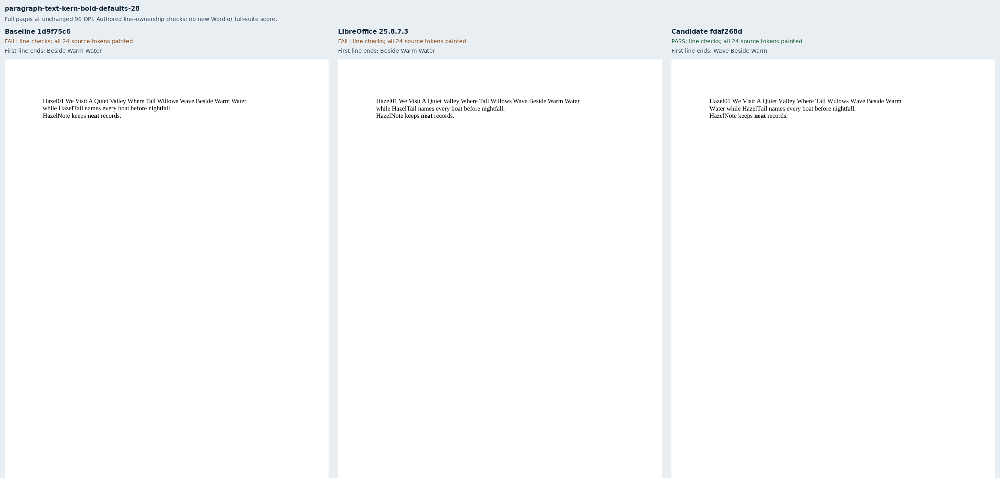


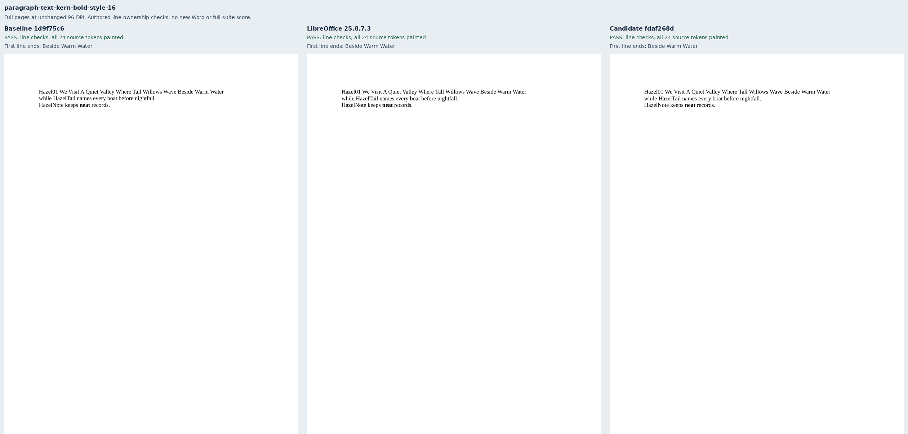


