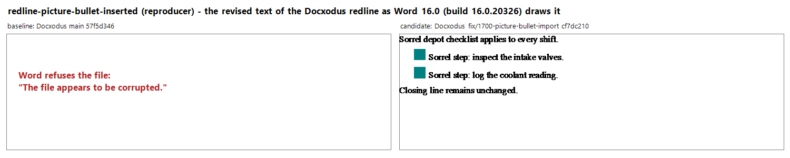
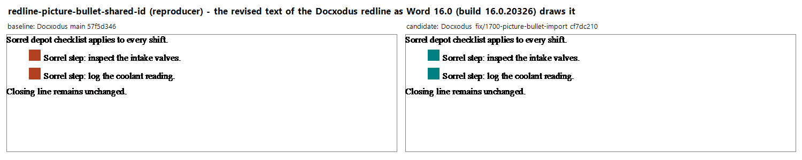
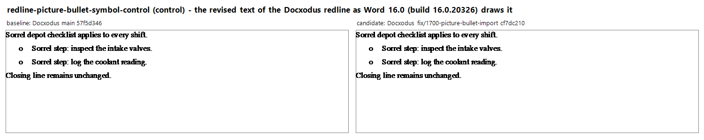

# Lists with picture bullets

Docxodus #1700 compared a document with one whose revision adds a list drawn with a picture
bullet. A picture bullet is three linked pieces in the numbering part: the level's
`w:lvlPicBulletId`, the `w:numPicBullet` of that id, and the image that bullet names through the
numbering part's relationships. Docxodus imported the revision's list definition without the
other two.

| Case | Kind | Word 2024, baseline | Failed checks, baseline | Word 2024, candidate | Failed checks, candidate |
| --- | --- | --- | --- | --- | --- |
| `redline-picture-bullet-inserted` | reproducer | refused: "The file appears to be corrupted." | `picture-bullets:accepted` | opens; accept leaves 2 list items, reject 0; no revisions remain | none |
| `redline-picture-bullet-shared-id` | reproducer | opens; accept leaves 2 list items, reject 2; no revisions remain | `picture-bullets:accepted` | opens; accept leaves 2 list items, reject 2; no revisions remain | none |
| `redline-picture-bullet-symbol-control` | control | opens; accept leaves 2 list items, reject 0; no revisions remain | none | opens; accept leaves 2 list items, reject 0; no revisions remain | none |

Baseline is Docxodus main `57f5d346`; candidate is the fix branch `cf7dc210` ([JSv4/Docxodus#1720](https://github.com/JSv4/Docxodus/pull/1720)). Word is 16.0.20326 on Windows, opening
a scratch copy of each redline through `Documents.Open` with repair off, then Accept All and
Reject All on fresh copies.

The two reproducers fail differently. Where the original has no picture bullet, the imported
level names one that does not exist and Word refuses the file. Where the original has its own
picture bullet under the same id, the file opens and the revision's items are drawn with the
original's picture: Word reports nothing, and the accepted text is right. In both, the round trips
pass and the Open XML SDK validator has no finding, which is why the `picture-bullets` check reads
the image each list item draws. The authored redlines pass every check listed and open in Word
with the same results as the candidate.

"Failed checks" are those of the bench's own markup engine and assertions, run on this machine.
The SDK validator was also run locally on every input, authored redline and Docxodus output:
no findings. LibreOffice was not available; its comparisons run in CI. `evidence.json` holds the
per-check and Word results.

The images show Word's own drawing of each redline's revised text (insertions in place, deletions
hidden), from `Range.EnhMetaFileBits`, baseline on the left and candidate on the right. Word
substitutes its default serif for Liberation Serif, which the capture machine does not have.

### redline-picture-bullet-inserted

### redline-picture-bullet-shared-id

### redline-picture-bullet-symbol-control

