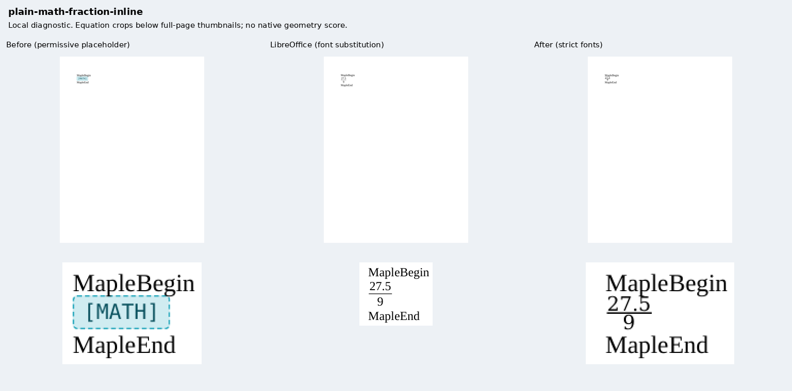
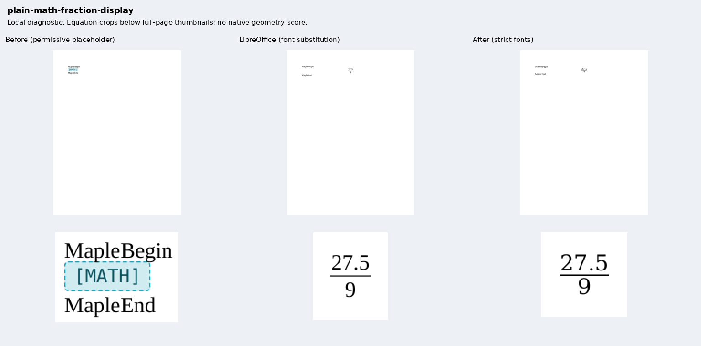
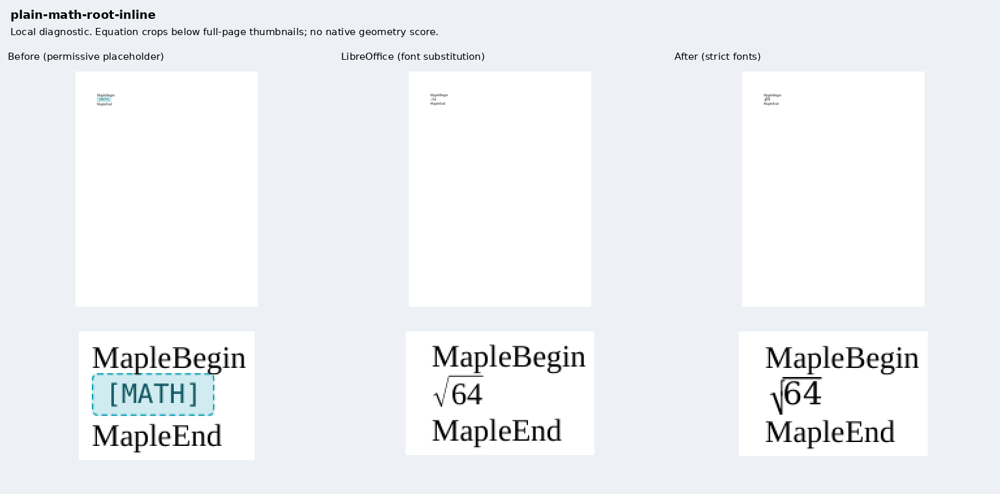
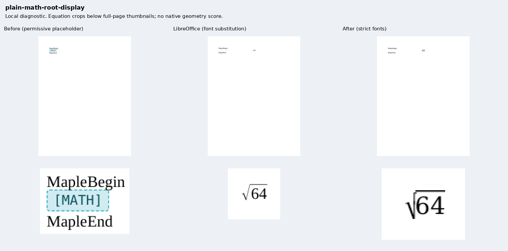
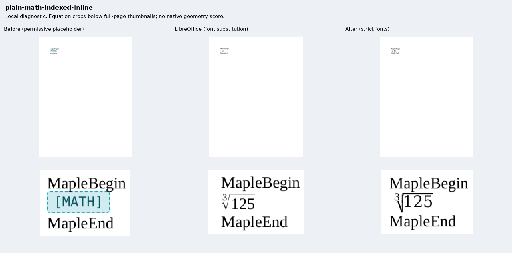
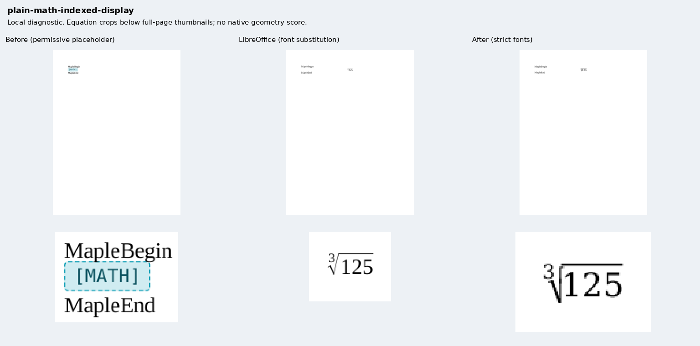
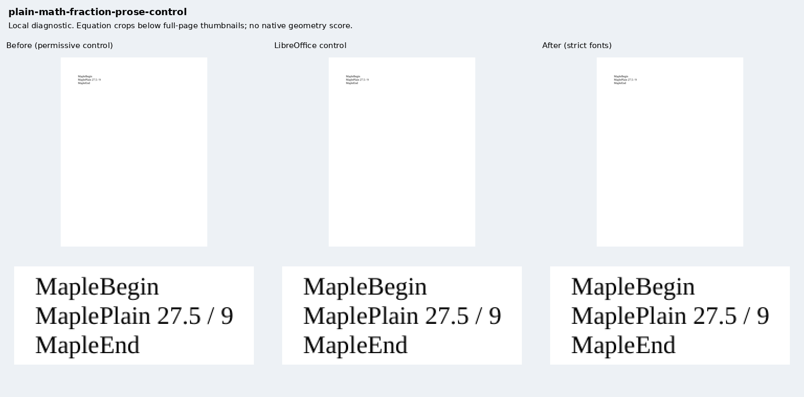
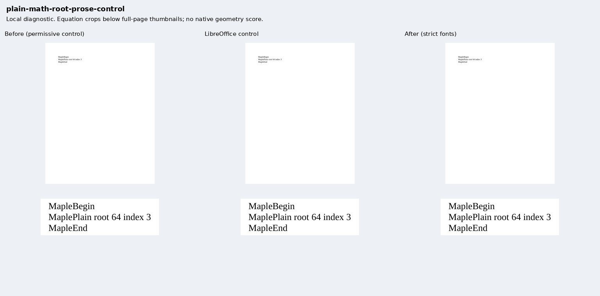

# Plain equations: independent source and export checks

Eight original Maple inputs cover inline/display fractions, square roots and indexed roots,
with two ordinary-prose controls for [Docxodus #1554](https://github.com/JSv4/Docxodus/issues/1554).
All eight packages pass Open XML SDK validation. They import no renderer fixture or helper.
The 844 earlier PDF-track inputs and their declarations are unchanged except for the generator hash.

The before build is `478a9a7acd6abff438aa757aedc6e185830214f8`; the after build is
`3ab1a4639da3d2b503911f33ec6fc168e34d35cb`. The before build's converter, formatting resolver,
font runtime, baseline and pagination sources are byte-identical to main `e868934b`.
Both production builds retain their 19 build-file hashes and 45 export-asset hashes in
[the evidence](evidence.json). The browser is the separately provisioned sandboxed Chromium,
so these are public-API diagnostics, not a pinned-runtime benchmark score.

| Observation | Before | After |
| --- | --- | --- |
| Strict-font delivery | 2/8 controls; six equation refusals | 8/8 |
| Selectable source content and required font | 2/8 in a separate permissive preview | 8/8 under strict policy |
| Exact native MathML operand tree | 0/6 | 6/6 |
| Painted fraction bars | Placeholder before | Both fraction bars present |
| Ordinary-prose controls | Pass | Pass |

The before strict refusals concern the existing placeholder's unresolved generic monospace font.
A separate **permissive** capture preserves its visible `[MATH]` output and both warnings:
`unsupported_content_placeholder` and `font_unavailable`. The screenshots label that policy.
This secondary capture does not turn the strict refusals into successful delivery.

The source declares DejaVu Serif for math and Liberation Serif for prose. LibreOffice 25.8.7.3
ignores that math-font setting: fractions use only Liberation Serif; roots also use OpenSymbol.
All six native equation references therefore fail the mandatory required-font-family assertion
and remain **ineligible for geometric fidelity scoring**. Both native prose controls qualify.
The root outputs also split `√` and its radicand into separate PDF words, while the source
notation contract requires `√64`, or index `3` and `√125`. No normalization conceals the difference.
Word Online was unavailable; these results do not establish Word typography or baseline parity.

The mandatory HTML assertion checks one MathML expression, namespaces, actual display mode,
ordered token/operator structure, default fraction-bar semantics and visible positive geometry.
Single-child `mrow` grouping is transparent. Browser mutants reject swapped fraction operands,
swapped root index/base, flattened structure, duplicates, missing/hidden formulas, hidden operands,
CSS display overrides and zero-thickness bars. Source PDF inventories, whole-formula page membership
and required-font presence remain separate mandatory checks. Font presence is a package-level
claim; it does not attribute an individual glyph to a font file.

`Compose.py` independently checks the source/artifact identities, all 26 retained diagnostic PDFs,
74 source-word paint observations and both fraction-bar drawings against raster paint.
The [zero-bar negative](zero-bar.pdf) keeps the operands but fails the bar-paint probe.
All eight sheets below include full-page thumbnails and enlarged crops from unchanged page rasters.
Raw HTML remains in ignored capture directories because it contains embedded configured font data;
its hashes and independent browser observations are retained. PDF reports and inspections are
compressed losslessly beside the evidence.

## Review sheets










## Reproduction

Generate `core-v118` with `python3 -m bench.fixtures`, select the eight `plain-math-*` cases,
and build each exact renderer commit with `python3 -m bench build-docxodus`. The shared
`docs/results/export-reliability/Capture.mjs` accepts `--html` to retain the artifact and independent
browser facts; only the separate before-visible capture adds `--allow-unverified-fonts`.
Capture native references with `python3 -m bench reference libreoffice --manifest MANIFEST --out OUT`.
Keep the original capture/build/asset manifests alongside the schema result, then run:

```sh
node docs/results/plain-math/ZeroBar.mjs AFTER_SOURCE AFTER_HTML RUN/zero-bar.pdf
python3 docs/results/plain-math/Compose.py RUN BEFORE_SOURCE AFTER_SOURCE
DOCXODUS_SOURCE_ROOT=AFTER_SOURCE node --test tests/test-math-browser.mjs
python3 -m unittest discover -s tests -v
python3 -m bench.audit
```

The diagnostic composer additionally uses Pillow and PyMuPDF; neither is required for the
benchmark's core Python contract or its MathML browser observer.
