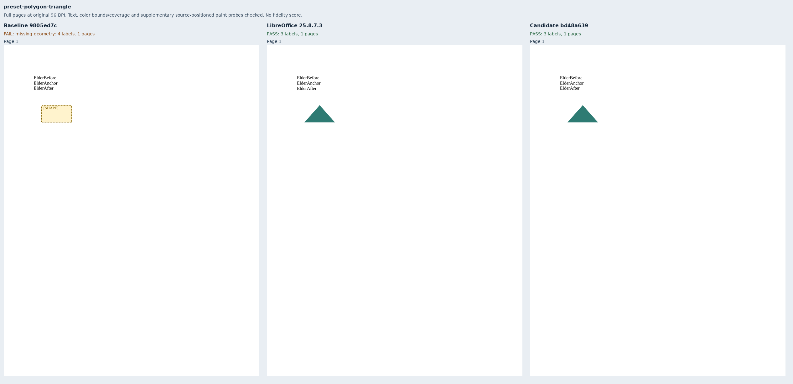
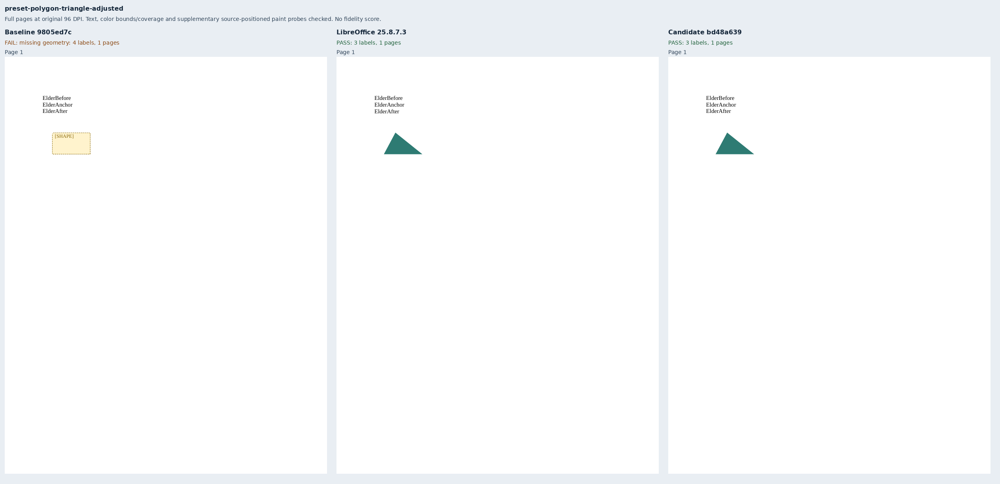
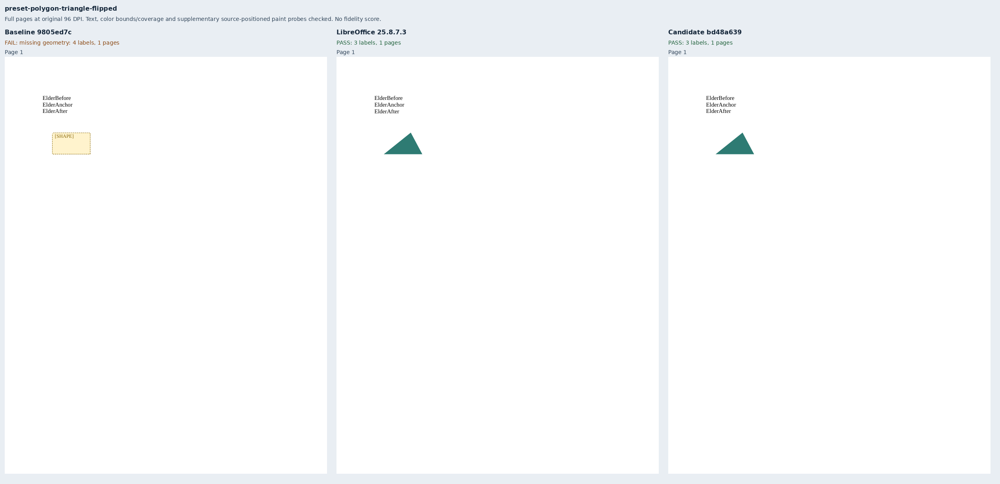
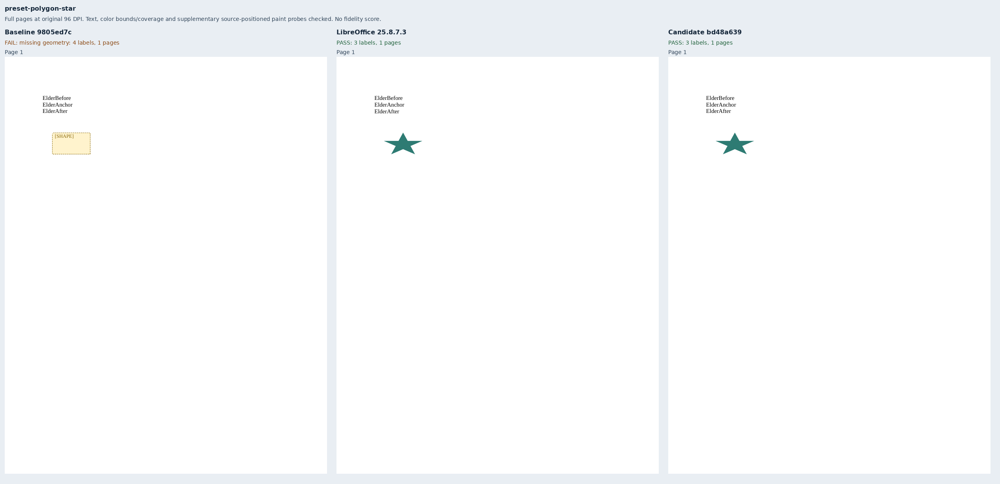
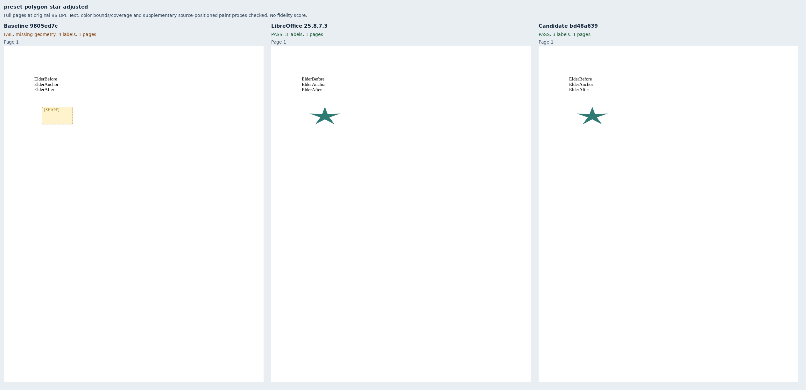
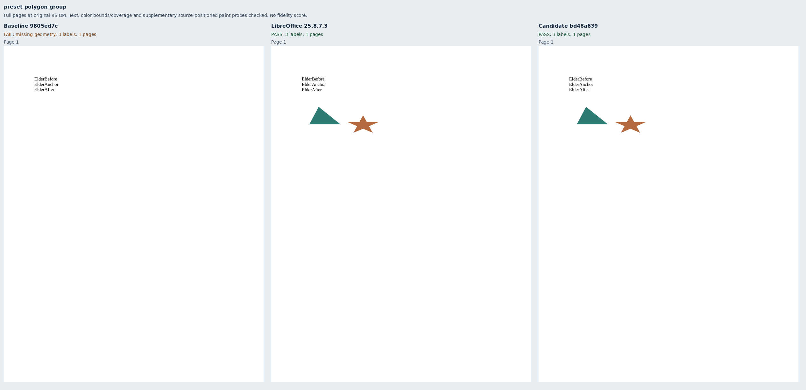
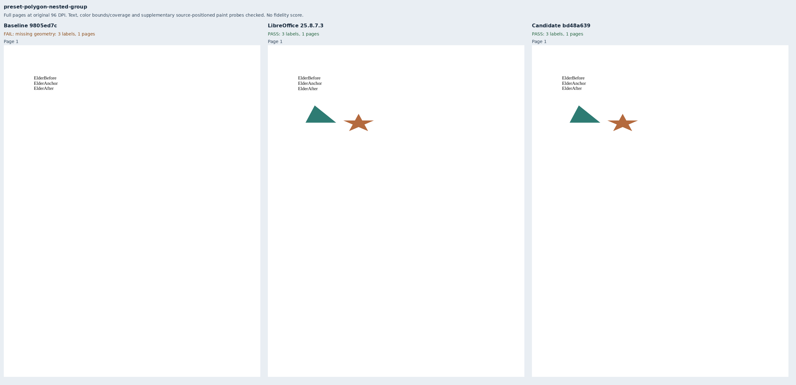
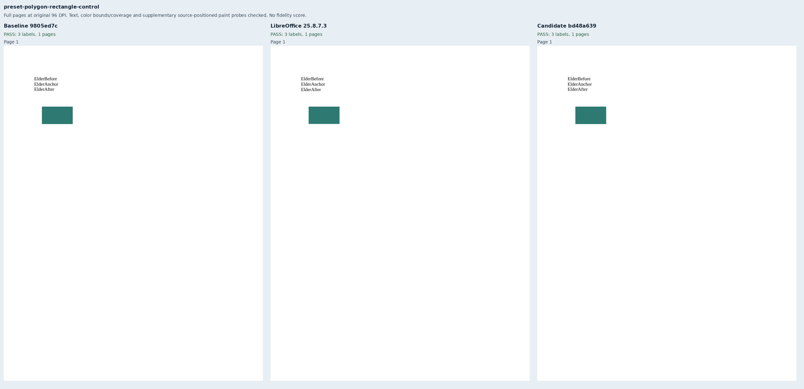

# Adjusted triangles and five-point stars

Nine original Elder packages cover default, adjusted and horizontally flipped triangles;
default stars, adjusted inner radius and explicit horizontal/vertical factors; translated,
unequally scaled groups and nested groups; and an unchanged rectangle control. The labels,
73×41pt frames, colors and literal DrawingML are independently authored in `bench/fixtures.py`.
All use 11pt Liberation Serif, Letter paper and 72pt margins, with page-positioned drawings at
(90, 144)pt. No renderer fixture or helper is imported.

Baseline `9805ed7cc31551c4fc724d07e21dd84abe0fba44` has the same complete source tree as main
`42bba69556dab01a80933e1d1c081b208a381f7d`. It passes the rectangle and fails the other eight
cases. Candidate `bd48a63923accd6f2ac582ce65c2f7e5e3613c29`, based directly on that main revision,
passes all nine through the production
public export API. This addresses only the triangle/star portion of
[Docxodus #1554](https://github.com/JSv4/Docxodus/issues/1554); OMML, other/custom geometry,
EMF/WMF and VML lines remain outside this change.

LibreOffice 25.8.7.3 supplies nine eligible native references. Group fixtures include an invisible
full-frame rectangle so native import preserves their declared bounds instead of fitting only the
painted children. The factor-star fixture explicitly supplies `adj`, `hf` and `vf` in that order;
omitting `adj` exposed LibreOffice's positional guide interpretation and produced a decagon.
The retained factor-star reference is a five-point star with the intended factors. No Word
reference is claimed. Captures use strict font verification and sandboxed system Chromium;
they are unscored diagnostics, not pinned-runtime or full-suite fidelity results.

Existing color geometry assertions compare each paint color's bounds and coverage against native
output, at the unchanged 1.5pt/8% tolerances. **Supplementary paint probes are separate from those
benchmark assertions and scores.** `GeometryProbes.py` samples authored page coordinates, never
detected paint bounds, using 3×3 patches at 288 DPI. Its literal fill/empty expectations were
checked against the published preset guide paths and calibrated against native renders. The
81 positions per renderer cover triangle apices, star interiors/notches, group translation and
the control. All candidate and reference probes pass; every failing baseline case loses paint.

`MutateApex.py` changes only the adjusted triangle's painted apex in the native PDF from x=111.9pt
to x=126.525pt. The retained `wrong-apex.pdf` preserves every text position, shape bounds and area,
and passes the existing benchmark checks. It fails two supplementary probes. This demonstrates
both the extra diagnostic's sensitivity and the narrower scope of the declared score contract.

Nine full-page comparison sheets show all 27 pages at original 96 DPI. `evidence.json` binds
87 extracted labels (including six baseline placeholder labels), input/PDF/report hashes, native
references, 243 paint probes, exact clean source revisions, 19 build files and 45 runtime assets
per renderer. The composer checks complete reports, input/PDF bindings, strict verified fonts,
observed browser identity, actual asset hashes/lengths and every page's text and paper bounds.
The separate wrong-apex control preserves three more labels. All nine inputs pass Open XML SDK
3.5.1 validation against Microsoft 365.

The suite advances to `core-v113` (810 inputs). All previous 801 input bytes and declarations
remain unchanged apart from generator provenance. The core's native/public tests additionally
cover unsupported adjustment formulas, clamping and rotation diagnostics; these nine benchmark
fixtures do not claim coverage of those policy boundaries.

```sh
python3 -m bench reference libreoffice --manifest MANIFEST --out REFERENCE
node docs/results/export-reliability/Capture.mjs SOURCE MANIFEST OUTPUT ENVIRONMENT
python3 docs/results/preset-polygons/MutateApex.py REFERENCE/preset-polygon-triangle-adjusted/reference.pdf
python3 docs/results/preset-polygons/Compose.py RUN BASELINE_SOURCE CANDIDATE_SOURCE
```










