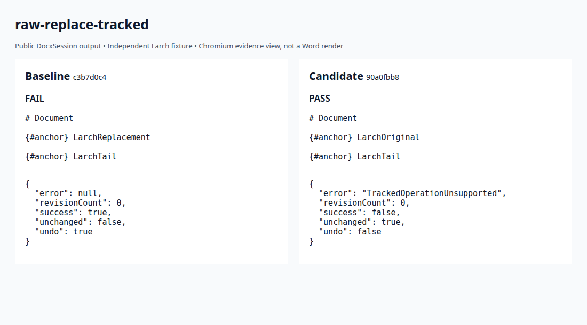
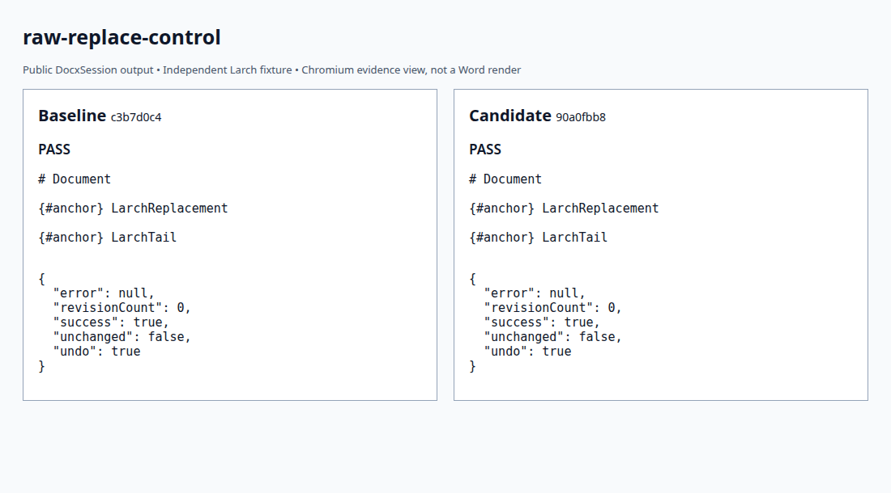
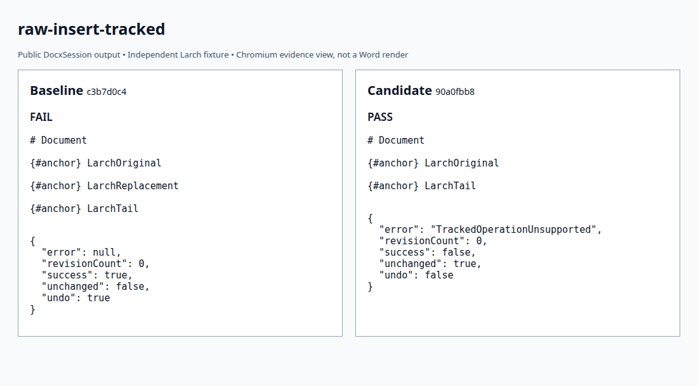
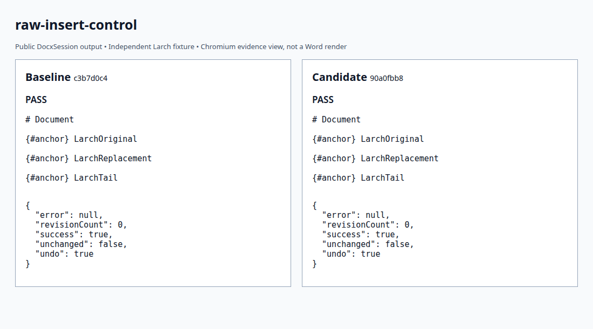

# Raw XML writes while recording

Four original fixtures reproduce [Docxodus #1625](https://github.com/JSv4/Docxodus/issues/1625).
The public session API attempts a raw insert or replacement, paired with the same operation after
explicitly disabling recording. Inputs use original Larch labels and literal OOXML; no product
fixture, helper or document was imported.

The [baseline](baseline.json) fails both tracked cases and passes both untracked controls.
The [candidate](candidate.json) passes all four, plus the fourteen unchanged projection cases.
Each result binds full source/build/input hashes. This is an unweighted session diagnostic, not a
PDF/redline score or a Word behavior claim. PDF and redline suite versions are unchanged.

The tracked result must be `TrackedOperationUnsupported`, with identical uncompressed package
parts, zero revisions and no undo entry. Controls must succeed, change the package, preserve
zero revisions and create an undo entry. Complete projected text and the saved output's Microsoft
365 schema validity are also required. The harness rejects missing or altered observations.

Screenshots show measured public Markdown and operation outcomes before/after the fix; anchor
identifiers are shortened for readability. They are Chromium captures of API evidence.

| Reproducer | Untracked control |
| --- | --- |
|  |  |
|  |  |

```bash
python3 -m bench.projection build --source /path/to/Docxodus --commit FULL_SHA --out runs/raw-build
python3 -m bench.projection run --build runs/raw-build --output runs/raw-result.json
python3 -m unittest discover -s tests -p test_projection.py -v
```

An independent adversarial review identified input-only schema validation. The adapter now checks
the saved session output, so an invalid untracked write cannot pass on a valid input alone.
