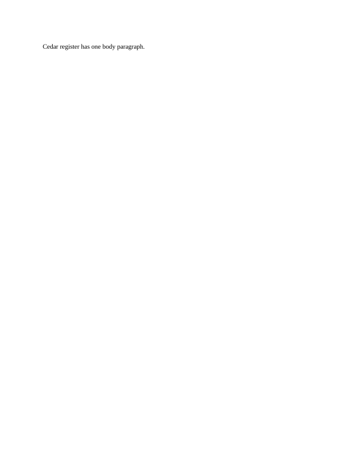
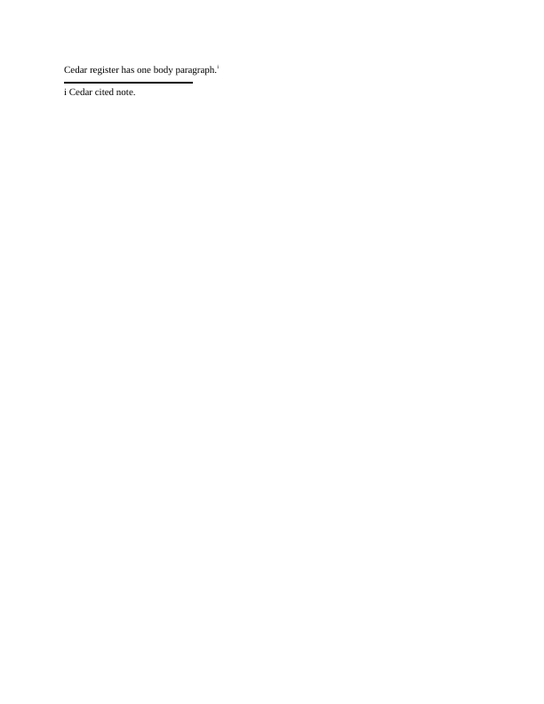

# Reserved endnotes (#1485)

Four original inputs exercise positive-id note classification. Each LibreOffice 25.8.7.3
PDF has one page and exactly the manifest's token inventory. This is diagnostic output,
not a fresh Word reference. The ordinary control includes its citation and note markers.

| Input | LibreOffice page |
|---|---|
| Uncited continuation notice |  |
| Uncited continuation separator |  |
| Uncited separator |  |
| Cited ordinary note |  |

Docxodus baseline/candidate PDF comparisons are pending. Native converter regressions
reproduce the notice leak on main and pass with the shared typed-note filter. Full-suite
rendering and Word scoring are not claimed.
