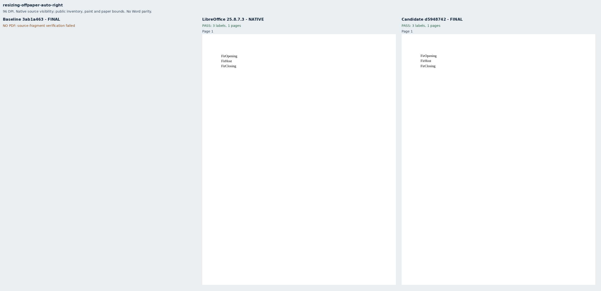
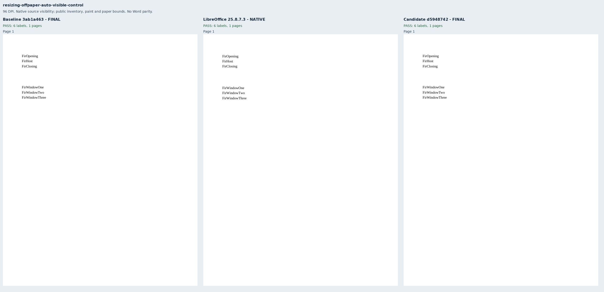
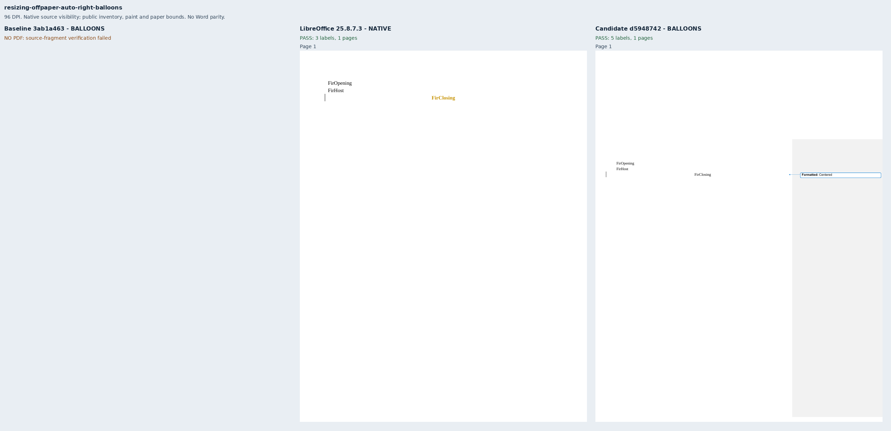
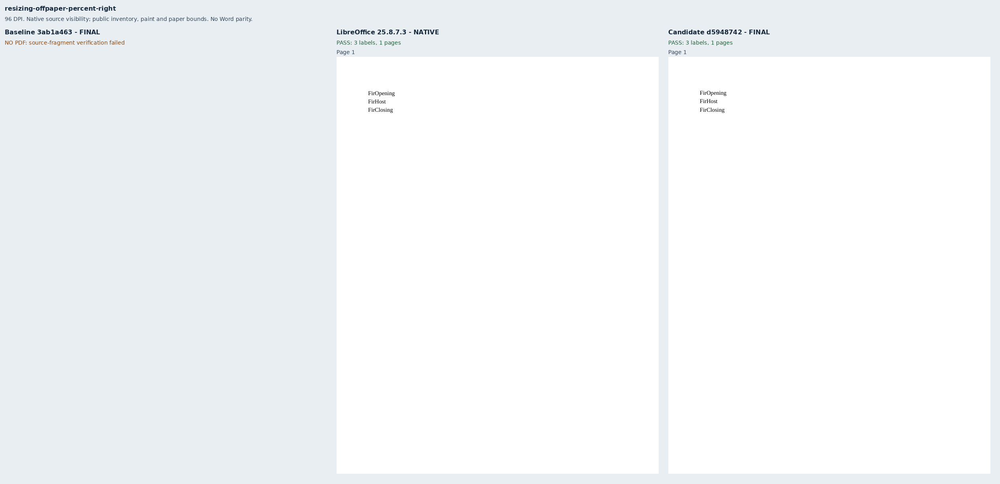
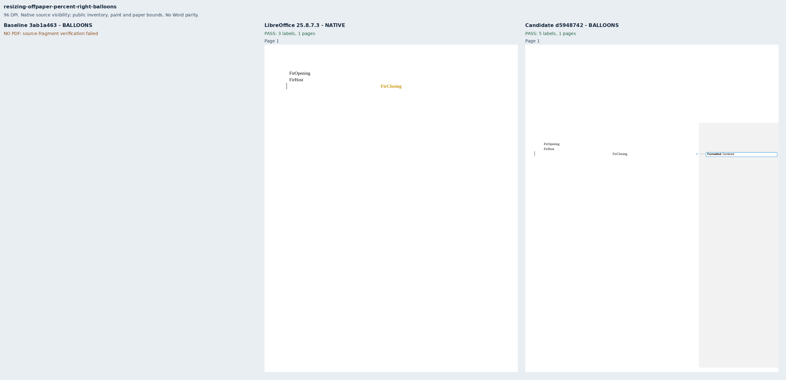

# Resizing text boxes beyond the page

Eight original Fir documents cover the standalone AutoFit and percentage-width failures
in [Docxodus #1558](https://github.com/JSv4/Docxodus/issues/1558). Both use explicit page-relative
offsets, no wrapping, 11pt Liberation Serif and 16pt exact lines. AutoFit grows a stored
16pt box to hold three paragraphs; percentage width resolves to 20% of Letter paper.
The right/bottom positions start beyond the paper. Each fitting mode has an on-page
control and a right-edge case beside a formatting balloon.

Strict public delivery improves from **2/8 to 8/8**. All eight packages have zero Open XML
SDK errors and eligible LibreOffice 25.8.7.3 references. Native references establish source
visibility; revised native inputs retain revision tint and are not Word All Markup oracles.
Word Online was unavailable. No new Word typography parity or full-suite score is claimed.

The companion PDF contract requires the complete printed inventory, including `Formatted:`
and `Centered` in balloon cases. All hidden box labels are explicitly forbidden. Source
labels remain in delivered HTML, and each omitted paragraph has its own matching
`source_text_clipped` warning. The compositor checks the original labels, source anchors,
exact visible inventories, dark painted ink and physical paper bounds. Both visible controls
retain every paragraph. The four other original refusals remain separate: grouped placement,
a later floating picture, a minimum-height row and a square-wrapped picture.

Baseline `3ab1a4639da3d2b503911f33ec6fc168e34d35cb` has production sources byte-identical
to merged main `1710b2fbec0f2b9e1d9939ac1a901d2dc0093a1d`; their only difference is equation
findings documentation. Candidate `d59487425398a2f39b260f619b5d6044e75773bb` is a clean,
source-bound production build. Both use strict font verification and sandboxed system
Chromium. These captures are targeted public-API diagnostics, without pinned-runtime scoring.

[Evidence](evidence.json) binds both source/build identities, all 19 build-file and 45 runtime
asset hashes per renderer, eight native references, ten public PDFs, reports, source-anchor
observations and all eight review sheets. All 18 inspected PDFs are retained under `pdf/`.
HTML remains in ignored capture directories because it embeds configured font data; its
hashes and source-anchor observations are retained. The prior 852 inputs and declarations
remain unchanged apart from their generator provenance hashes.

Independent adversarial review found no false placement exemption. It added a wrong-origin
regression that fails when the new origin comparison is removed, and corrected the balloon
inventory to include `Centered`. Changed source text, size, offsets, actual placement and
partially visible siblings remain guarded by the renderer tests.

## Reproduction

Generate `core-v119` with `python3 -m bench.fixtures`, select `resizing-offpaper-*`, and derive
the companion manifest from each case's `pdfCompanion` profile and required tokens. Build
both exact renderer commits with `python3 -m bench build-docxodus`. Capture native references
using `python3 -m bench reference libreoffice --manifest MANIFEST --out OUT`, then both public
renderers using `docs/results/export-reliability/Capture.mjs` with `--html`. Preserve the build
and asset manifests beside the schema results and run:

```sh
python3 docs/results/resizing-offpaper/Compose.py RUN BASELINE_SOURCE CANDIDATE_SOURCE
python3 -m unittest discover -s tests -v
node --test tests/test-adapter.mjs
python3 -m bench.audit
```

The compositor additionally uses Pillow for labeled review sheets. It preserves unchanged
96-DPI page rasters and labels failed baseline exports explicitly.

## Review sheets









