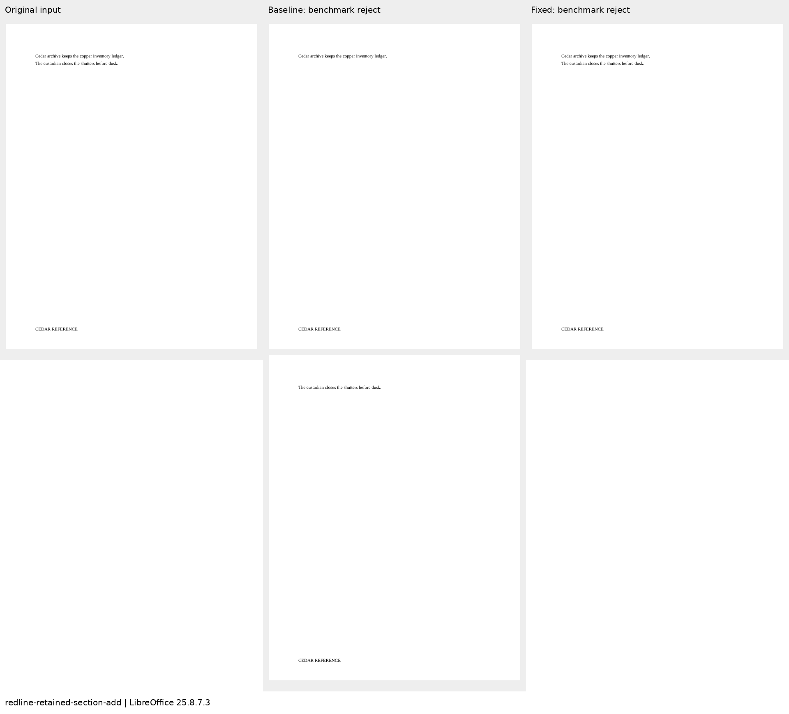
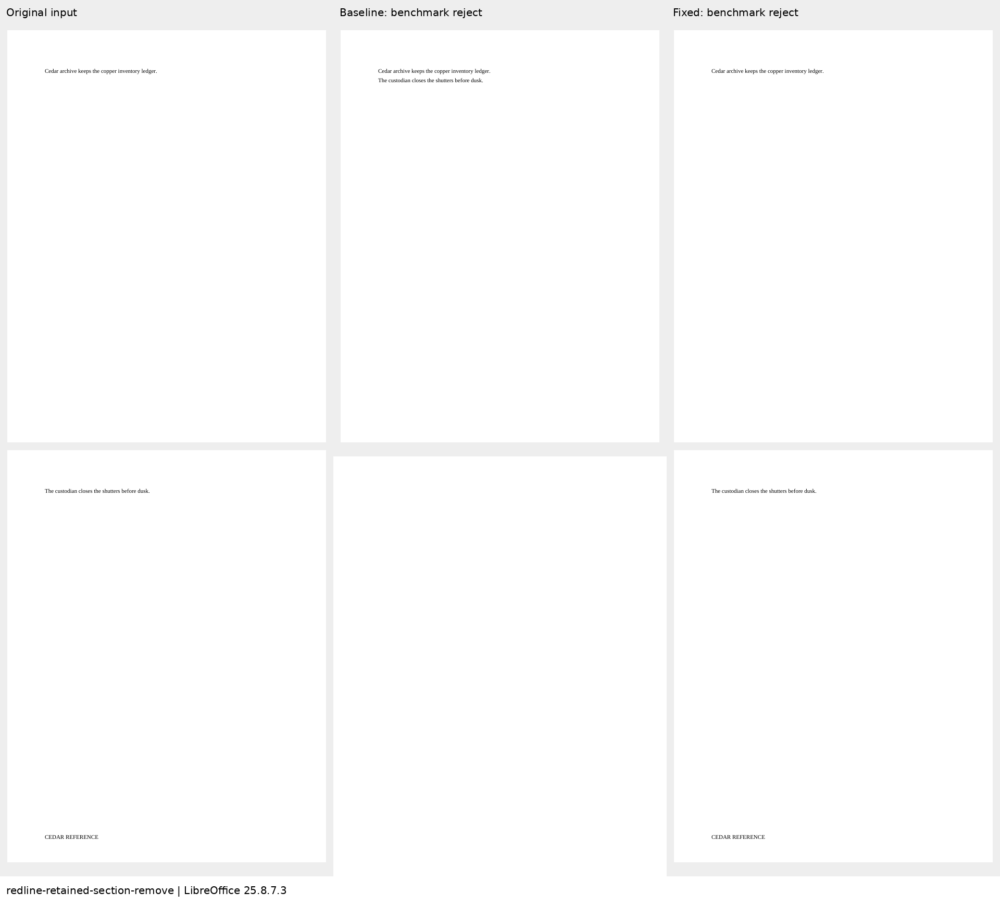
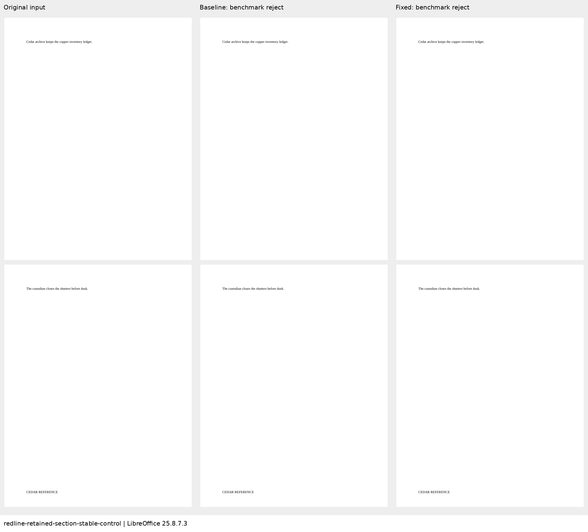

# Retained paragraphs gaining or losing section boundaries

The add/remove cases preserve the same two body paragraphs while adding or removing
an inline section boundary on the first. That boundary changes the first paragraph’s
footer from CEDAR REFERENCE to an explicitly empty story. The control keeps both
sections and changes one word.

Baseline `5b733a20` scores 0 on both reproductions and 100 on the control. Candidate
`90fd0e97` and authored calibration score 100 on all three. These are three focused
diagnostics, not a complete 239-case suite score. Independent accept/reject checks
compare body paragraphs, per-section footer stories, and the exact paragraph carrying each
boundary; every SDK check passes. Metric contract 18 adds the carrier-position check.
Independent review supplied a schema-valid wrong-carrier mutant that formerly scored 100;
the strengthened assertion now scores it 0.

Four of six LibreOffice endpoint comparisons apply. LibreOffice 25.8.7.3 retains an
empty paragraph and its section/footer binding when rejecting the authored added
boundary or accepting its removal. Those two comparisons are explicitly ineligible
based on authored calibration, not on the candidate result. The exact independent
markup endpoints and SDK checks remain mandatory. No Word parity is claimed; the
available Office session required sign-in.

Each review sheet shows all pages of the original input, baseline rejection and fixed
rejection. The benchmark’s independent revision engine resolves the redlines before
LibreOffice renders those resolved packages; these pictures are not LibreOffice
Reject All results. Source, resolved-package, PDF and image hashes and check results
are recorded in `evidence.json`.

