# Independent review visibility

These 14 original Hazel fixtures exercise Docxodus #1523: formatting-only, comment-only,
and combined controls, followed by every formatting/text/comment visibility combination.
Each pair uses identical source bytes. All 724 previous corpus inputs are unchanged.

The first panel is a separately captured LibreOffice primary PDF, with comments hidden.
Mixed-revision primary PDFs show both old and new text, matching LibreOffice's native
view; the other primary PDFs use the final view. The middle and right panels are the
candidate's default and requested review display. Each sheet includes the complete page
and a crop around the text and review labels. This does not claim native Word balloon
geometry or a before/after renderer comparison.

Local checks pass for all 14 cases: exact source inventories and positive dark paint in
printed companions; absent hidden-source/formatting tokens; accessible HTML text; exact
balloon, insertion, deletion and markup-container counts; original package digest; and no
derived source package. Positive formatting cases also require the printed `Formatted:`
label. The same-file comment-only control preserves its display when formatting is hidden.
All 14 fixtures pass Open XML SDK 3.5.1 validation. The independent browser observer is
mutation-tested for missing and duplicated families, retained empty containers and hidden
source markers. Final adversarial review added complete visible HTML token inventories
and forbidden tokens; mutations now catch empty/hidden comment text and comments leaked
as plain paragraphs independently of the companion PDF.

[Local evidence and source identity](local-evidence.json) and [schema findings](schema.json)
record the local artifacts at their original source revision.

The pinned production [baseline run](https://github.com/JSv4/docx-fidelity-bench/actions/runs/41512262047)
and [candidate run](https://github.com/JSv4/docx-fidelity-bench/actions/runs/41513743927)
use the same contract, native reference bundle and calibration (100). The baseline passes
the four default controls and fails the ten new-policy PDF companions; those ten HTML
exports reject the unsupported option. Candidate `915d6fc1` passes all 14 PDF mandatory
checks and all 14 HTML cases. The focused mean changes from 27.3432 to 91.3802. All 14
primary page rasters are byte-identical to baseline, as are all four default HTML outputs.
[Pinned evidence](pinned-evidence.json) records source revisions, result hashes and checks.
These are focused diagnostic results, not a full-corpus fidelity score.

## review-visibility-format-only-default-control

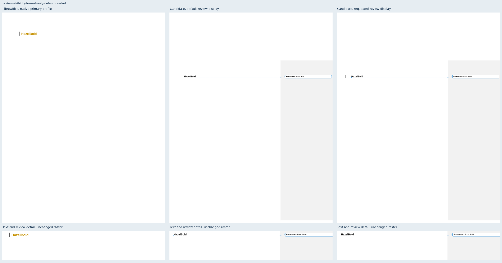

## review-visibility-format-only-hide-formatting

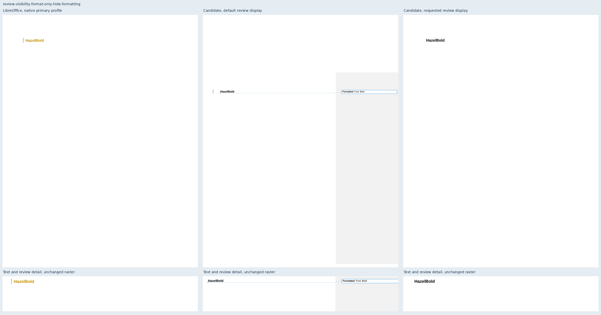

## review-visibility-comment-format-default-control

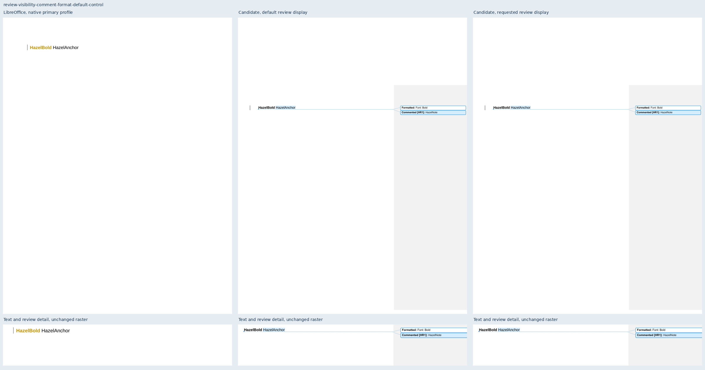

## review-visibility-comment-format-hide-formatting

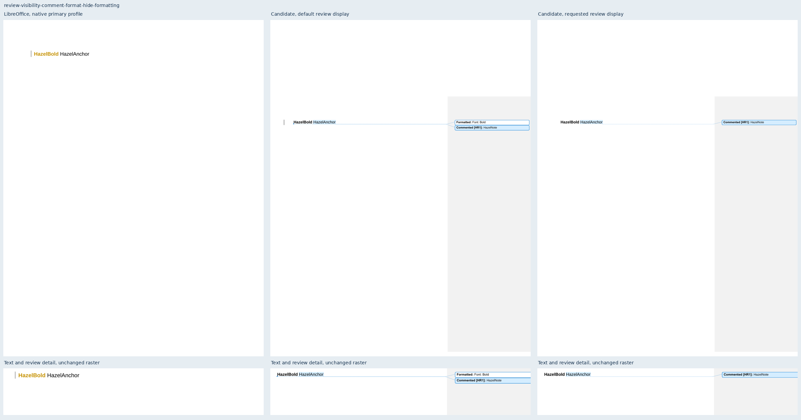

## review-visibility-comment-only-default-control

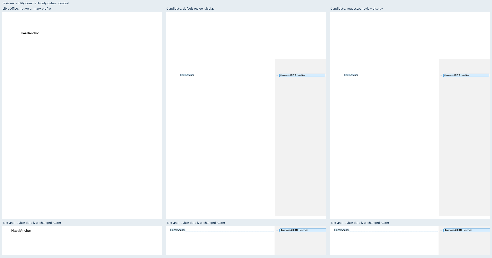

## review-visibility-comment-only-hide-formatting

## review-visibility-mixed-000

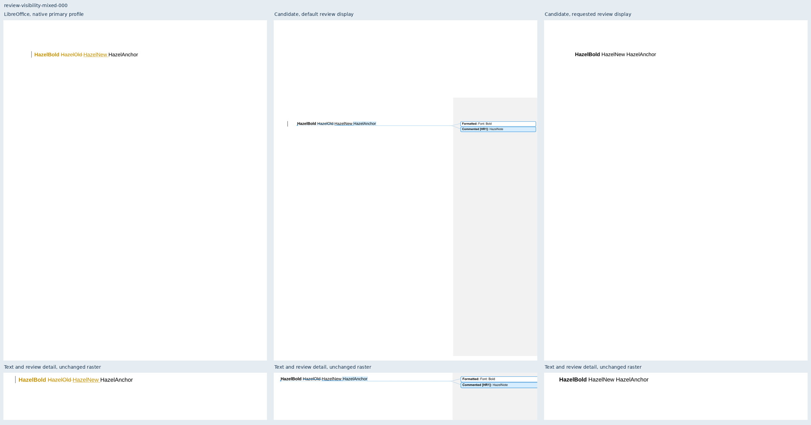

## review-visibility-mixed-001

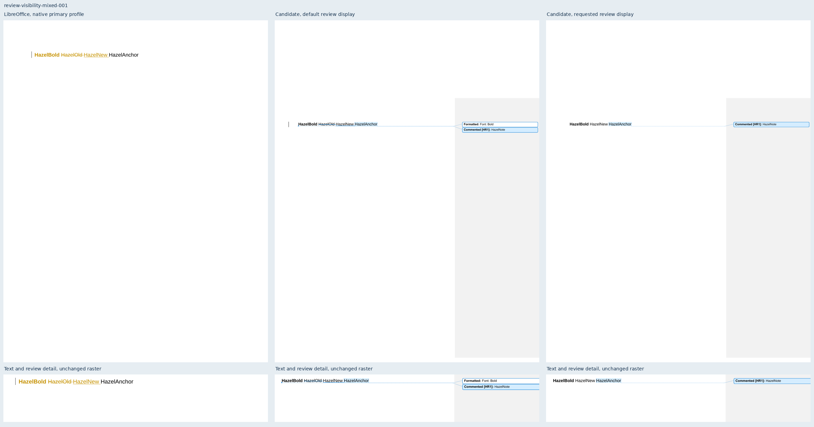

## review-visibility-mixed-010

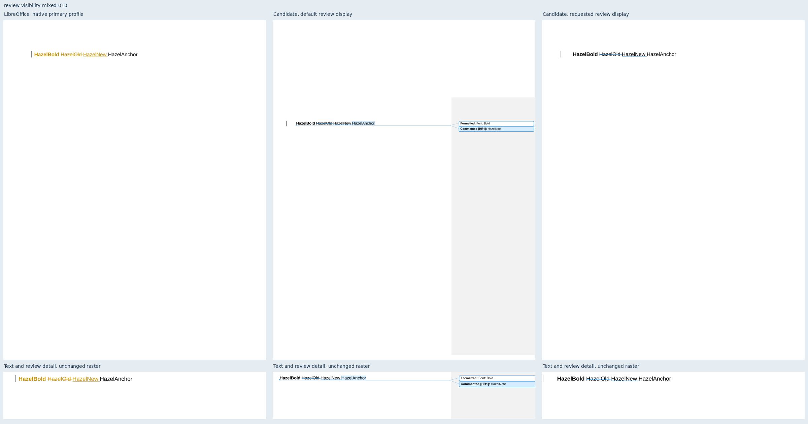

## review-visibility-mixed-011

## review-visibility-mixed-100

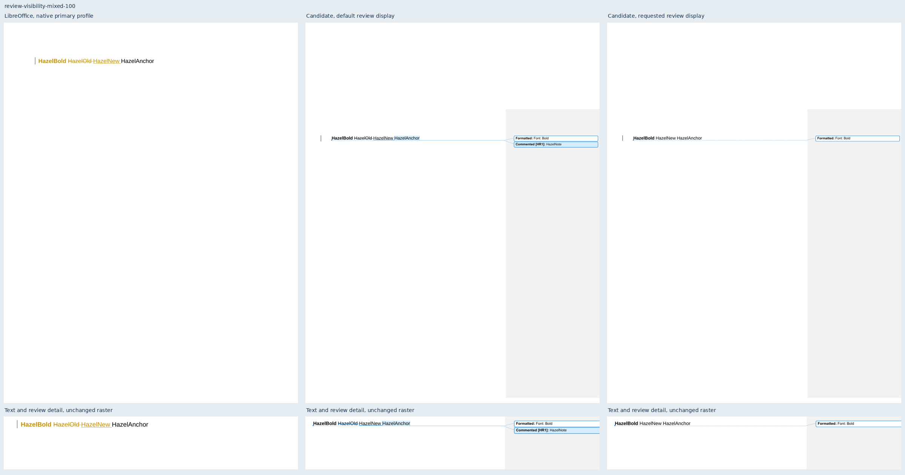

## review-visibility-mixed-101

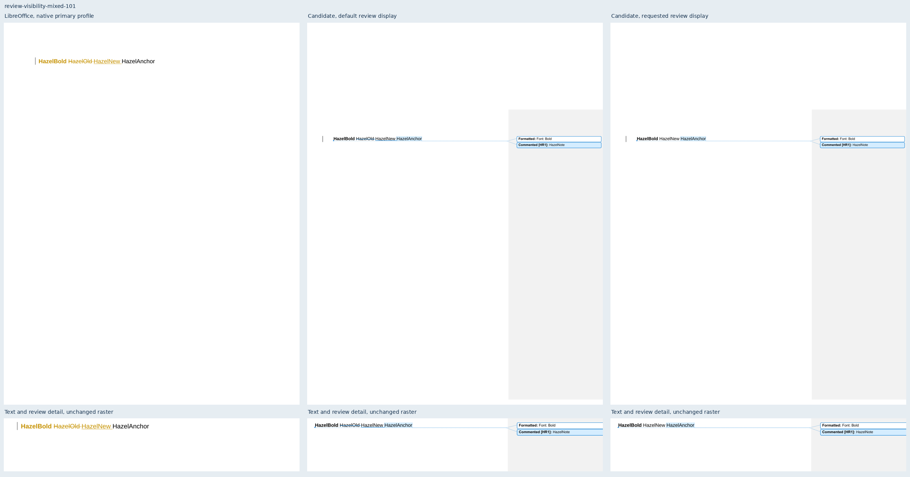

## review-visibility-mixed-110

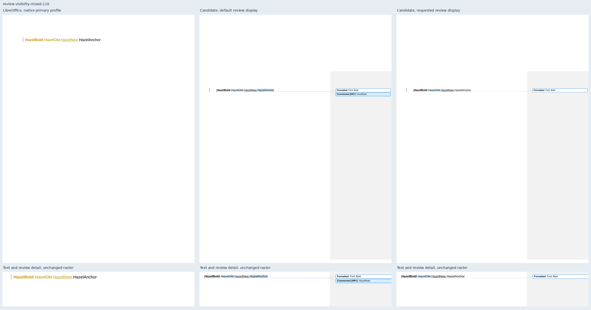

## review-visibility-mixed-default-control

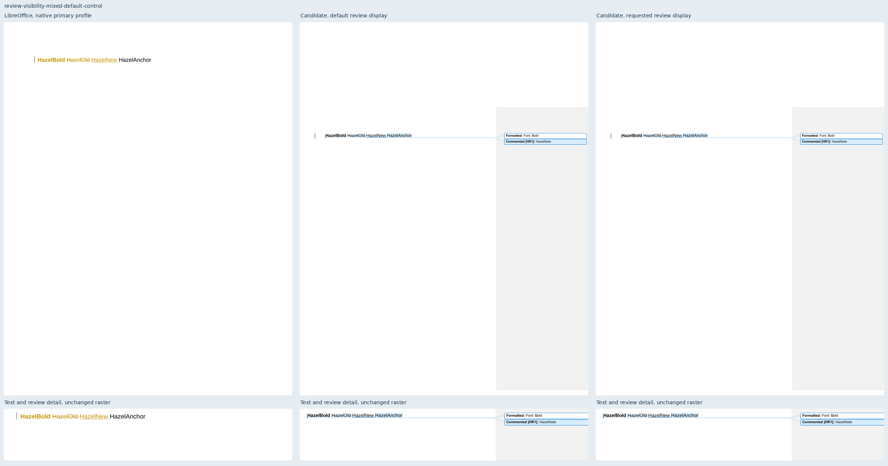
