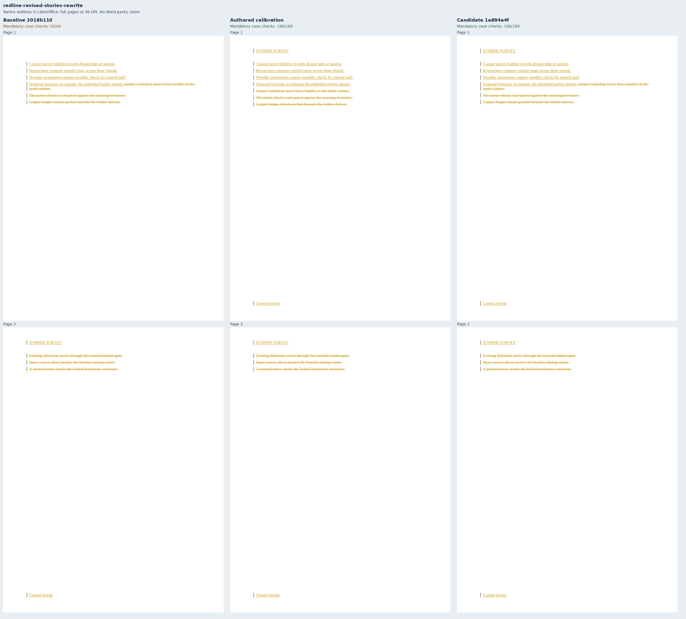
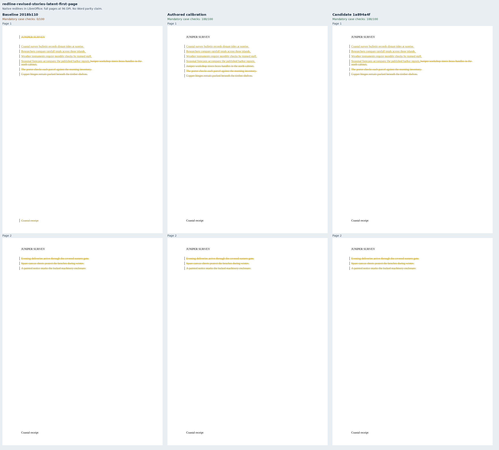
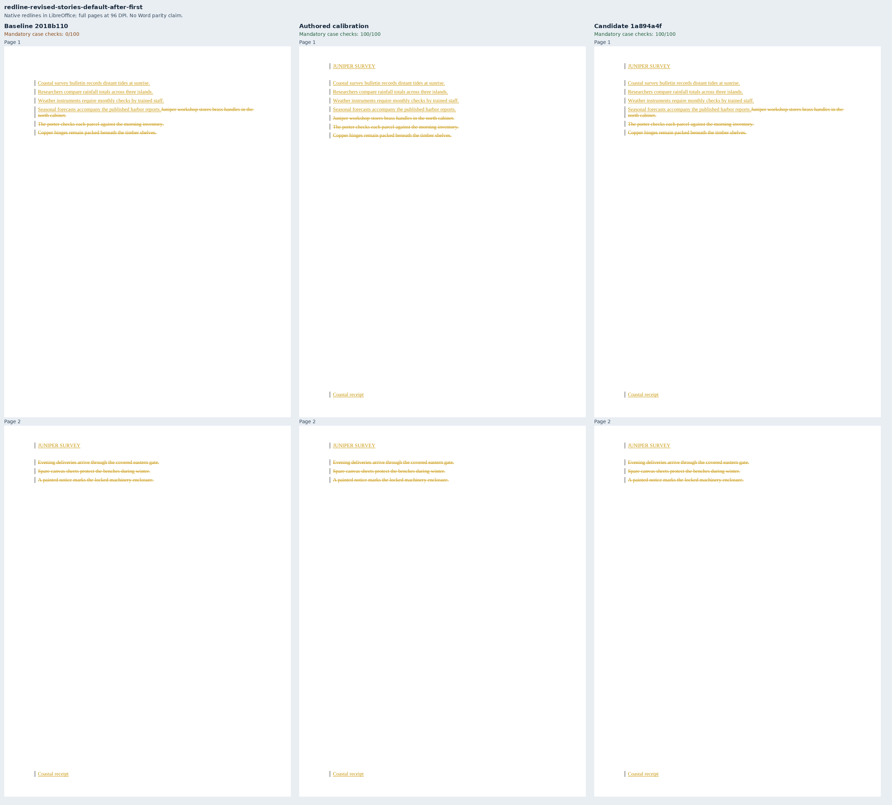
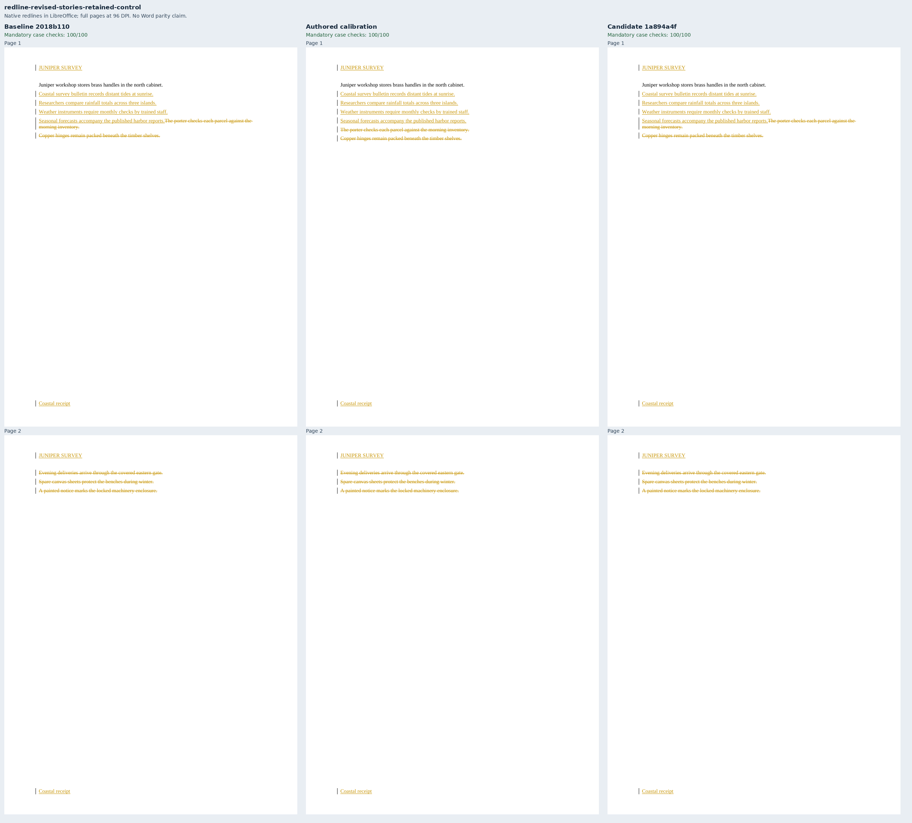

# Revised running stories across deleted section boundaries

These five independently authored Juniper documents merge two sections into one.
Four cases rewrite the body completely; the control retains its opening paragraph.
The source documents use explicit empty running stories so their independently
resolved references remain comparable. The latent First case retains existing story
text and changes its visibility instead.

| Case | Main `2018b110` | Fixed `1a894a4f` | Authored calibration |
| --- | ---: | ---: | ---: |
| Rewritten body, default stories | 0 | 100 | 100 |
| Newly active first-page stories | 0 | 100 | 100 |
| Unchanged latent First stories | 0 | 100 | 100 |
| Default stories after disabling First | 0 | 100 | 100 |
| Retained opening paragraph control | 100 | 100 | 100 |

The first, second and fourth baseline redlines leave the first review section's
header and footer empty. The latent-story baseline displays the stories, but rejecting
its revisions incorrectly leaves the first section's `titlePg` enabled. Its screenshot
therefore looks plausible while the independent rejection check fails.

Metric contract 21 checks first-page flags in the review and both resolved endpoints,
excluding section-property history and textbox stories. Existing assertions require
exact review header/footer text and the paragraph carrying each resolved section
boundary. Mutation tests prove that wrong flags fail even when the semantic text view
is unchanged. All 469 harness contracts pass.

LibreOffice 25.8.7.3 retains a deleted empty boundary paragraph and its section after
Accept All in every authored case. Its rejection of the two First-story cases also
materializes extra running-story references. Those seven endpoint comparisons are
explicitly ineligible based on authored calibration. The other three comparisons,
independent OOXML endpoints, flags, references and SDK validity remain mandatory.
This is a focused five-case measurement, not a full-suite score or a Word parity claim.

Each sheet shows every page of the unchanged native baseline, authored and fixed
redlines rendered by LibreOffice. These are markup previews, not resolved documents.
All fixed and authored previews show the revised body text, header and footer on page
one. Build identities, native package/PDF/raster hashes, validation and full check
results are recorded in [evidence.json](evidence.json). `Compose.py` regenerates these
sheets from the recorded runs without cropping or retouching pages.

