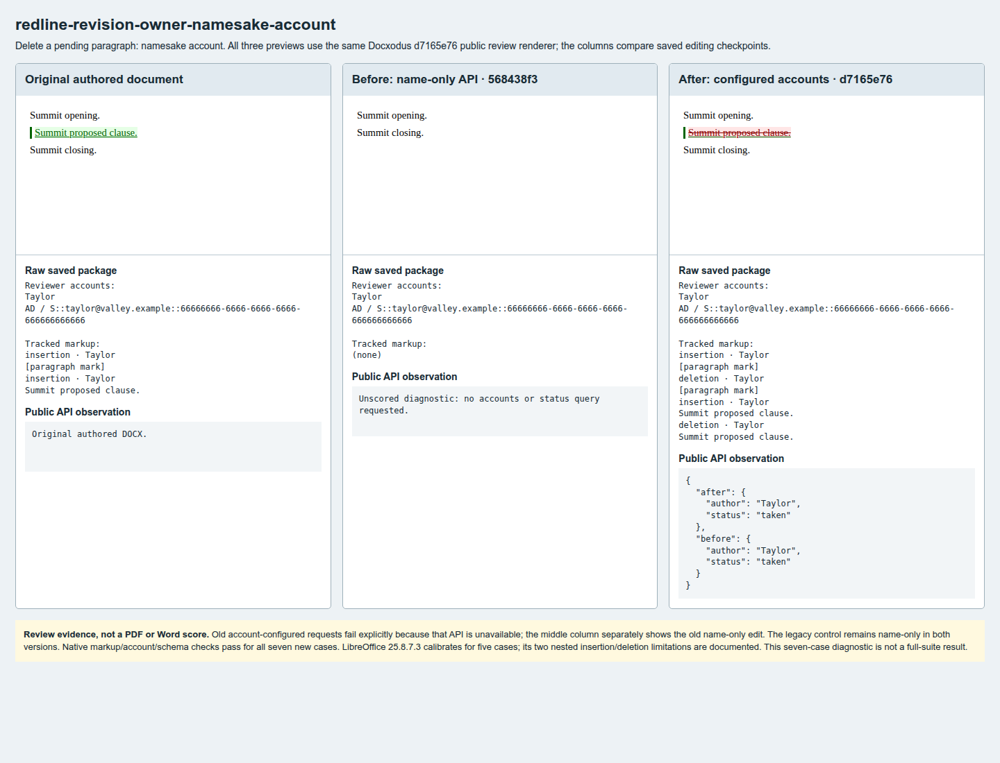
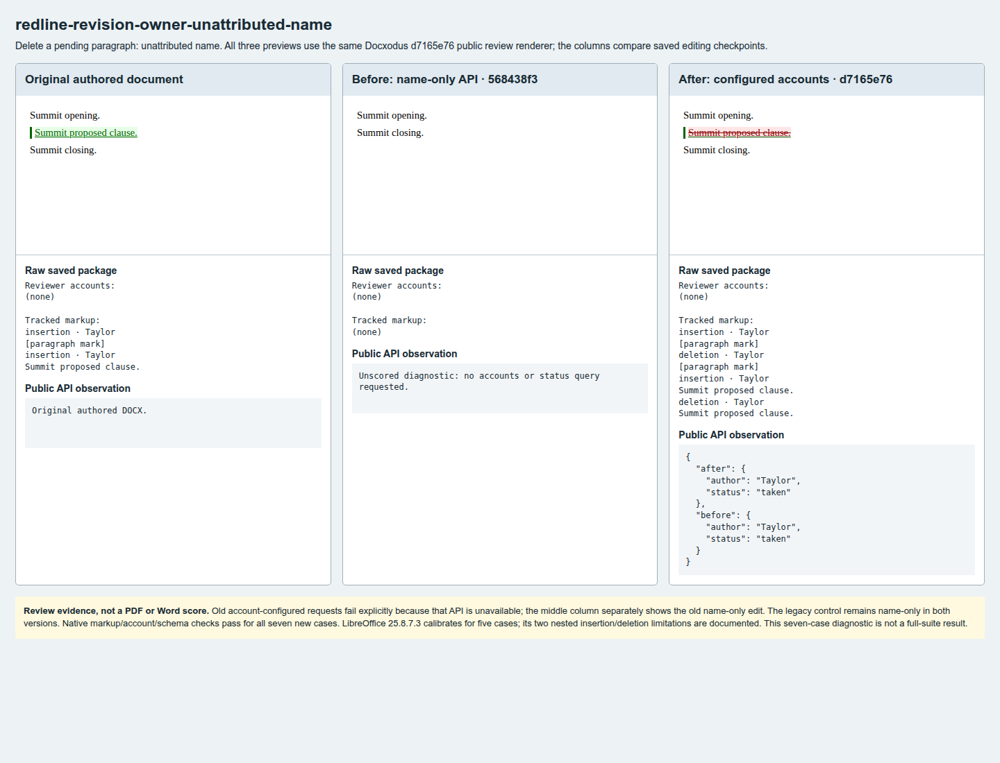
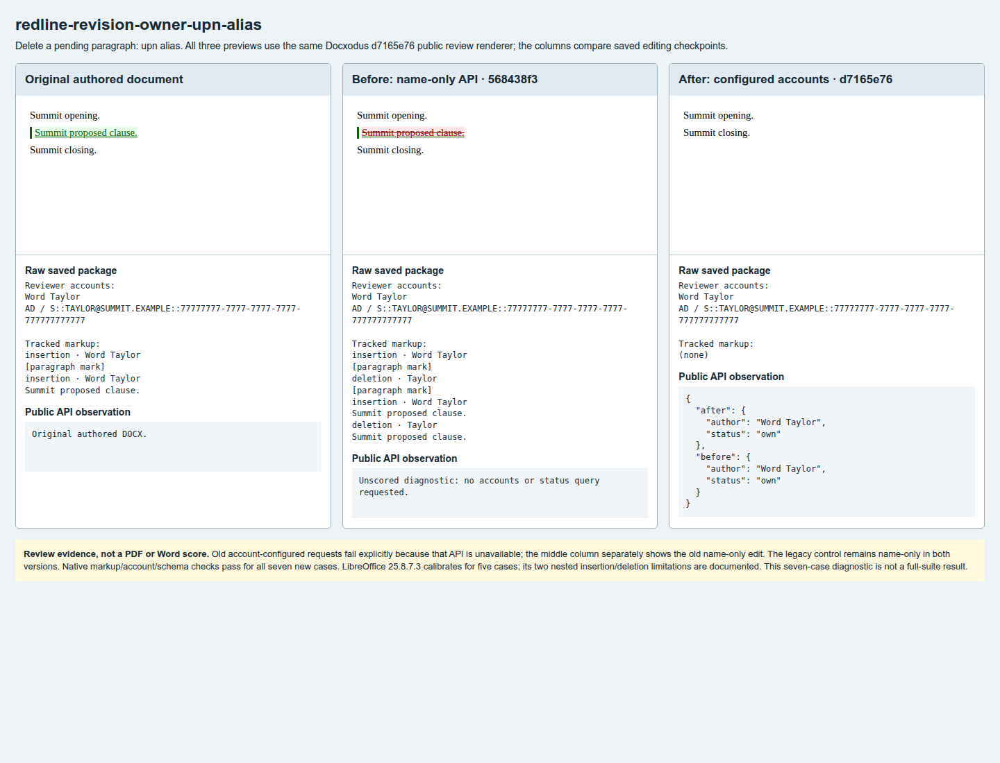
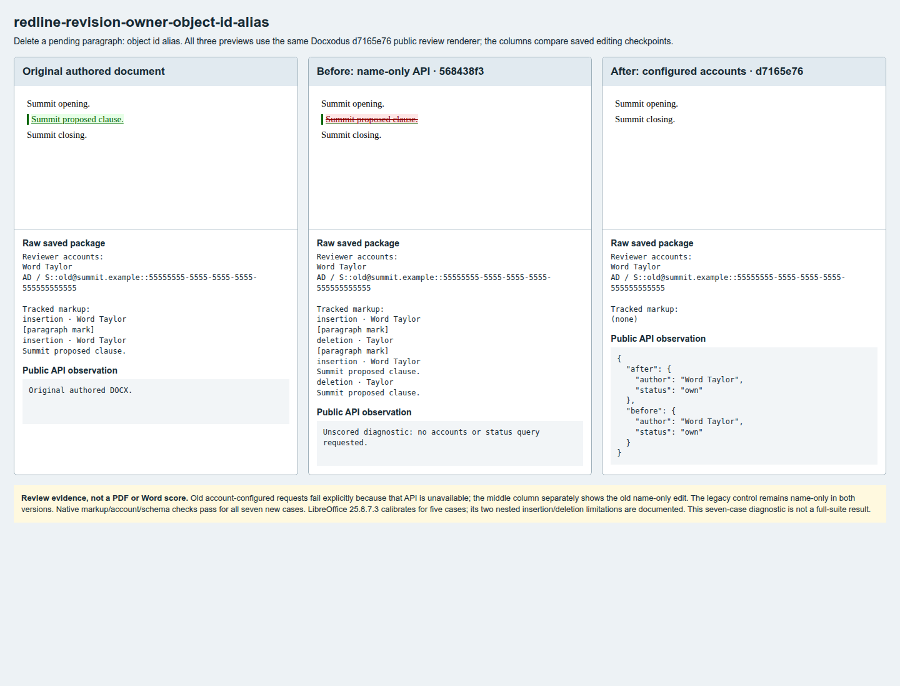
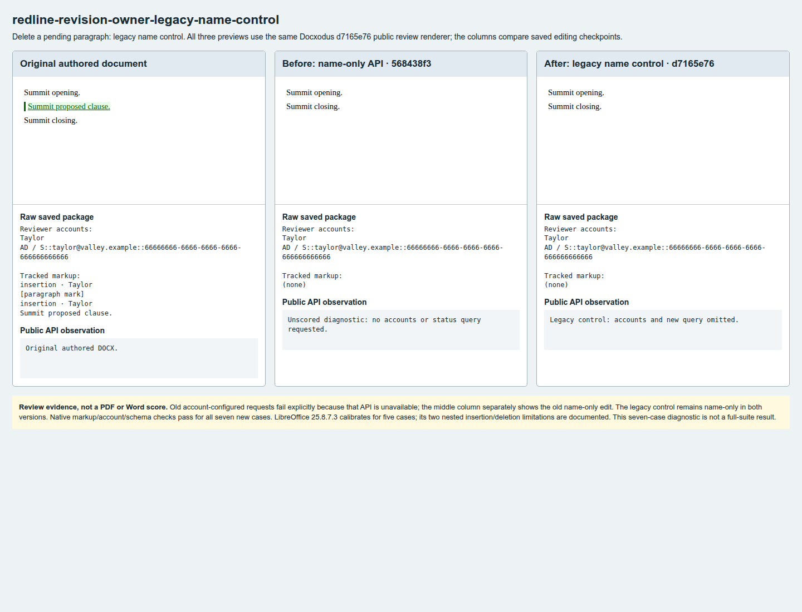
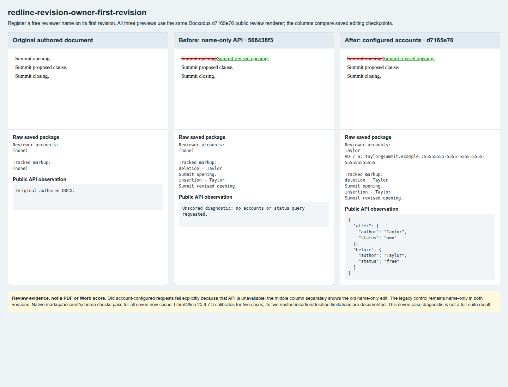
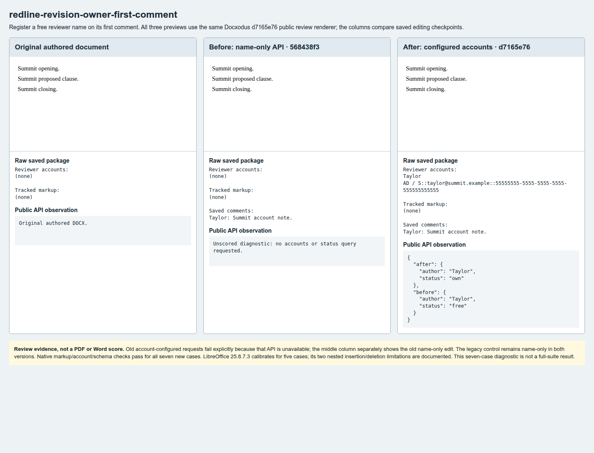

# Reviewer account and namesake evidence

Seven original Summit cases for [Docxodus #1317](https://github.com/JSv4/Docxodus/issues/1317).
Every sheet was visually inspected. Each shows the original authored DOCX, an explicitly
name-only edit by pre-feature source `568438f3`, and the edit from account-capable source
`d7165e76`. All previews use the same fresh `d7165e76` public `RenderHtmlForReview` renderer;
these are document checkpoint comparisons, not different rendering-engine versions.

The old candidate cannot accept the new account setting or name query. Its six corresponding
benchmark requests fail as unsupported operations (measured zero), and its legacy control passes.
The middle panels are separately captured **unscored name-only diagnostics**, with neither
unsupported feature requested or emulated. The legacy control opts out in both versions.

All seven authored calibrations and all seven fixed-candidate cases pass their mandatory
independent revision, raw markup, reviewer metadata, query and schema checks. These are scoped
measurements, not a full-suite result: `redline-v16` has 146 required cases and no full-suite
score is claimed here. All 954 previous tracked DOCX files retain their exact bytes. The 23
new fixture/expectation packages and 14 produced diagnostics have zero SDK findings.

LibreOffice 25.8.7.3 calibrates for the five non-nested cases (ten accept/reject comparisons).
For the two foreign proposals, it mishandles the schema-valid authored `w:ins` containing a
`w:del`: accept joins the still-visible proposal to the closing paragraph; reject keeps the
proposal. The initial observed diffs are retained in [measurements.json](measurements.json),
and these four comparisons are declared ineligible under the existing authored-calibration
policy. The independent markup round trips, exact identities, retained proposal/deletion,
paragraph counts, text controls and schema checks remain mandatory and pass. No Word capture,
PDF score or Word parity claim is made.

[capture.json](capture.json) binds every image to its package hashes, raw metadata, public
name-status observations and exact source identities. [measurements.json](measurements.json)
retains all case checks, including missing-feature failures and calibration limitations.

