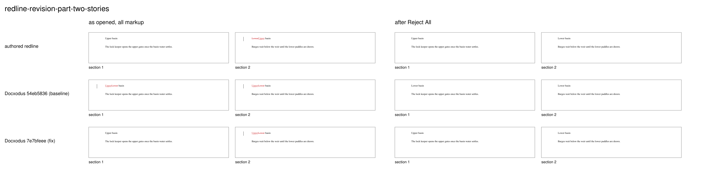
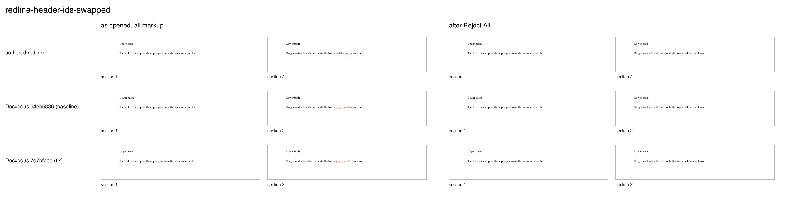
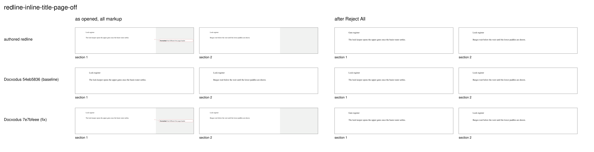
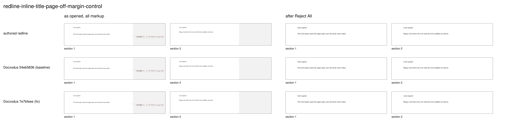

# Revision relationship ids and an inline title page

Docxodus #1771 found two ways a comparison loses the original on a section break that both documents
share. Docxodus writes that break from the revised document, so the break carried the revision's section
properties and its header references.

The references name parts by the revision's relationship ids. The redline is built in the original's
package, so Docxodus looked a revision id up there, or took whichever output the revision's part was last
paired with. When the revision kept the first section's header under a part of its own and let the second
section inherit it, rejecting showed the second section's header in the first; when the two documents only
disagreed about which ids their two headers had, both accept and reject showed the second header twice. (In
the swapped and renamed pairs the revision also changes one word of the body, so each has a change to record.)

The properties were recorded in `w:sectPrChange` only when the paragraph ending the section counted as
changed, which under Docxodus's default policy needs a change of page size, margins, orientation or section
type. A section that only lost its title page (`w:titlePg`) was copied from the revision without a record,
so rejecting left its first page showing the running header.

| Case | Kind | Failed checks, baseline | Reject, baseline | Failed checks, candidate | Reject, candidate |
| --- | --- | --- | --- | --- | --- |
| `redline-revision-part-two-stories` | reproducer | `markup-rejected` | Lower basin, Lower basin | none | Upper basin, Lower basin |
| `redline-header-ids-swapped` | reproducer | `markup-accepted`, `markup-rejected` | Lower basin, Lower basin | none | Upper basin, Lower basin |
| `redline-header-ids-renamed-control` | control | none | Upper basin, Lower basin | none | Upper basin, Lower basin |
| `redline-inline-title-page-off` | reproducer | `assertion-section-flags` | Lock register, Lock register | none | Gate register (title page), Lock register |
| `redline-inline-title-page-off-margin-control` | control | none | Gate register (title page), Lock register | none | Gate register (title page), Lock register |

Baseline is Docxodus main `54eb5836`; candidate is the fix commit `7e7bfeee`
([JSv4/Docxodus#1774](https://github.com/JSv4/Docxodus/pull/1774)). The reject columns are a desktop word
processor's (build 16.0.20326) Reject All on every story range, reading the header on each section's first
page: its first-page header, marked (title page), where the section has a title page, else its primary header. Every redline,
the authored ones included, opens there, and no revision remains after Reject All or Accept All.

After Accept All the authored redlines and the candidate show the revision's headers and title pages in
every case. The baseline does too, except in `redline-header-ids-swapped`, where it shows `Lower basin` in both
sections as opened, after Accept All and after Reject All alike. The authored redlines pass every check and give
the same results as the candidate.

That application's own compare of each header pair gives the same review and endpoints as the authored
redline: in `redline-revision-part-two-stories` it leaves `Upper basin` unchanged in the first section and marks
the second section's header changed, and in the swapped and renamed pairs it marks nothing. It does not track a
title page. In both title-page pairs its review, Reject All and Accept All all keep the original's title page on
the first section, so its accepted document is not the revision (in the control the margin change is its only
revision). A redline that, like the authored one and the candidate, records the title page in `w:sectPrChange`
reproduces both documents.

"Failed checks" are the bench's own markup comparisons, SDK validation and assertions, run on this machine.
LibreOffice was not available on the capture machine; CI runs it. `evidence.json` holds the per-check and
reference results, including each document as opened and after Accept All, and the reference application's
own compare of each pair.

Each image shows the top of every page (header and first line) of each redline's PDF export as opened, with
all markup, and after Reject All. Rows are the authored redline, the baseline and the candidate; each section
is one page. Liberation Serif is substituted because the capture machine does not have it.

### redline-revision-part-two-stories

### redline-header-ids-swapped

### redline-header-ids-renamed-control

### redline-inline-title-page-off

### redline-inline-title-page-off-margin-control

