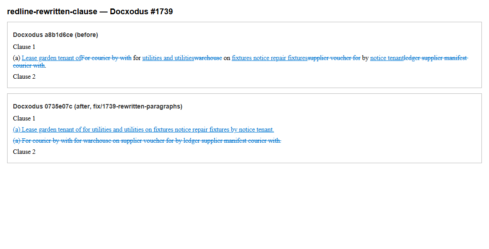
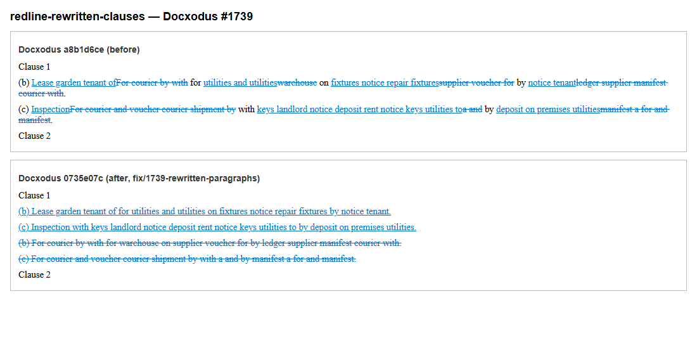
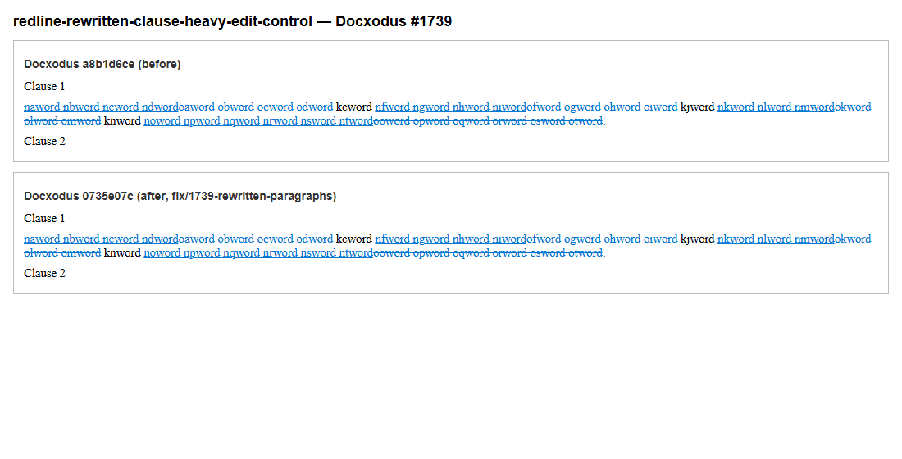
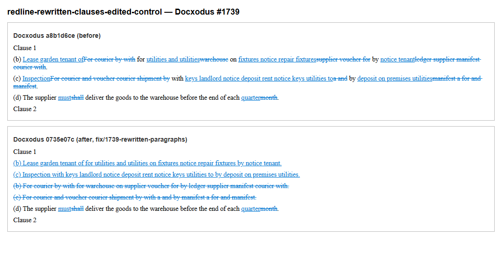

# Rewritten clauses (Docxodus #1739)

Two reproducers and two controls. In each reproducer a clause is rewritten in an unrelated vocabulary but
keeps its `(a)`/`(b)`/`(c)` label and a few articles and prepositions in other places. Docxodus
`a8b1d6ce` pairs the old clause with the new one and diffs them word by word: both round trips pass, but
short insertions and deletions alternate around the shared words and `revision-blocks` fails. Docxodus
`0735e07c` (branch `fix/1739-rewritten-paragraphs`) deletes and inserts each clause whole and passes. Both
builds keep the controls' three surviving words and edited clause outside every revision.

| Case | Kind | `a8b1d6ce` | `0735e07c` | authored |
|---|---|---|---|---|
| `redline-rewritten-clause` | reproducer | round trips pass, `revision-blocks` fails | pass | pass |
| `redline-rewritten-clauses` | reproducer | round trips pass, `revision-blocks` fails | pass | pass |
| `redline-rewritten-clause-heavy-edit-control` | control | pass | pass | pass |
| `redline-rewritten-clauses-edited-control` | control | pass | pass | pass |

These results come from the benchmark's own accept/reject engine and assertion code applied to each
redline, not from a complete scored run: the SDK validator and LibreOffice comparisons were not run, so
they are not a suite score. `evidence.json` records the commits and every check.

Each review sheet shows the `a8b1d6ce` redline above the `0735e07c` redline, both rendered by Docxodus
`docx2html --track-changes --word-markup` from the `0735e07c` build and captured with headless Edge.

### redline-rewritten-clause

### redline-rewritten-clauses

### redline-rewritten-clause-heavy-edit-control

### redline-rewritten-clauses-edited-control

