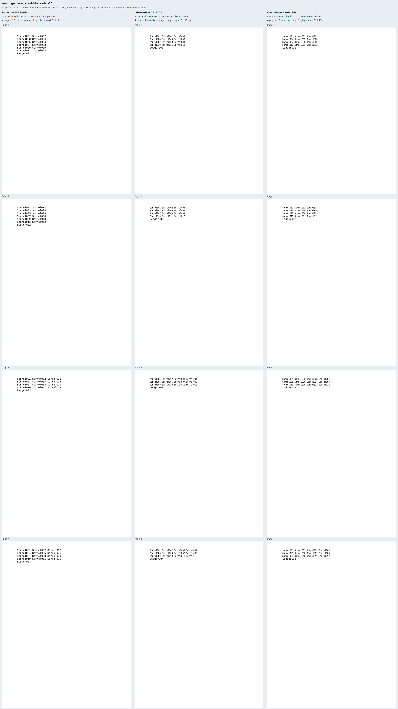
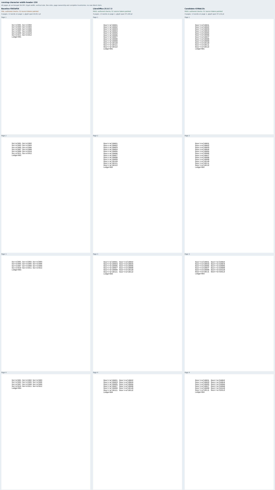
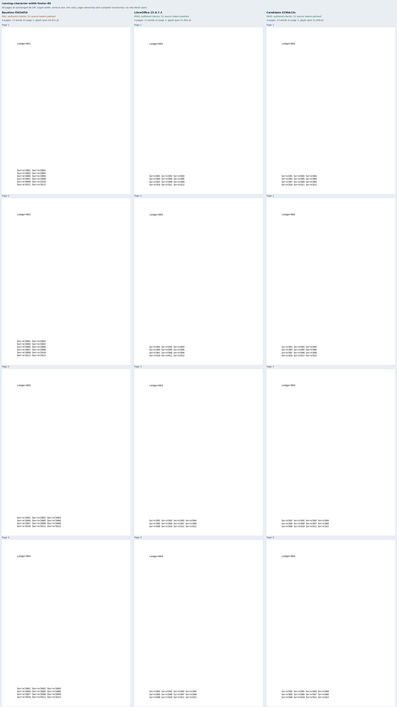
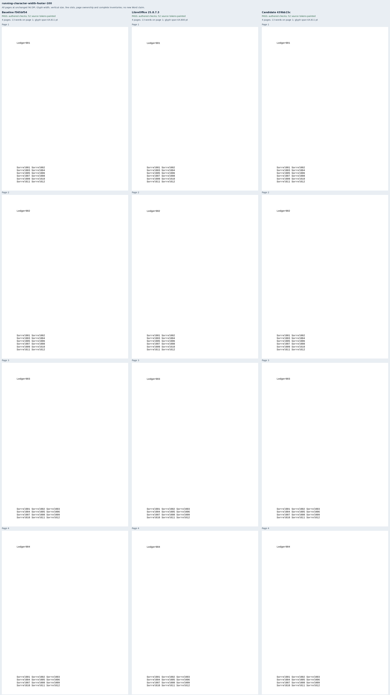
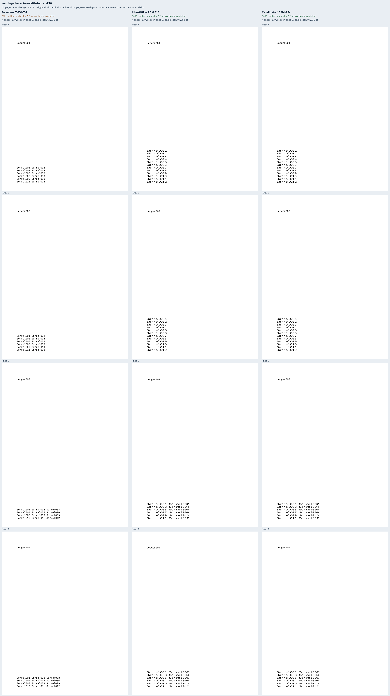

# Character width in running headers and footers

Six original Sorrel documents repeat the existing twelve-word character-width
paragraph in a header or footer, at 80%, 100% or 150%. Each document has four
pages across two sections. The second section inherits the story and changes its
right margin, widening the paragraph from 180pt to 252pt. Contract tests verify
that the story paragraph and font defaults match the original body control, and
that percentage is the only difference within each story set. These cases cover
part of [Docxodus #1564](https://github.com/JSv4/Docxodus/issues/1564).

Assertions are fixed before renderer capture. Liberation Mono supplies
`1229 / 2048 × 12` points per character and `2320 / 2048 × 12` points per natural
line. Every word has a source-derived line slot and glyph width/height. Every
page must repeat the complete story exactly once and contain its own body label.
Header text begins at 36pt; footer text ends at 756pt. The body starts at 72pt or
the header's lower edge, whichever is lower on the page. Positions allow 0.5pt
raster-origin rounding; glyph dimensions allow 0.1pt. All six native controls
satisfy these bounds. PDF extraction may list a two-column arrangement of words
in column order, so physical reading order comes from page, Y and X coordinates;
each individual word's authored slot is independently required.

Adversarial review added the body-band reservation assertion and deliberate body
overlap/displacement mutations. Correct header widths alone cannot prove that
pagination reserves their full height. The renderer's own review also identified
an unintended expansion into unscaled text; the measured-story pass is restricted
to scaled automatic paragraphs, with negative unscaled/exact controls.

The unchanged renderer at `f565bf54a23675d2d96686e581aabc23df9974e0` is tree-identical
to merged main `c11646aec2aacd89cb2d5fcfa4166d0337306857`. The baseline passes both 100% controls and fails all four scaled cases. Candidate
`439bb15c077e93331ac20cc890cb15e33cdc6f34` passes all six, with both 100% controls
unchanged within 0.02pt. [Retained evidence](evidence.json) binds all 18 PDFs,
72 pages, 936 painted words, twelve strict-font reports, six comparison sheets,
19 build files and 45 runtime assets per renderer. All [96 corrupted
observations](mutations.json) are rejected. The source and verifier freeze remains
unchanged through capture. All six benchmark packages have zero SDK findings;
the previous 994 inputs and contracts remain unchanged apart from generator
provenance. All 508 Python tests and four adapter tests pass. Independent review
re-inspected every PDF, verified all 72 page raster hashes and screenshot regions,
and viewed all six sheets. The frozen run is `runs/running-width-v1`.

Native references use LibreOffice 25.8.7.3. Public captures use sandboxed system
Chromium with strict font verification. This is diagnostic evidence, without a
pinned-runtime score or a new Word capture. Footnote/endnote continuations, mixed
runs, AutoFit/percentage table owners, `fitText`, exact-spacing scaling and the
unresolved Word exact-fit boundary remain outside this change.

## Reproduction

Generate `core-v134`, select `running-character-width-*`, validate packages, and
retain the source/verifier freeze before capture.

```sh
node docs/results/export-reliability/Capture.mjs SOURCE RUN/manifest.json RUN/candidate RUN/environment.json --html
python3 docs/results/running-character-width/Compose.py RUN BASELINE_SOURCE CANDIDATE_SOURCE
python3 docs/results/running-character-width/Mutations.py
python3 -m unittest discover -s tests -v
node --test tests/test-adapter.mjs
python3 -m bench.audit
```











