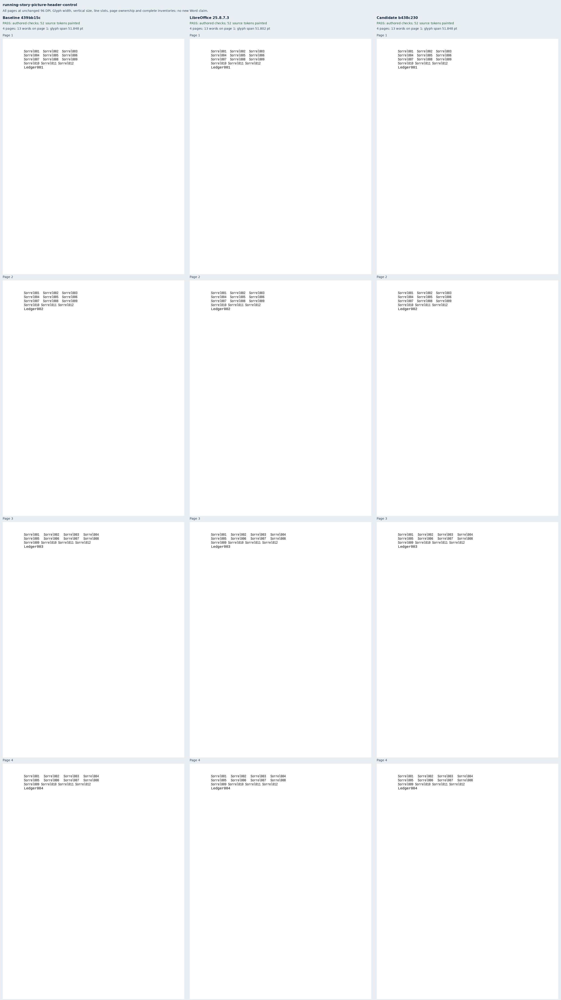
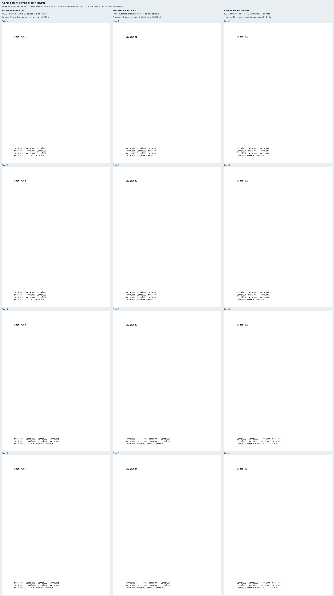
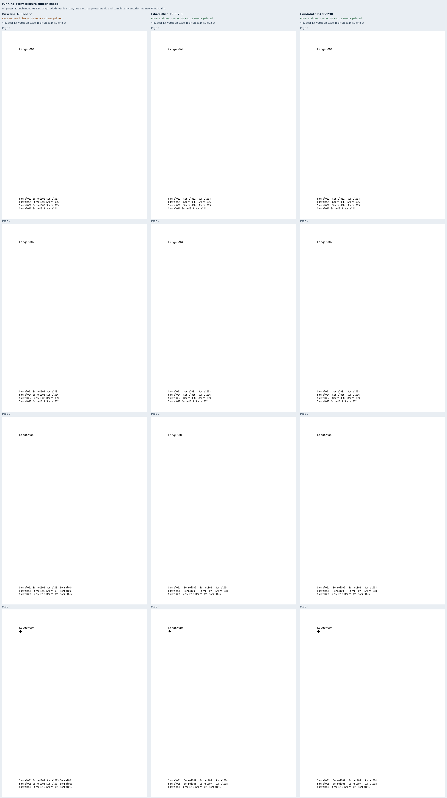

# Pictures in the body must preserve running-story justification

Four original Sorrel documents pair each 80% justified header/footer with an
otherwise identical document containing one independent body picture. Each has
four pages and inherited sections whose story paragraphs widen from 180pt to
252pt. The picture is the benchmark's original diamond, with explicit zero
inline distances. The picture-free controls and every other source property are
preserved by contract tests. These cases cover part of
[Docxodus #1564](https://github.com/JSv4/Docxodus/issues/1564).

The acceptance contract is fixed before export: complete inventories, physical
reading order, every justified word's source-derived line slot, natural final
lines, percentage glyph widths, unchanged font heights and body reservation.
Position bounds remain 0.5pt and glyph dimensions 0.1pt. A separate raster check
requires the body picture to remain painted in both native and exported PDFs.
Source packages have zero SDK findings. All 1,000 previous inputs and contracts
remain unchanged apart from generator provenance.

Baseline `439bb15c077e93331ac20cc890cb15e33cdc6f34` passes the two picture-free
controls and fails both documents containing a body picture. Candidate
`b438c230080c68a5004389f7c3d11704bd2778e0` and LibreOffice 25.8.7.3 pass all four.
[Evidence](evidence.json) retains twelve PDFs, 48 pages, 624 painted words, eight
strict-font export reports and four comparison sheets. Both controls preserve
geometry within 0.02pt. All [68 corrupted observations](mutations.json), including
removed justification, are rejected. The immutable run is `runs/running-picture-v2`.

The initial fixture omitted the optional inline-picture distances. LibreOffice
then used a different left clearance, failing the supplementary image-presence
crop. Explicit zero distances remove that ambiguity; the original run remains
in `runs/running-picture-v1`. The second run passed all native checks before its
source/verifier freeze, without relaxing the acceptance bounds.

The [six earlier running-width cases](../running-character-width/README.md) were
also replayed on this candidate. [Replay evidence](legacy-replay.json) binds all
six new PDFs and strict reports, confirms every source contract, and verifies
that all 24 page rasters are byte-identical to the previously reviewed candidate.
The earlier evidence remains unchanged.

Public exports use sandboxed system Chromium and strict font verification. These
are diagnostic captures, without a pinned-runtime score or a new Word claim.
The associated renderer change isolates picture decisions in actual header and
footer bands. Existing body, cell and promoted-drawing handling remains covered
by its prior tests. Own-story picture controls also reject a deliberately broken
implementation that discards all running-story pictures.

## Reproduction

```sh
python3 -m bench.fixtures
node docs/results/export-reliability/Capture.mjs SOURCE RUN/manifest.json RUN/candidate RUN/environment.json --html
python3 docs/results/running-story-picture/Compose.py RUN BASELINE_SOURCE CANDIDATE_SOURCE
python3 docs/results/running-story-picture/Mutations.py
python3 docs/results/running-story-picture/Legacy.py LEGACY_CAPTURE CANDIDATE_SOURCE
python3 -m unittest discover -s tests -v
node --test tests/test-adapter.mjs
python3 -m bench.audit
```







