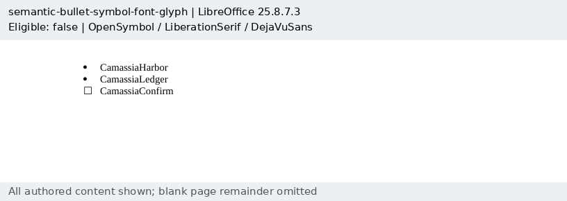
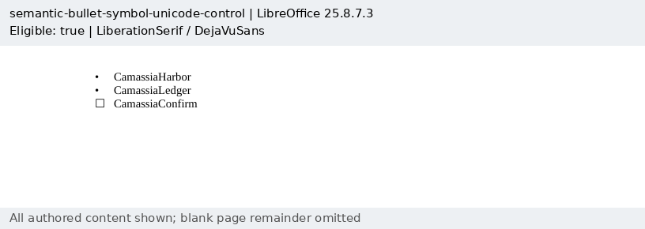
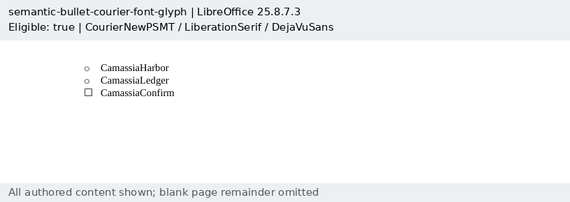
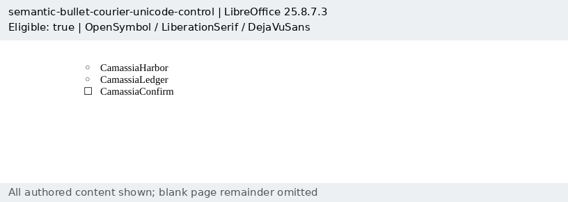

# Familiar semantic bullets

Four original Camassia documents retain the inputs for
[Docxodus #1623](https://github.com/JSv4/Docxodus/issues/1623). Symbol's private-use
bullet and Courier New's `o` each have a Unicode disc/circle control. Within a pair,
only the first abstract numbering definition's glyph and font differ. Each input
also has a separate checkbox list in DejaVu Sans, which covers the checkbox glyph.
No control is used as a reference for its paired input.

Three native captures are eligible. The Symbol capture remains **ineligible**:
LibreOffice uses OpenSymbol instead of the declared physical Standard Symbols PS
font policy, and its PDF text preserves U+F0B7 rather than U+2022. Both glyph tokens
and every checkbox/body token are mandatory; assertions are not loosened to admit
that capture. The [exact manifest](capture-manifest.json) and [bundle](reference-bundle.json)
retain source/PDF hashes, inspections, environment and eligibility. All four inputs
have [zero schema findings](schema-validation.json), and all 1,058 prior input hashes
are unchanged.

These PDF cases protect source content, native marker handling and text positions.
**They do not score the new flow-HTML normalization option.** Paginated export
ignores semantic lists. Product tests through .NET, Python and browser/worker APIs
check the opt-in CSS markers, marker-free item text, checkbox/custom content, hidden
markers and mixed fonts. No Word parity or visual equivalence of normalization is
claimed; the option explicitly permits marker formatting and line-height changes.
Word capture and eligible Symbol scoring remain pending.

