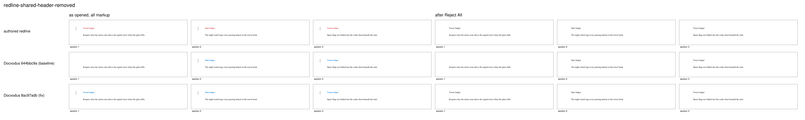
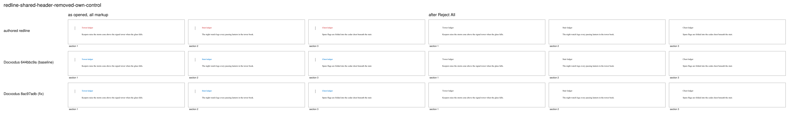

# A removed header that two sections share

Docxodus #1763 compared an original with three sections, whose first and third sections reference
the same header part, against a revision that keeps the body and section breaks but references no
header at all. Docxodus writes an unchanged section break with the revision's section properties,
and it bound the shared part only where it reappeared in the third section, so the first section of
its redline had no header reference. Rejecting the redline then left that section without its
header.

| Case | Kind | Failed checks, baseline | Reject, baseline | Failed checks, candidate | Reject, candidate |
| --- | --- | --- | --- | --- | --- |
| `redline-shared-header-removed` | reproducer | `markup-accepted`, `markup-rejected`, `assertion-section-stories` | (none), Stair ledger, Tower ledger | none | Tower ledger, Stair ledger, Tower ledger |
| `redline-shared-header-removed-own-control` | control | none | Tower ledger, Stair ledger, Chest ledger | none | Tower ledger, Stair ledger, Chest ledger |

Baseline is Docxodus main `644bbc9a`; candidate is the fix branch `8ac97adb`
([JSv4/Docxodus#1769](https://github.com/JSv4/Docxodus/pull/1769)). The reject columns are a desktop
word processor's (build 16.0.20326) Reject All on every story range, reading each section's header.
Every redline, the authored ones included, opens there; no revision remains after Reject All or
Accept All, and Accept All leaves every header story empty. The authored redlines pass every check
and give the same results as the candidate.

That application's own compare of each pair keeps a header reference in every section, gives every
section a part of its own and marks each header's text deleted. The authored redlines do the same.
The candidate keeps the shared part in the first and third sections, which reads the same after
either Reject All or Accept All.

"Failed checks" are the bench's own markup comparisons and assertions, run on this machine. The
baseline's accepted view also fails because its first section has no header story at all, where the
accepted expectation keeps an empty one. LibreOffice and the SDK validator were not available on
the capture machine; CI runs both. `evidence.json` holds the per-check and reference results.

Each image shows the top of every page (header and first line) of each redline's PDF export as
opened, with all markup, and after Reject All. Rows are the authored redline, the baseline and the
candidate. Liberation Serif is substituted because the capture machine does not have it.

### redline-shared-header-removed

### redline-shared-header-removed-own-control

