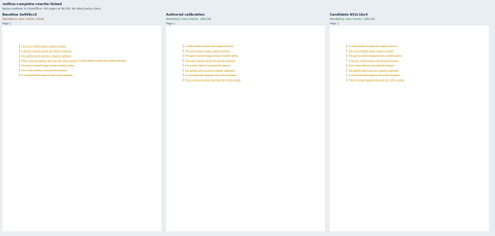
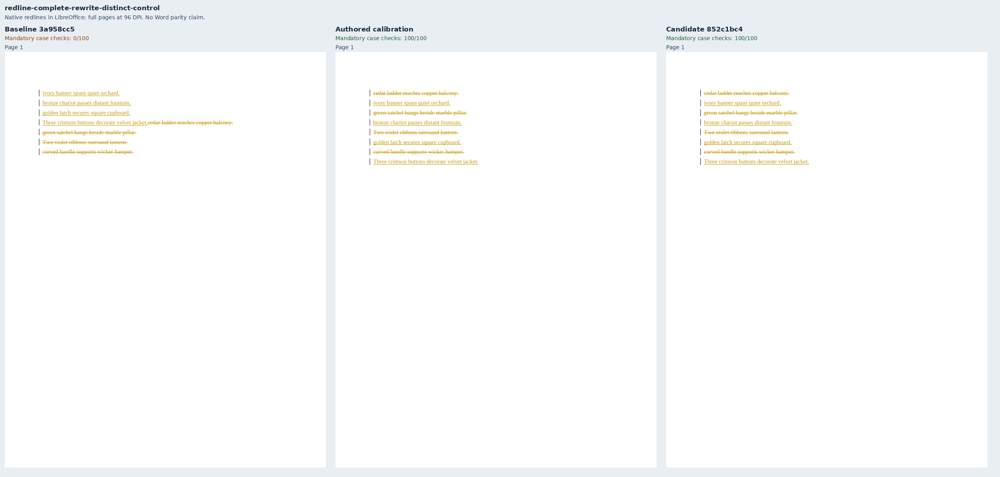
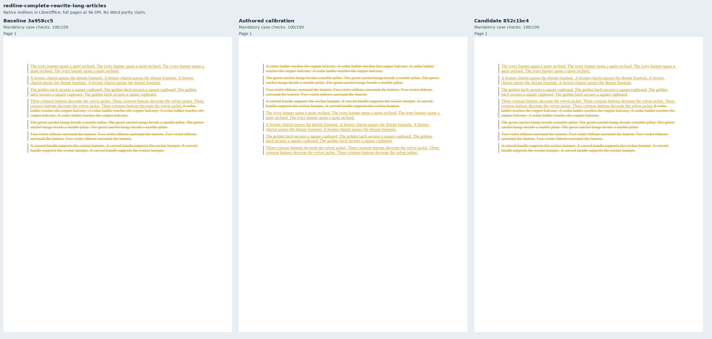
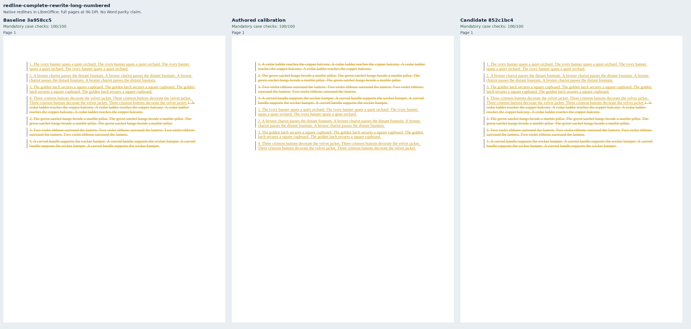
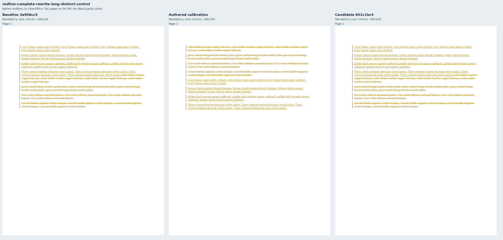
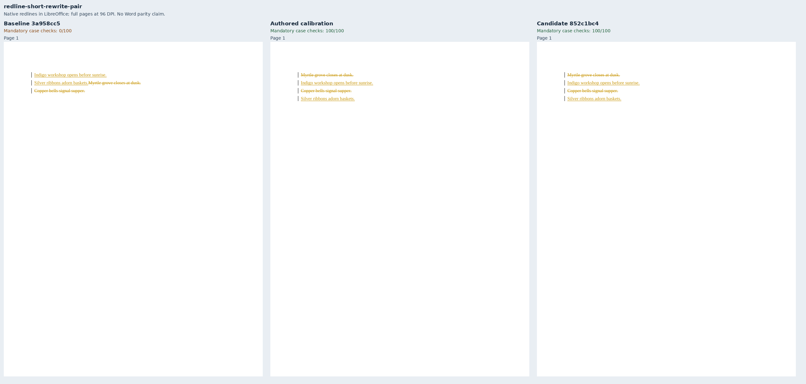
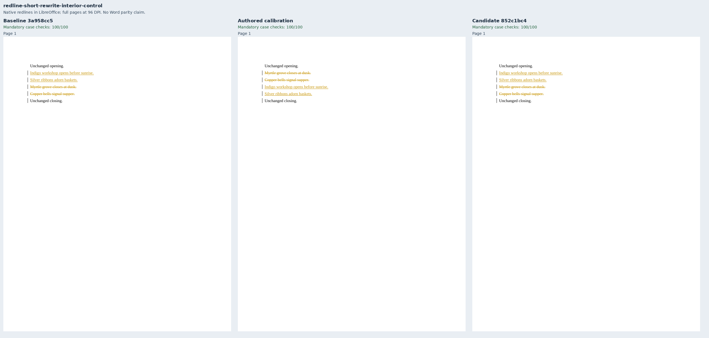
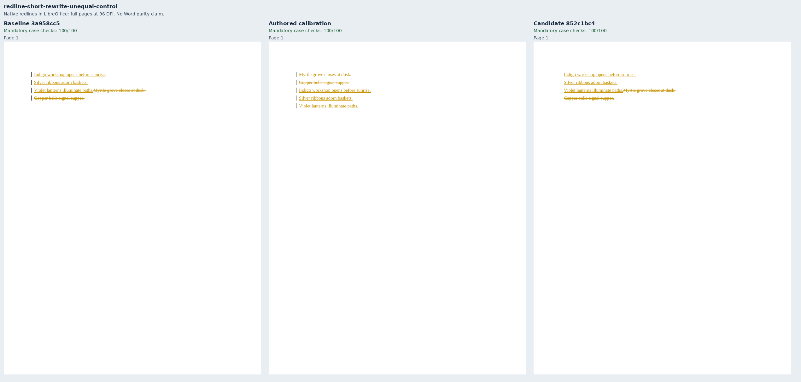
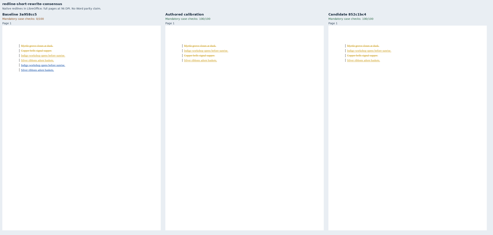

# Positional short paragraph rewrites

The requested #1556 review policy keeps each complete old sentence beside its positional
replacement. This intentionally supersedes the arrangement expectation for the four short
#1535 cases; their source and resolved endpoint bytes remain unchanged. Historical #1535
screenshots and measurements are preserved in [complete rewrites](../complete-rewrites/README.md).
Long-rewrite controls retain the coherent-block policy.

Twelve focused cases improve from **6/12** on baseline `3a958cc5` to **12/12** on candidate
`852c1bc4`; authored calibration also passes all twelve. All 24 LibreOffice endpoint
comparisons apply in each run. Independent exact markup endpoints, SDK validation,
whole-sentence pairing and selective consensus attribution remain mandatory. These are
focused diagnostics, not a complete 258-case suite score or a Word Compare parity claim.

Four existing Cedar inputs cover articles, literal ordinals, linked words and distinct prose.
Four new long counterparts require coherent side blocks. Independent Myrtle prose covers a
short two-paragraph rewrite, interior and unequal-count controls, and identical-reviewer
consensus credited once to the first reviewer. The second reviewer's selective view remains
the base, as declared by the default consensus policy.

Metric contract 22 adds `positional-rewrites` v1. Mutation tests preserve exact accepted and
rejected views while constructing whole-side blocks, wrong partners and alternating linked
words; all fail the arrangement assertion. A coherent old/new pair in a shared paragraph
passes. `revision-blocks` v1 is unchanged.

Each sheet contains every native review page, rendered by LibreOffice at 96 DPI, with
baseline, authored and candidate labels. `Compose.py` verifies every PDF's complete token
inventory against its unchanged redline and records source, PDF and raster hashes. The
source-bound adapter records, environment, case checks and SDK findings are in `evidence.json`.
The public WASM entry point is validated separately in the core PR.

### complete-rewrite-articles

### complete-rewrite-numbered

### complete-rewrite-linked

### complete-rewrite-distinct-control

### complete-rewrite-long-articles

### complete-rewrite-long-numbered

### complete-rewrite-long-linked

### complete-rewrite-long-distinct-control

### short-rewrite-pair

### short-rewrite-interior-control

### short-rewrite-unequal-control

### short-rewrite-consensus

