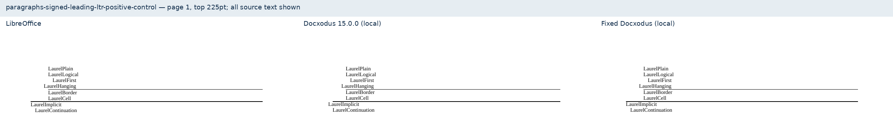
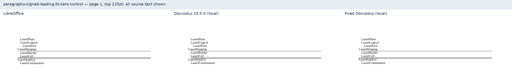
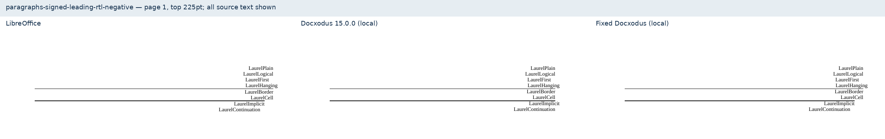
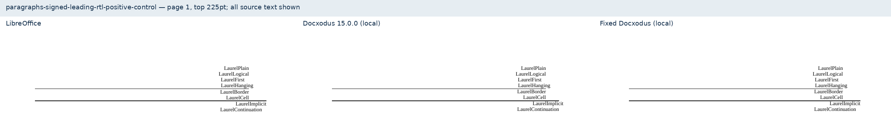
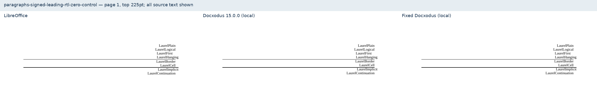

# Signed leading paragraph indents

Six original Laurel fixtures cover left-to-right and right-to-left paragraphs with −540, zero, and +540 twip leading indents. Each tests physical and logical attributes, first-line and hanging offsets, border wrappers, a table cell, and a hanging-only paragraph with first and continuation lines.

All 695 prior inputs are byte-identical; the PDF suite advances to core-v97 (701 cases). The new cases use the existing exact text inventory and 0.5pt reference-position checks. No tolerance, metric, normalization, historical reference or CI-suite change is made.

[Local evidence](evidence.json) binds the final inputs, PDFs, converter source and fresh runtime asset manifest. The existing 15.0.0 build fails six positions in each negative case and passes all four controls. The fixed build passes every declared check on all six cases. The implicit-leading hanging first/continuation control passes in both versions. All inputs have [zero SDK 3.5.1 findings](schema.json).

These are unscored local diagnostics against LibreOffice, not a calibrated full-suite result. Word Online was unavailable; no Word capture is claimed. The screenshots show the top225pt of each one-page output, containing all source text, at the same scale. The left panel is LibreOffice, the middle the existing 15.0.0 build, and the right the fresh fixed build.

