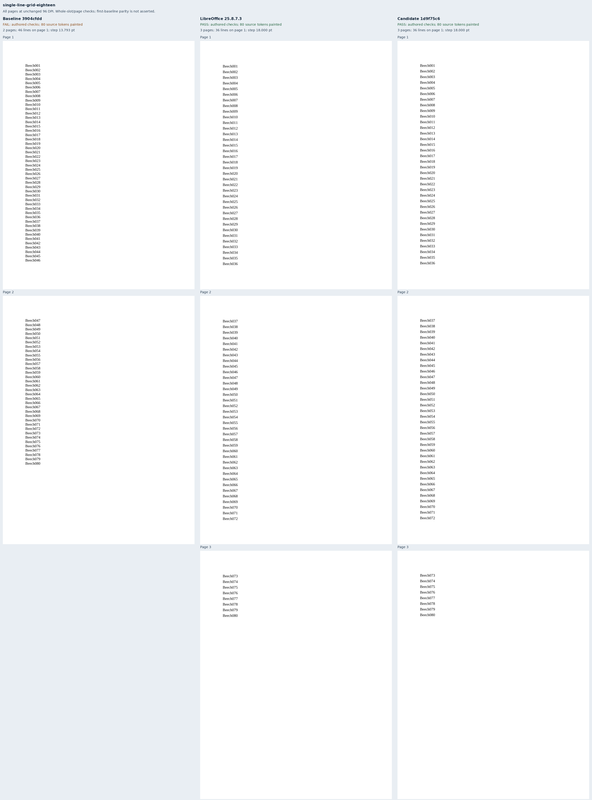
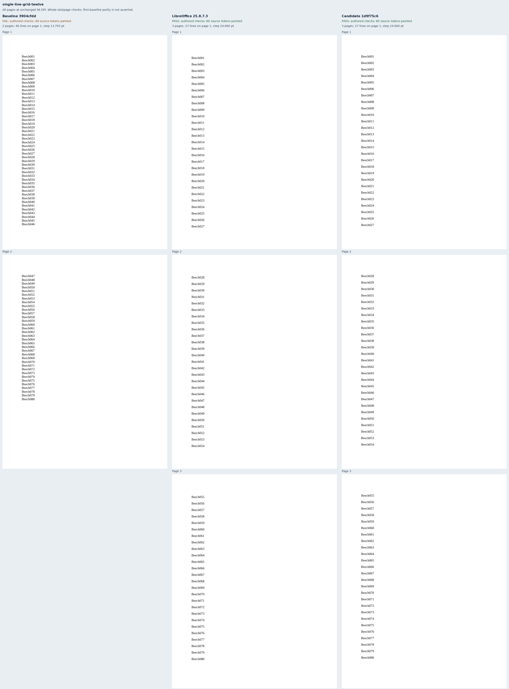
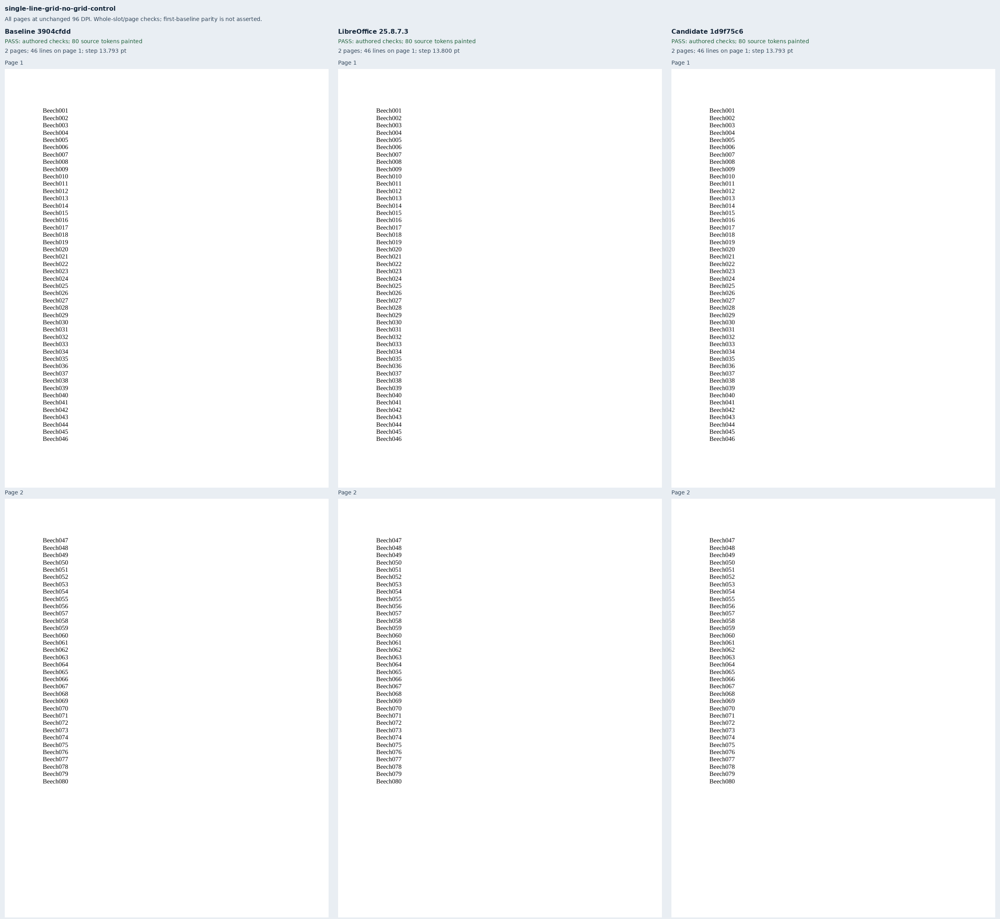
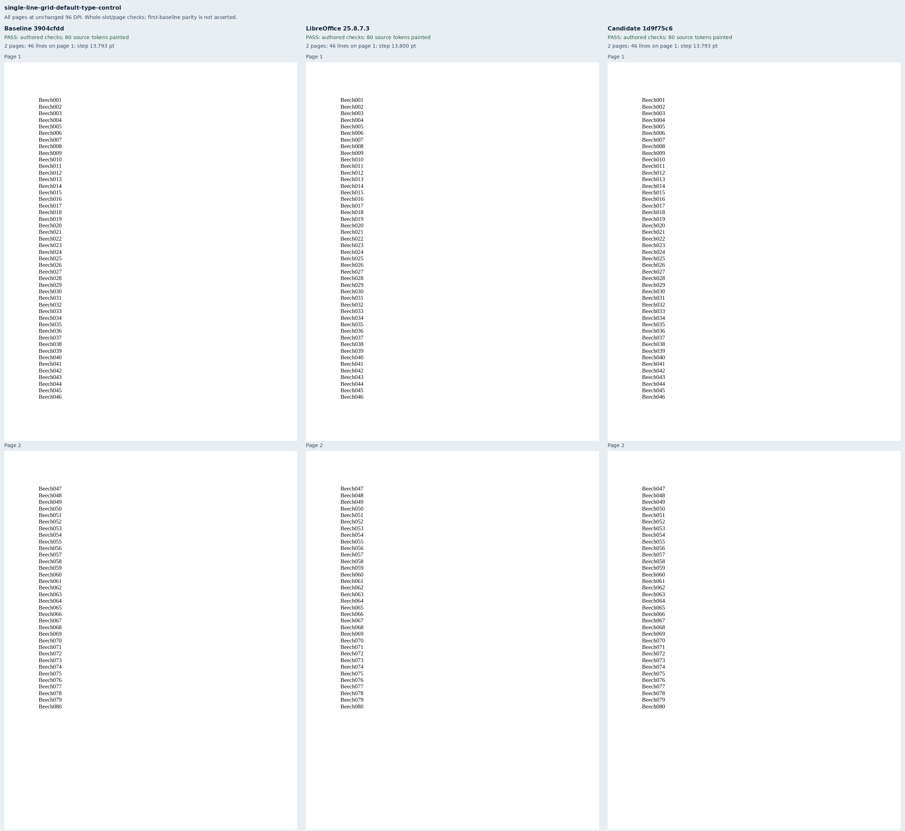

# Single-spaced section grids

Eight original Beech cases isolate single-spaced, uniform 12 pt Liberation Serif body text
on Letter paper with one-inch margins and explicit zero paragraph spacing. The cases cover
18 pt and 12 pt line grids, direct and inherited snap-off, direct snap-on over inherited off,
no grid, the default grid type, and an unrelated table following the text.

The [issue author's Word print](https://github.com/JSv4/Docxodus/issues/1551#issuecomment-6701327908)
confirms 18 pt line steps and 36 lines per page for the 18 pt grid, and 24 pt steps and 27 lines
for the 12 pt grid. These independently authored fixtures use 80 labels, so both grid cases
span three pages; the four disabled controls span two. All eight LibreOffice references meet
the authored checks. The fixtures test whole line slots and page ownership, not first-baseline
placement. The renderer preserves its existing natural baseline policy.

Exact token inventories and companion checks verify all 641 source tokens per renderer,
including the unrelated table label, paper geometry, bounds, and visible paint. Marker regions
cover all 80 labels, including every line slot and page boundary. Three mutations
per case move the third label up or down a whole slot or move the tenth label onto page
two; all must fail. There are no adapter or scoring changes.

Before candidate capture, native reference calibration exposed a sub-twip control discrepancy:
LibreOffice rounds the natural step to 13.8 pt, while the font metric gives 13.798828125 pt.
The final four disabled controls allow 0.1 pt around their authored boxes (the observed maximum
boundary overrun was 0.046 pt). Grid cases retain their original 0.0001 pt tolerance and all page
assignments. The initial calibration manifest and reference bundle are retained as compressed JSON beside this report; the final
manifest was frozen before candidate rendering.

Multiple spacing, exact lines, mixed or raised runs, cells and other stories, revisions, and
paragraph line-based before/after spacing are outside this production change. No new Word
capture, pinned-runtime qualification, or whole-suite score is claimed. System-Chromium exports
use the public API, strict verified fonts, and the Chromium sandbox.

The final evidence binds eight schema-valid inputs, 24 retained PDFs, 1,923 painted tokens over
56 pages, production reports, and both sets of 19 build files and 45 runtime assets. All eight
review sheets include every page at unchanged 96 DPI. Baseline authored checks pass 4/8;
candidate checks pass 8/8. The exact candidate is `1d9f75c605dce3283caf843499fc126b1629af8d`,
compared with baseline `3904cfdd360c4193c1aabb37d1752bb4f41c979d`.

## At-least lines and tracked changes (`core-v158`)

Four original Tamarack cases, single-spaced 12 pt Liberation Serif with zero paragraph spacing:

- `grid-at-least-below-pitch`: 40 lines of `w:lineRule="atLeast"` 15 pt on an 18 pt `lines` grid.
- `grid-tracked-lines-before`: 20 lines with `w:beforeLines="100"` on the same grid, the last a
  tracked insertion, rendered with the markup review profile.

Each control drops only the grid. Word 2024 printed these inputs, with the font renamed to Times
New Roman: the at-least lines step 18 pt (36 on page 1, two pages; the control steps 15 pt), and
the tracked lines step 36 pt, 18 pt before and an 18 pt line (18 on page 1, the control 25.8 pt),
with no space before at the top of page 2. The regions are each label's line slot and page; Word's
word boxes lie inside them, within 0.3 pt for the controls' natural lines. On equivalent 120-line
inputs Docxodus `main` printed 15 pt and 25.8 pt steps on the grid. A build of JSv4/Docxodus#1681
meets every region of these inputs. LibreOffice references,
scores and screenshots are pending.

## At-least lines above the pitch and revised paragraphs (`core-v159`)

Four more original Tamarack cases, with the same styles and grid:

- `grid-at-least-above-pitch`: 24 lines of 24 pt text with `w:lineRule="atLeast"` 30 pt on an
  18 pt `lines` grid.
- `grid-revised-paragraphs`: 50 single-spaced lines of 12 pt text, each label followed by a
  tracked deletion of the word Juniper, rendered with the markup review profile.

Each control drops only the grid. Word 2024 printed these inputs, with the font renamed to Times
New Roman, the revised ones in the inline markup view: the 24 pt lines step 36 pt, the two grid
lines the text needs (18 on page 1; the control steps 30 pt, 21 on page 1), and the revised lines
step 18 pt like unrevised ones (36 on page 1; the control steps 13.8 pt, 46 on page 1). Word's word
boxes lie inside every region. On equivalent 120-line inputs Docxodus `main` printed 30 pt and
13.8 pt steps on the grid. A build of JSv4/Docxodus#1682 meets every region of these inputs.
LibreOffice references, scores and screenshots are pending.

## Reproduction

Generate `core-v122` with `python3 -m bench.fixtures`, select `single-line-grid-*` into a manifest,
and build both exact renderer commits with `python3 -m bench build-docxodus`.
Capture native references using `python3 -m bench reference libreoffice --manifest MANIFEST --out OUT`,
then capture both public renderers with `docs/results/export-reliability/Capture.mjs --html`.
Retain build and asset manifests and SDK validation, then run:

```sh
python3 docs/results/single-line-grid/Compose.py RUN BASELINE_SOURCE CANDIDATE_SOURCE
python3 -m unittest discover -s tests -v
node --test tests/test-adapter.mjs
python3 -m bench.audit
```











