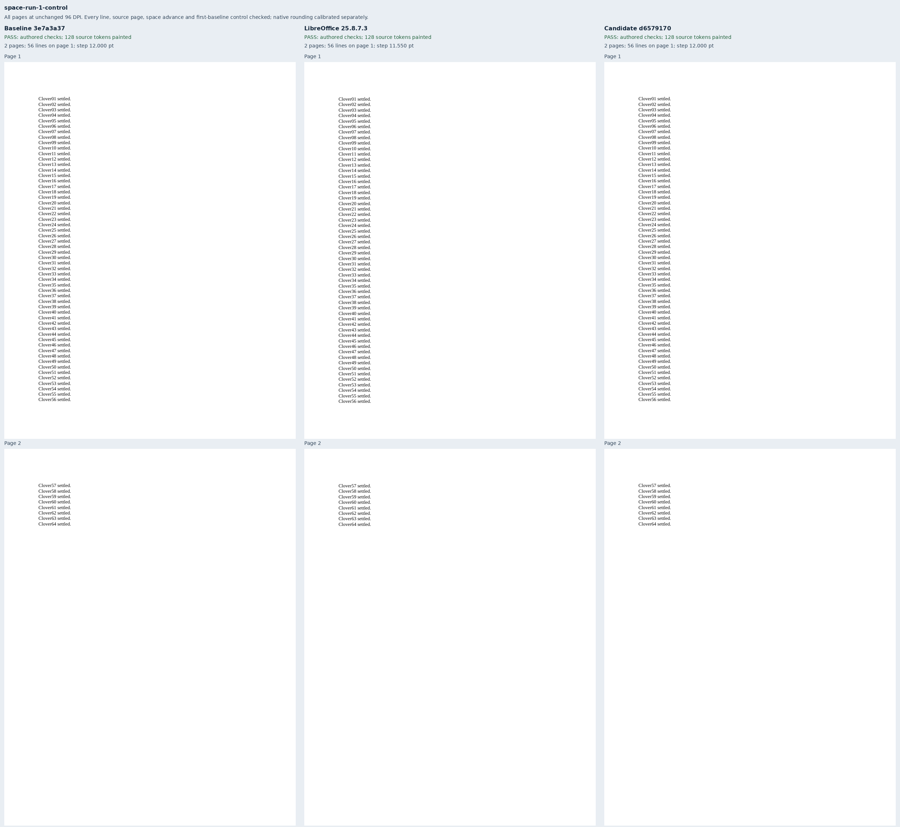
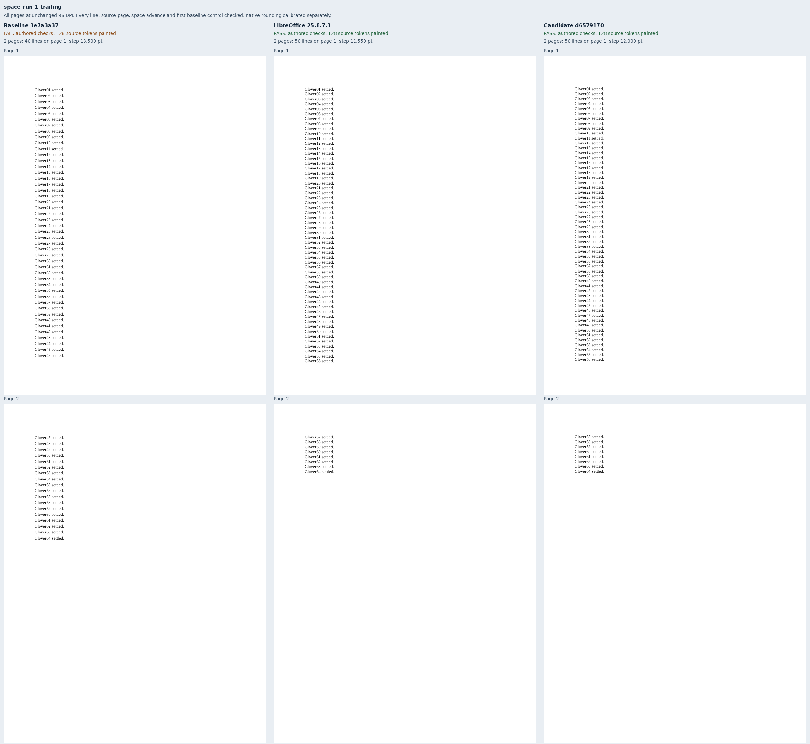
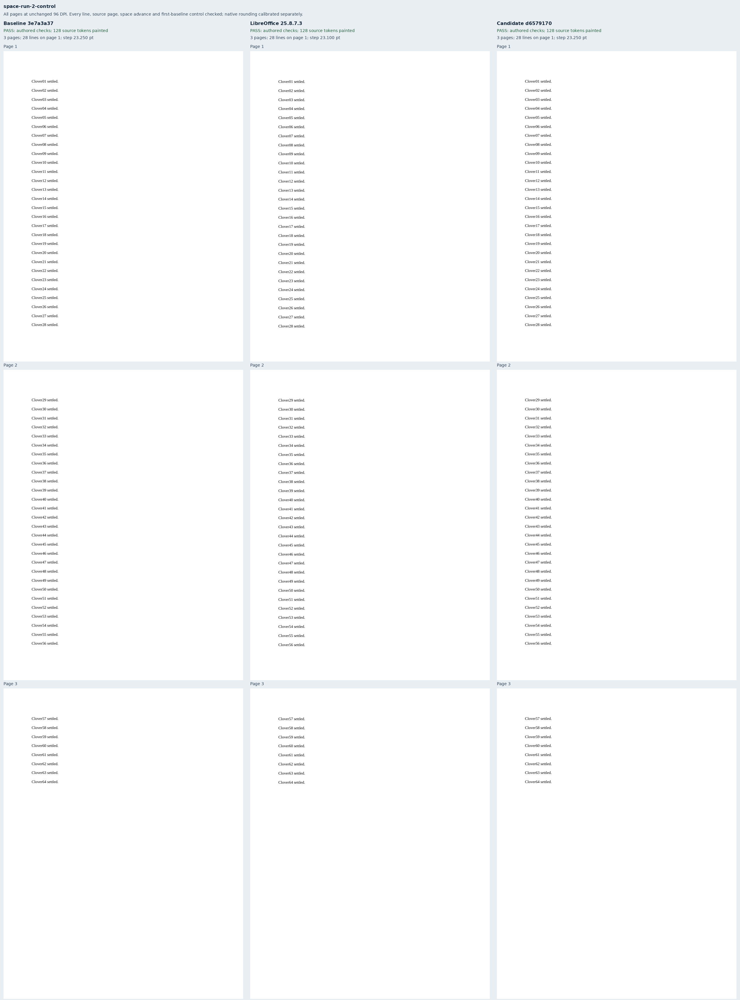
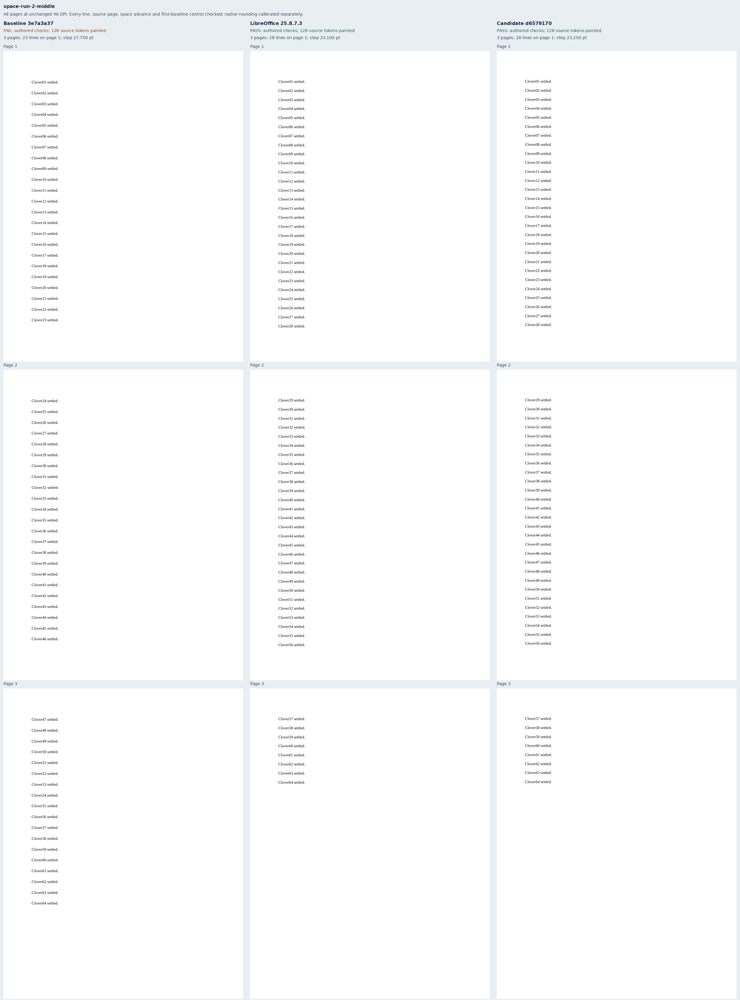

# Larger spaces and line metrics

Eight original Clover documents isolate a 12pt space in 10pt Liberation Serif text.
Each single- and double-spacing group has an unchanged control and a larger space on
the first, middle or last line of a 64-line paragraph. Only that space's font size differs
from its control. These cases cover ordinary space-only runs in
[Docxodus #1565](https://github.com/JSv4/Docxodus/issues/1565), whose existing Word
measurement confirms that a larger ordinary space does not raise its text line.

Source font units give a natural pitch of `2355 / 2048 × 10` points and a space advance
of one quarter of its font size: 2.5pt normally, 3pt for the larger space. Every label has
an explicit page and line slot. Separate checks require every consecutive and accumulated
pitch, the unchanged first baseline on every page, every space advance within 0.125pt,
complete text, painted words, paper geometry and the exact page count. Single spacing
puts 56 lines on the first page; double spacing puts 28 on each full page.

Native controls advance by 11.55pt per single line, slightly more than the unrounded
11.499pt font pitch. Over a full page, native glyph boxes overrun the initial 0.5pt slots
by at most 2.815pt. The retained control-only calibration therefore uses 3.5pt whole-slot
tolerance for both multiples. The additional checks stay strict: native accumulated pitch
allows 0.02pt; browser pitch allows 0.75pt for independently quantized glyph origins;
first-baseline equivalence to the same renderer's unchanged control allows 0.02pt.
Inputs, calibration, references and checks were frozen before candidate capture. The
composer later corrected only an output-inventory filename and its printed summary counts.

Exact baseline `3e7a3a37ecd64ed65f767ce153ca50f858b65237`, whose tree equals merged
main `3c22cb7653033645005933a3409727bbfe466c72`, passes the two controls and fails
all six larger-space cases. Exact candidate `d657917072ac19b0a4084ac7c84d952a96b830d4`
and LibreOffice pass all eight. [Evidence](evidence.json) binds 24 PDFs across 60 pages,
3,072 painted words, 16 strict-font reports, two sets of 19 build files and 45 runtime
assets, and all eight comparison sheets.

All [80 mutations](mutations.json) are rejected. They cover whole-line moves, one-point
moves inside the broad slots, uniform baseline shifts, collapsed space advances, wrong
pages, missing/duplicate/extra words and lost paint. The within-slot and space mutations
still pass the placement rectangles but fail the independent metric checks.

Captures use sandboxed system Chromium 157.0.8103.38 and LibreOffice 25.8.7.3. This is
diagnostic evidence, without a pinned-runtime score, full-suite parity claim or new Word
capture. Large visible runs, blank-break metrics, decorated/raised spaces and nonautomatic
line rules remain outside this fixture family.

## Reproduction

Generate `core-v130`, select `space-run-*`, validate all eight packages, capture native
references and freeze the calibrated manifest and checks. Build exact renderer commits
or verify every retained build file and runtime asset against its full-build record.

```sh
node docs/results/export-reliability/Capture.mjs SOURCE RUN/manifest.json RUN/candidate RUN/environment.json --html
python3 docs/results/space-runs/Compose.py RUN BASELINE_SOURCE CANDIDATE_SOURCE
python3 docs/results/space-runs/Mutations.py
python3 -m unittest discover -s tests -v
node --test tests/test-adapter.mjs
python3 -m bench.audit
```









