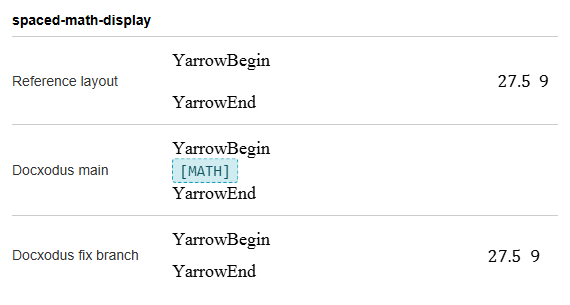
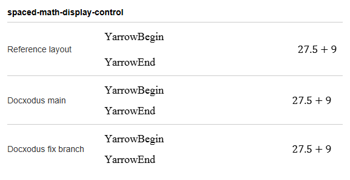

# Spaces in an equation's math text (Docxodus #1705)

`core-v169` adds one input and one control for [Docxodus #1705](https://github.com/JSv4/Docxodus/issues/1705).

**Trigger.** Docxodus turned any equation whose math text (`m:t`) holds a space into a `[MATH]`
placeholder, so none of its operands reached the HTML or PDF. Spaces are common in real equations:
the built-in Taylor expansion of the reference word processor's equation gallery sets its
condition after a plain-style run of two spaces (`+⋯,` then `  ` then `−∞<x<∞`).

**Cases.** Each input is three paragraphs of 12pt Liberation Serif on Letter with 1in margins and
no paragraph spacing: `YarrowBegin`, a display equation, `YarrowEnd`. The document's math font is
DejaVu Serif. The equation is three runs, `27.5`, a plain-style (`m:sty="p"`) run and `9`.

| Input | Middle run | Visible tokens |
| --- | --- | --- |
| `spaced-math-display` | two spaces | `27.5`, `9` |
| `spaced-math-display-control` | `+` | `27.5`, `+`, `9` |

Within the pair only the middle run's text differs. Both assert that every token is on one page and
that DejaVu Serif is in the PDF's fonts, as the plain-equation cases do. All inputs are authored in
`bench/fixtures.py` by `spaced_math_cases`. No reporter attachment was opened.

**Reference layout.** Copies of these inputs with DejaVu Serif renamed to Cambria Math and Liberation
Serif to Times New Roman (neither original family is installed on the capture machine) were printed
to PDF by the reference word processor (version 16.0.20326). It draws the equation centred, with the
two spaces at the font's space width between `27.5` and `9`; its PDF has the words `27.5` and `9`.

**Docxodus.** The same copies were converted to HTML by `main` (a8b1d6ce) and by the fix branch
`feat/1705-remaining-math`, with unsupported-content placeholders on, and printed by Chromium to
Letter with 1in margins. This is not the harness's adapter, which was not built here.

| Case | `main` | fix branch |
| --- | --- | --- |
| `spaced-math-display` | fails: `[MATH]` in place of `27.5` and `9` | passes: `27.5 9`, centred at 288.4pt (reference 288.9pt) |
| `spaced-math-display-control` | passes | passes |

**Screenshots.** Each shows the reference layout, Docxodus `main` and the fix branch, top to bottom.

**Pending.** LibreOffice references, a registered capture with the declared fonts, and scores
through the harness's own adapter.
