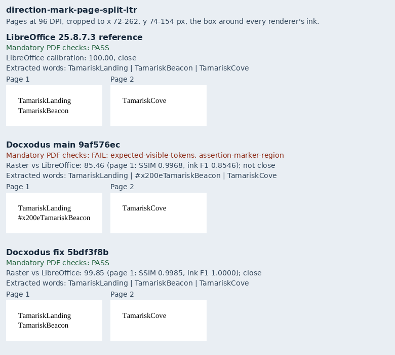
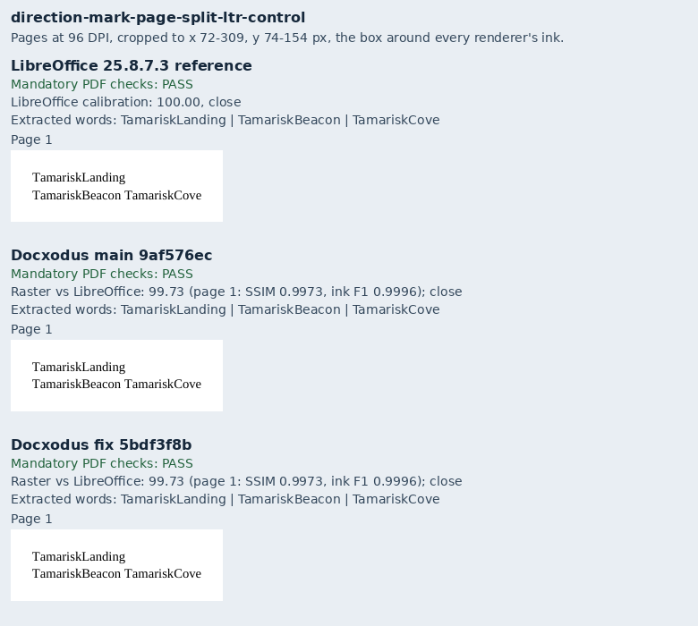
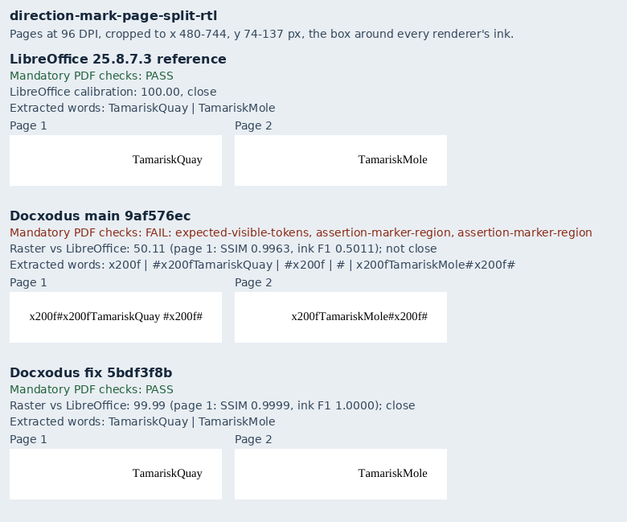

# Direction marks in moved text (Docxodus #1862)

Docxodus's HTML converter writes invisible direction marks: U+200E after a line break in a left-to-right
paragraph, and U+200F at the start of a right-to-left paragraph and around each right-to-left run. Two steps
of the converter move text it has already rendered to a new parent: the paginated view splits a paragraph
at a page or column break into one piece per page or column, and a link inside a HYPERLINK field's result is
unwrapped into the field's own link. Docxodus `main` at `9af576ec` moved that text by copying it, and the copy
of a mark is the plain text `#x200e` or `#x200f`, so the paginated view and PDF export printed those words.

The PDF track's visible-word inventory leaves out the marks themselves (see `docs/SCORING.md`) but counts the
printed text, so each reproducer fails its inventory on `main` and passes with the fix.

| Case | What it holds | Its control |
| --- | --- | --- |
| `direction-mark-page-split-ltr` | `TamariskLanding`, a line break, `TamariskBeacon`, a page break, `TamariskCove` | `-control`: no page break |
| `direction-mark-page-split-rtl` | a `w:bidi` paragraph: right-to-left runs `TamariskQuay`, a page break, `TamariskMole` | `-control`: a line break in the page break's place |
| `direction-mark-field-link-line-break` | a `w:hyperlink` holding `TamariskChart`, a line break and `TamariskSounding`, inside a complex HYPERLINK field's result | `-control`: the same link outside any field |

Each control's package differs from its reproducer only in `word/document.xml`, by the page-break run or the
field's characters (`tests/test_direction_marks.py`). The right-to-left control keeps a line break where the page
break was, so each label still has a line of its own: the order of two right-to-left runs sharing a line is a
separate question the reproducer never asks. Every case pins each label to its page with a whole-page
`marker-region` check, so a page break that a renderer dropped, or a label it printed glued to `#x200e`, fails too.

## Measurements

| Case | Kind | LibreOffice 25.8.7.3 | Docxodus main `9af576ec` | Docxodus fix `5bdf3f8b` |
| --- | --- | --- | --- | --- |
| `direction-mark-page-split-ltr` | reproducer | pass; calibration 100.00 | **fail** (`#x200eTamariskBeacon`); raster 85.46 | pass; raster 99.85, close |
| `direction-mark-page-split-ltr-control` | control | pass; calibration 100.00 | pass; raster 99.73, close | pass; raster 99.73, close |
| `direction-mark-page-split-rtl` | reproducer | pass; calibration 100.00 | **fail** (`x200f`, `#x200fTamariskQuay`, `#x200f`, `#`, `x200fTamariskMole#x200f#`); raster 50.11 | pass; raster 99.99, close |
| `direction-mark-page-split-rtl-control` | control | pass; calibration 100.00 | pass; raster 99.87, close | pass; raster 99.87, close |
| `direction-mark-field-link-line-break` | reproducer | pass; calibration 100.00 | **fail** (`#x200eTamariskSounding`); raster 76.73 | pass; raster 91.05, **not close** |
| `direction-mark-field-link-line-break-control` | control | pass; calibration 100.00 | pass; raster 99.84, close | pass; raster 99.84, close |

"Pass" and "fail" are the **mandatory PDF checks only**: the complete visible-word inventory, the declared font
family and the page of each label. Each failure on `main` is `expected-visible-tokens` plus the `marker-region`
check of each label printed glued to a mark; the words in parentheses are the ones the inventory did not expect. A
mandatory failure makes the case score zero, so the three reproducers score 0 on `main`; their raster figure is
shown only to describe the page. The fix passes by keeping the marks as characters, not by dropping them: Poppler
still reports U+200F in its raw words for the right-to-left reproducer. The standalone HTML each build delivered
holds the text `#x200e` or `#x200f` once, five times and once in the three reproducers on `main`, and never on the
fix or in any control.

"Raster" is the worst page's `100 × min(SSIM, ink F1)` against the LibreOffice reference, computed with
`bench.metrics.page_metrics` on Poppler's 96-DPI CropBox rasters exactly as `bench run` computes it; "close" is
SSIM ≥ 0.98 and ink F1 ≥ 0.95 on every page with every mandatory check passing. The field-link reproducer's worst
page has SSIM 0.9979 and ink F1 0.9105 with the fix: Docxodus renders the HYPERLINK field as a bare link that takes
the browser's default underline, which LibreOffice does not draw (on `main` the text is also blue, because the
copied runs lost their formatting). That raster stays below close until
[Docxodus #1869](https://github.com/JSv4/Docxodus/issues/1869) is fixed, while the case's mandatory checks isolate
#1862. Every other fix result and every control is close on both builds. `evidence.json` holds each page's SSIM,
ink F1, precision and recall.

All six LibreOffice references are eligible, and the LibreOffice identical-engine calibration scores 100 on each
with the `close` gate. The two Docxodus columns are **unscored diagnostics**, not registered candidate scores: the
benchmark's own adapter reports `ENVIRONMENT_INELIGIBLE` on this host, which denies the user namespaces its pinned
Chromium sandbox needs, so the PDFs were captured with `docs/results/export-reliability/Capture.mjs` through the
public export API in a system Chrome 158.0.8127.36 with its sandbox on, strict fonts and the hashed Liberation Serif
directory, and checked with `Inspect.py`.

Both renderers were built with `bench build-docxodus`: `main` at `9af576ecded6cd820647b38e79864665e8d1568f`
and the fix at `5bdf3f8b317862f79538b3ccd9780b7d34d8a3a6` ([JSv4/Docxodus#1866](https://github.com/JSv4/Docxodus/pull/1866)).
The fix branch sits on two commits for Docxodus #1861, which leave `WmlToHtmlConverter.cs` unchanged, and was
later amended to `73743aa9`, which differs from `5bdf3f8b` only in `CHANGELOG.md`.

## Shapes

- The line break comes before the page break: LibreOffice 25.8.7.3 drops a page break that a line break directly
  follows, and prints both labels on one page.
- The right-to-left runs hold Latin labels. Poppler extracts Hebrew words from the LibreOffice PDF in visual order
  (reversed), so a Hebrew inventory could not be met by the reference. Docxodus writes the marks around a run
  marked `w:rtl` whatever its script. The runs state `w:szCs` so that every renderer prints them at 11pt.

## Pending

Word reference registration and full-suite scoring for `core-v176` remain pending; no Word capture was made for
these cases.

## Reproduce

`evidence.json` binds the manifest, the reference bundle and its environment, the calibration result, both build
identities, the capture and inspection records, every page measurement, and the hashes of every PDF, page raster
and screenshot. `reference-bundle.json` is the LibreOffice bundle. With `MANIFEST` holding only these six cases,
`ENVIRONMENT` the JSON that `bench.environment.environment(['Liberation Serif'])` returns, and `RUN` a scratch
directory:

```sh
python3 -m bench build-docxodus --source SOURCE --commit FULL_SHA   # for each build
python3 -m bench reference libreoffice --manifest MANIFEST --out RUN/reference
python3 -m bench run --manifest MANIFEST --reference RUN/reference/bundle.json --adapter libreoffice \
  --candidate reference-calibration --out RUN/calibration --gate close
node docs/results/export-reliability/Capture.mjs SOURCE MANIFEST RUN/capture-main ENVIRONMENT --html
python3 docs/results/export-reliability/Inspect.py MANIFEST RUN/capture-main/capture.json
python3 docs/results/split-direction-marks/Compose.py RUN
```

Repeat the capture and inspection for `RUN/capture-fix`, and copy each source's `.docx-bench-build.json` to
`RUN/main-docx-bench-build.json` and `RUN/fix-docx-bench-build.json` before composing. `Compose.py` measures the
rasters and draws the sheets from the same unchanged pixels, every page of a case cropped to the box around all
three renderers' ink.








