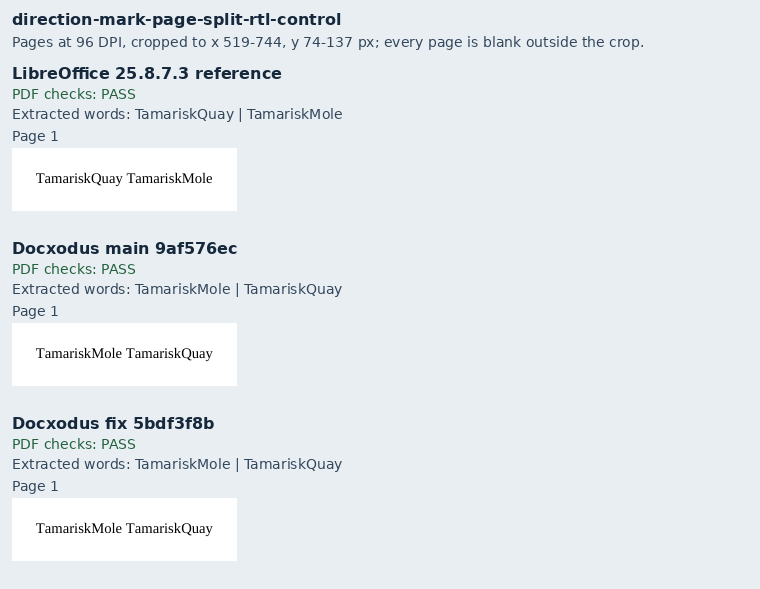
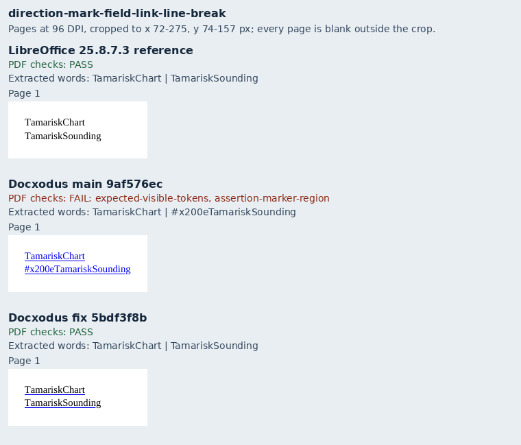

# Direction marks in moved text (Docxodus #1862)

Docxodus's HTML converter writes invisible direction marks: U+200E after a line break in a left-to-right
paragraph, and U+200F at the start of a right-to-left paragraph and around each right-to-left run. Two steps
of the converter move text it has already rendered to a new parent: the paginated view splits a paragraph
at a page or column break into one piece per page or column, and a link inside a HYPERLINK field's result is
unwrapped into the field's own link. Docxodus `main` at `9af576ec` moved that text by copying it, and the copy
of a mark is the plain text `#x200e` or `#x200f`, so the paginated view and PDF export printed those words.

The PDF track's visible-word inventory leaves out the marks themselves (see `docs/SCORING.md`) but counts the
printed text, so each reproducer fails its inventory on `main` and passes with the fix.

| Case | What it holds | Its control |
| --- | --- | --- |
| `direction-mark-page-split-ltr` | `TamariskLanding`, a line break, `TamariskBeacon`, a page break, `TamariskCove` | `-control`: no page break |
| `direction-mark-page-split-rtl` | a `w:bidi` paragraph: right-to-left runs `TamariskQuay`, a page break, `TamariskMole` | `-control`: no page break |
| `direction-mark-field-link-line-break` | a `w:hyperlink` holding `TamariskChart`, a line break and `TamariskSounding`, inside a complex HYPERLINK field's result | `-control`: the same link outside any field |

Each control's package differs from its reproducer only in `word/document.xml`, by the page-break run or the
field's characters (`tests/test_direction_marks.py`). Every case pins each label to its page with a whole-page
`marker-region` check, so a page break that a renderer dropped, or a label it printed glued to `#x200e`, fails too.

## Measurements

| Case | Kind | LibreOffice 25.8.7.3 | Docxodus main `9af576ec` | Docxodus fix `5bdf3f8b` |
| --- | --- | --- | --- | --- |
| `direction-mark-page-split-ltr` | reproducer | pass | **fail**: `#x200eTamariskBeacon` | pass |
| `direction-mark-page-split-ltr-control` | control | pass | pass | pass |
| `direction-mark-page-split-rtl` | reproducer | pass | **fail**: `x200f`, `#x200fTamariskQuay`, `#x200f`, `#`, `x200fTamariskMole#x200f#` | pass |
| `direction-mark-page-split-rtl-control` | control | pass | pass | pass |
| `direction-mark-field-link-line-break` | reproducer | pass | **fail**: `#x200eTamariskSounding` | pass |
| `direction-mark-field-link-line-break-control` | control | pass | pass | pass |

"Pass" means every mandatory PDF check passed: the complete visible-word inventory, the declared font family and
the page of each label. Each failure on `main` is `expected-visible-tokens` plus the `marker-region` check of each
label printed glued to a mark. The extracted words shown are the ones the inventory did not expect. The standalone
HTML each build delivered holds the text `#x200e` or `#x200f` once, five times and once in the three reproducers on
`main`, and never on the fix or in any control.

All six LibreOffice references are eligible, and the LibreOffice identical-engine calibration scores 100 on each
with the `close` gate. The two Docxodus columns are **unscored diagnostics**, not candidate scores: the benchmark's
own adapter reports `ENVIRONMENT_INELIGIBLE` on this host, which denies the user namespaces its pinned Chromium
sandbox needs, so the PDFs were captured with `docs/results/export-reliability/Capture.mjs` through the public
export API in a system Chrome 158.0.8127.36 with its sandbox on, strict fonts and the hashed Liberation Serif
directory, and checked with `Inspect.py`.

Both renderers were built with `bench build-docxodus`: `main` at `9af576ecded6cd820647b38e79864665e8d1568f`
and the fix at `5bdf3f8b317862f79538b3ccd9780b7d34d8a3a6` ([JSv4/Docxodus#1866](https://github.com/JSv4/Docxodus/pull/1866)).
The fix branch sits on two commits for Docxodus #1861, which leave `WmlToHtmlConverter.cs` unchanged, and was
later amended to `73743aa9`, which differs from `5bdf3f8b` only in `CHANGELOG.md`.

## Shapes

- The line break comes before the page break: LibreOffice 25.8.7.3 drops a page break that a line break directly
  follows, and prints both labels on one page.
- The right-to-left runs hold Latin labels. Poppler extracts Hebrew words from the LibreOffice PDF in visual order
  (reversed), so a Hebrew inventory could not be met by the reference. Docxodus writes the marks around a run
  marked `w:rtl` whatever its script. The runs state `w:szCs` so that every renderer prints them at 11pt.

## Differences these checks do not measure

They remain in the page rasters only.

- In `direction-mark-page-split-rtl-control`, Docxodus prints `TamariskMole` left of `TamariskQuay`, and LibreOffice
  prints them in source order, left to right.
- Docxodus underlines the HYPERLINK field's link text on both builds; LibreOffice does not underline it. On `main`
  the link text is also blue, because the copied runs lost their formatting.

## Pending

Word reference registration and full-suite scoring for `core-v176` remain pending; no Word capture was made for
these cases.

## Reproduce

`evidence.json` binds the manifest, the reference bundle and its environment, both build identities, the capture
and inspection records, and the hashes of every PDF, page raster and screenshot. `reference-bundle.json` is the
LibreOffice bundle. With `MANIFEST` holding only these six cases, `ENVIRONMENT` the JSON that
`bench.environment.environment(['Liberation Serif'])` returns, and `RUN` a scratch directory:

```sh
python3 -m bench build-docxodus --source SOURCE --commit FULL_SHA   # for each build
python3 -m bench reference libreoffice --manifest MANIFEST --out RUN/reference
node docs/results/export-reliability/Capture.mjs SOURCE MANIFEST RUN/capture-main ENVIRONMENT --html
python3 docs/results/export-reliability/Inspect.py MANIFEST RUN/capture-main/capture.json
python3 docs/results/split-direction-marks/Compose.py RUN
```

Repeat the capture and inspection for `RUN/capture-fix`, and copy each source's `.docx-bench-build.json` to
`RUN/main-docx-bench-build.json` and `RUN/fix-docx-bench-build.json` before composing. Each sheet crops every page
to one rectangle around all three renderers' ink and checks that the rest of each page is blank.







