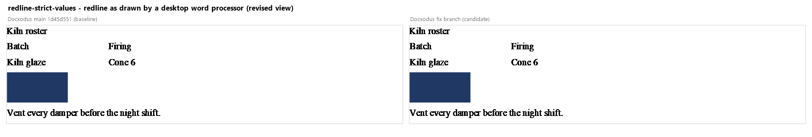
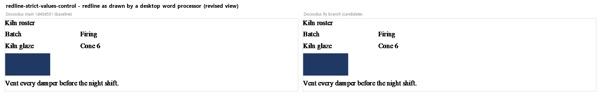

# Values Strict writes in a form Transitional does not have

Docxodus #1758: a package in the ISO/IEC 29500 Strict conformance class writes some values
differently from a Transitional one, and Docxodus converted Strict inputs by renaming their
namespaces only. A table's `w:cnfStyle` keeps its twelve flags but has no `w:val`, which
Transitional requires, and a DrawingML percentage keeps its Strict spelling (`val="50%"`) where
Transitional writes thousandths of a percent (`val="50000"`). A redline of two valid Strict
documents therefore failed schema validation.

| Case | Kind | Failed checks, baseline | Failed checks, candidate | Desktop word processor, baseline and candidate |
| --- | --- | --- | --- | --- |
| `redline-strict-values` | reproducer | `no-new-validation-errors`: five `The required attribute 'val' is missing.` on `w:cnfStyle` (row, two cells, two paragraphs) and one `The attribute 'val' has invalid value '50%'` on `a:lumMod` | none | opens; 2 revisions; Accept All gives the revised text and Reject All the original, no revisions left; fill darkened by half |
| `redline-strict-values-control` | control | none | none | the same |

Baseline is Docxodus main `1d45d551`; candidate is the fix branch for
[JSv4/Docxodus#1758](https://github.com/JSv4/Docxodus/issues/1758). "Failed checks" are the bench's
own markup engine, its `untracked-text` assertion and the `no-new-validation-errors` rule with
`tools/ooxml-validator` (DocumentFormat.OpenXml 3.5.1, `Microsoft365`), run on this machine. Every
input and both authored redlines have no validator finding, so the rule admits none in a redline.
LibreOffice was not available; its comparisons run in CI.

The defect is in validity, not in appearance. The desktop word processor (16.0.20326, Windows,
through COM) reads `50%` even where Transitional expects thousandths, so it opens the baseline
redline and draws the badge darkened, as in the candidate. Other readers do not. The Open XML SDK
types the value as an integer, and Docxodus's own shape renderer drew a Strict document's
darkened badge at full brightness. The authored redlines open, accept and reject the same way.
`evidence.json` holds the per-check and desktop results.

The images show the desktop word processor's drawing of each redline's revised text (insertions
in place, deletions hidden), from `Range.EnhMetaFileBits`, baseline on the left and candidate on
the right. The capture machine does not have Liberation Serif, so a default serif is substituted.

### redline-strict-values

### redline-strict-values-control

