# Tabs and line breaks (Docxodus #1759)

Five reproducers and six controls. In each reproducer a paragraph holds a tab or a line break, and the text
around it is edited exactly as in its control, which has none. Docxodus `1d45d551` diffs such a paragraph by
all of its tokens, spaces included: both round trips pass, but the redline keeps a space, a tab or a lone comma
unmarked between one-word revisions, or keeps a rewritten tabbed clause as one edited paragraph, and an
assertion fails. Docxodus `6b8df7cb` (branch `fix/1759-tab-break-anchoring`) treats a tab or break as
whitespace, as the reference compare does, and passes. Both builds pass all six controls.

| Case | Kind | `1d45d551` | `6b8df7cb` | authored |
|---|---|---|---|---|
| `redline-tab-phrase-lead-tab` | reproducer | round trips pass, `untracked-text` fails | pass | pass |
| `redline-tab-phrase-lead-break` | reproducer | round trips pass, `untracked-text` fails | pass | pass |
| `redline-tab-phrase-inner-tab` | reproducer | round trips pass, `revision-blocks` and `untracked-text` fail | pass | pass |
| `redline-tab-comma-lead-tab` | reproducer | round trips pass, `revision-text` fails | pass | pass |
| `redline-tab-clause-tabbed` | reproducer | round trips pass, `revision-blocks` fails | pass | pass |
| `redline-tab-phrase-control` | control | pass | pass | pass |
| `redline-tab-phrase-inner-space-control` | control | pass | pass | pass |
| `redline-tab-comma-control` | control | pass | pass | pass |
| `redline-tab-clause-control` | control | pass | pass | pass |
| `redline-tab-clause-edited-control` | control | pass | pass | pass |
| `redline-tab-for-space-control` | control | pass | pass | pass |

These results come from the benchmark's own accept/reject engine and assertion code applied to each redline,
not from a complete scored run: the SDK validator and LibreOffice comparisons were not run, so they are not a
suite score. `evidence.json` records the commits and every check.

Each review sheet shows the `1d45d551` redline above the `6b8df7cb` redline, both rendered by Docxodus
`docx2html --track-changes --word-markup` from the `6b8df7cb` build and captured with headless Edge. The
browser draws a deleted and an inserted tab at the same position, so the before sheets of the inner-tab case
overlap their text there.

### redline-tab-phrase-lead-tab

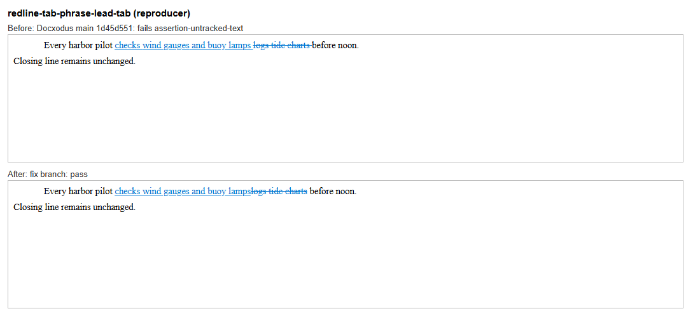

### redline-tab-phrase-lead-break

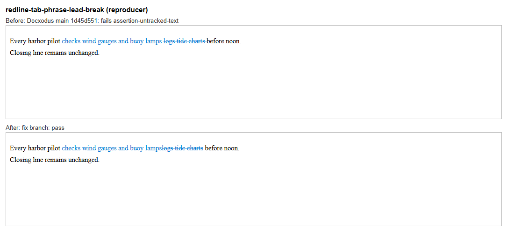

### redline-tab-phrase-inner-tab

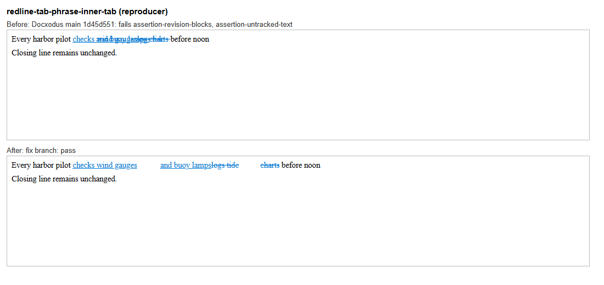

### redline-tab-comma-lead-tab

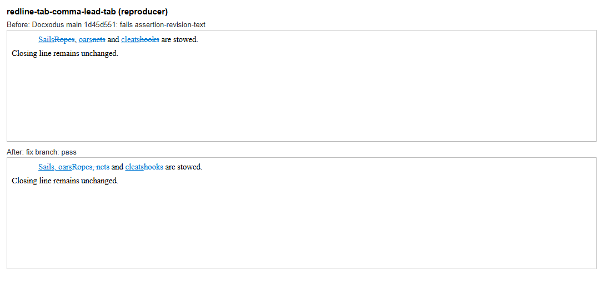

### redline-tab-clause-tabbed

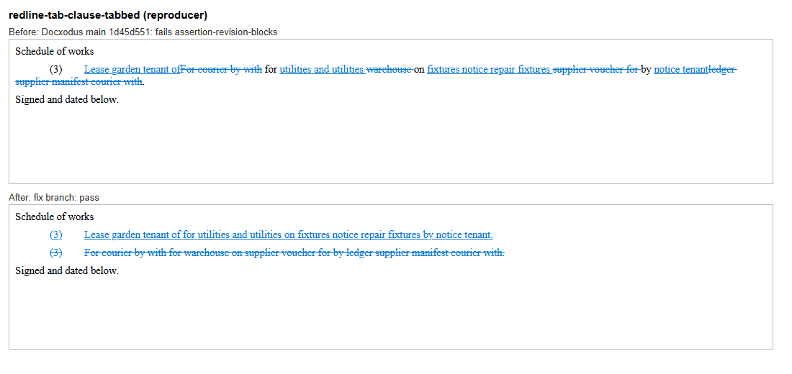

### redline-tab-phrase-control

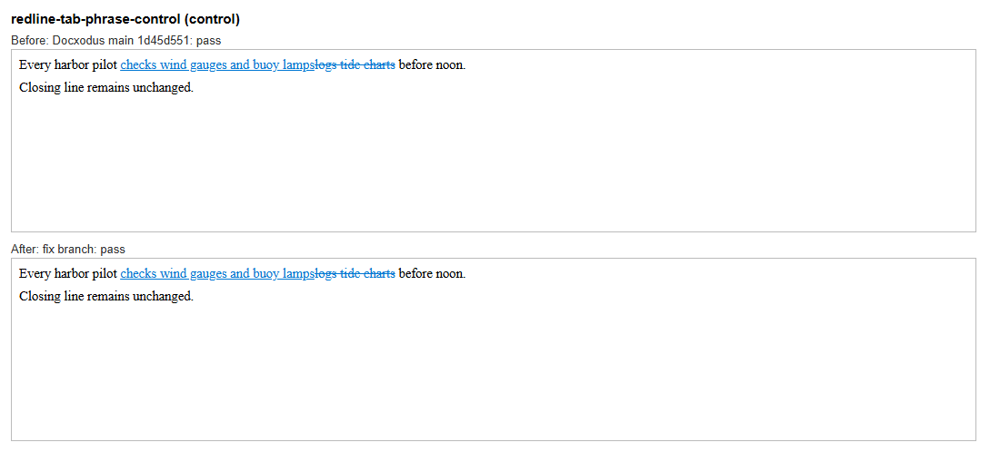

### redline-tab-phrase-inner-space-control

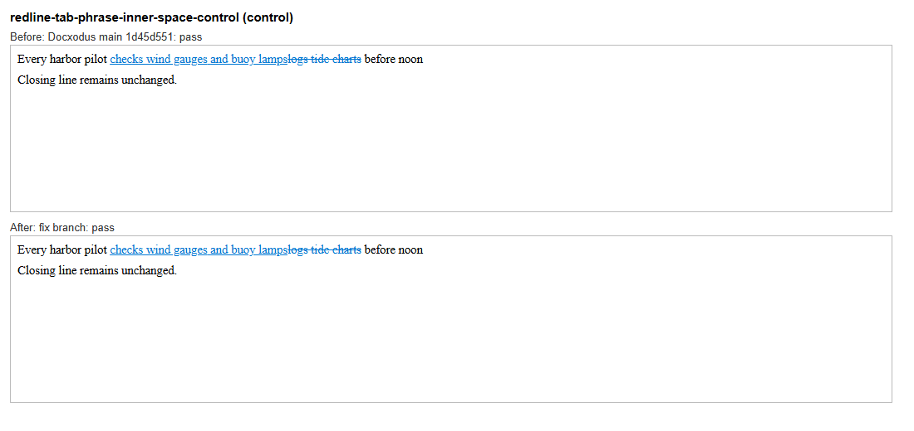

### redline-tab-comma-control

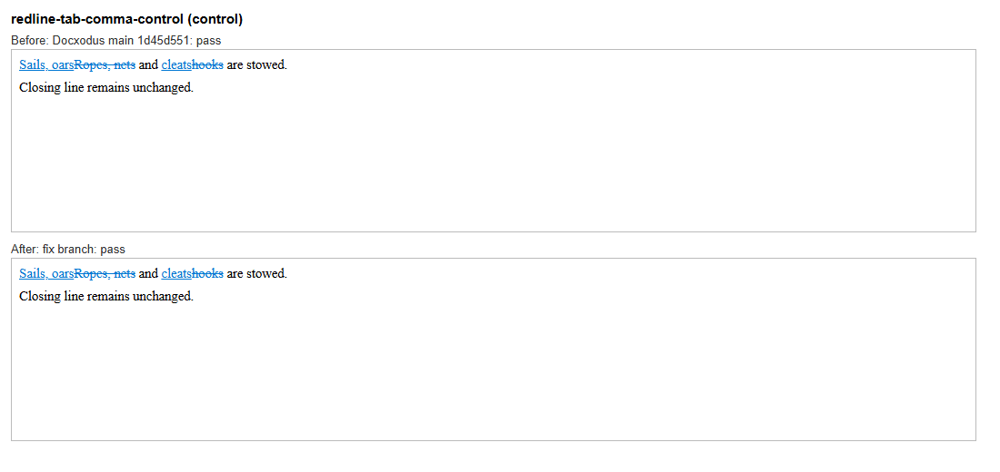

### redline-tab-clause-control

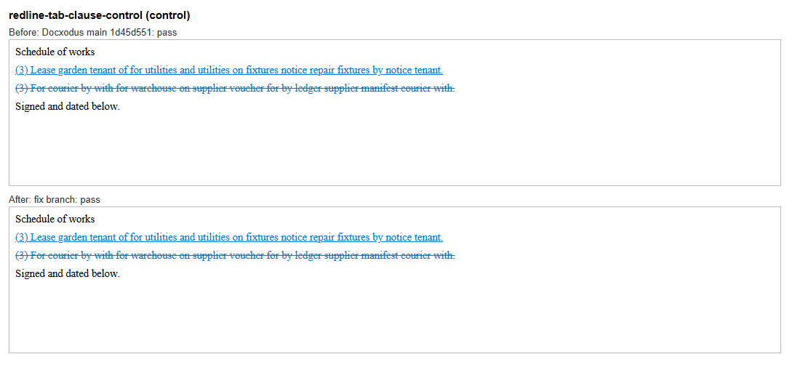

### redline-tab-clause-edited-control

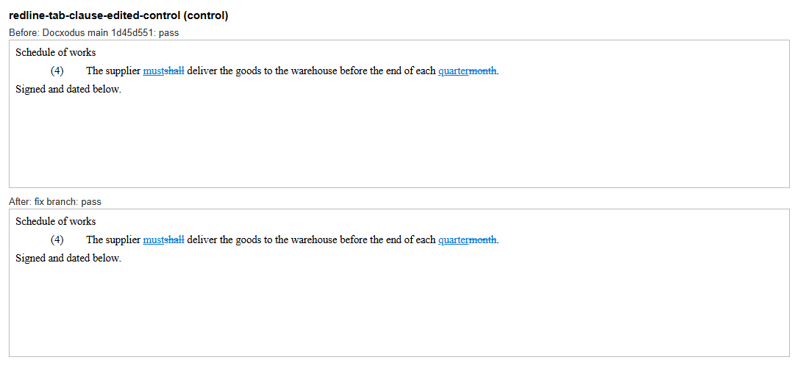

### redline-tab-for-space-control

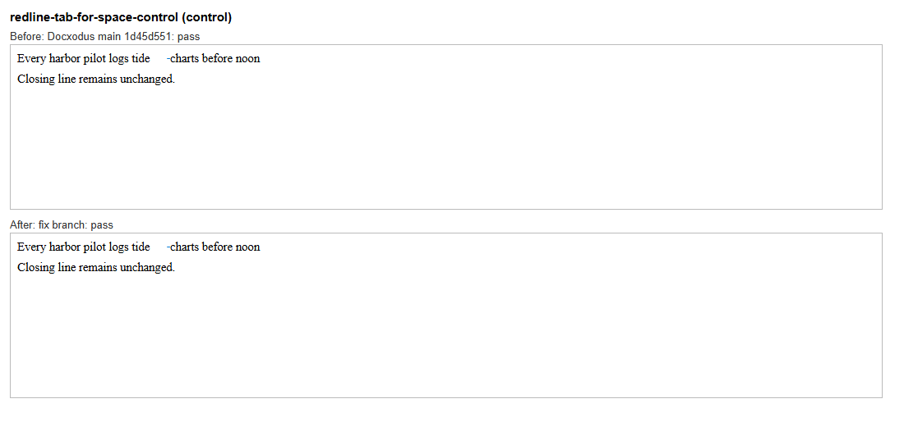
