# Table margins, indents, and boundaries

This expands the existing benchmark PR #82 to `core-v65`: 325 PDF cases, with `redline-v17` unchanged at 152 cases. It adds 19 original cases for [Docxodus #1219](https://github.com/JSv4/Docxodus/issues/1219) and the already-fixed [#1244](https://github.com/JSv4/Docxodus/issues/1244). All 992 preceding DOCX files retain their exact hashes; all 19 new inputs have zero Open XML SDK 3.5.1 Microsoft365 findings.

Eight cases cover absent/explicit cell margins, mode 14/15 indents, and default table styles. Five keep paragraph after-spacing and adjacent-table controls. Six more cover centred and nested tables, named styles with no margins, a leading omitted grid column, and a percentage-width table. Every case retains its complete token inventory and 0.5pt reference-position assertions.

Native Word for the web exported the exact registered sources through authenticated Playwright. All 19 new cases declare Times New Roman and their Word references are eligible. The original `tables-nested` diagnostic requests Liberation Serif, which Word substitutes, and has two SDK property-order findings; it remains ineligible. Its unchanged raw source, a schema-order-only control, and a separate Times New Roman control yield identical left-cell origins: 73.025pt outer and 73.775pt inner. Original capture hashes, provider, capture dates, explicit null build identity, declared font contract, and observed PDF fonts are retained in `word-capture.json` and `nested-ci-proof.json`. Native PDFs were not repaired or substituted.

## The failing CI comparison

The retained artifact from core PR #1338 run 39949701592 shows one regression: `tables-nested` loses raster similarity to LibreOffice, from 99.7699 to 92.7035. Its old mandatory declarations passed on both sides. Word shows why: LibreOffice and the baseline add default 5.4pt cell margins that the source never declares. The PR places the two left-cell origins within 0.5pt of Word. Version 2 of this existing case now declares those Word-adjudicated regions, with unchanged input bytes. The original CI PDFs are inspected in `nested-ci-proof.json`: the baseline fails those two mandatory checks and the PR passes them. The lower LibreOffice raster scores remain recorded.

`core-ci-v2` preserves all 12 historical CI inputs by exact SHA-256, with their current declarations. It is an explicit registered selection; the full 325-case corpus is still the default. Reference creation and every run must name the same selection. A local LibreOffice 25.8.7.3 calibration passes all 12 cases with score 100, mandatory rate 1, and close-match rate 1. The local binary is the installed distribution build; CI retains its separately signed official 25.8.7.3 runtime. No metric tolerance or regression-checker algorithm is changed. The checker continues to require every candidate mandatory check and preserve every metric for baseline cases that already meet all mandatory requirements.

## Renderer evidence and limits

The PNGs show native Word, the unchanged current-main renderer at `1a873928`, and the reviewed fix at `73bba6bd`, at equal scale. Each full-width crop covers the top 240pt; all declared markers lie in that region. `evidence.json` retains exact input and PDF hashes, raw marker positions, every measured correctness result, and screenshot hashes. These exports are **unscored diagnostics**: pinned Chromium 143.0.7499.4 runs with its sandbox enabled through the existing root-owned helper, but the formal benchmark's required unprivileged-user-namespace preflight is unavailable. That requirement remains enforced.

Review found and fixed a real `gridBefore` width error: an unused leading column narrowed the visible cell and split `BravoCell` and `gridBefore.`. The fix omits only grid columns unused by every own row; separate controls cover content-control wrappers, nested tables, and columns used by other rows. Browser tests also retain the complete Word token inventories.

Existing differences are retained without relaxing assertions: bordered cell baselines can differ vertically by about 0.527pt, adjacent-table trailing text by about 0.953pt, and the legacy nested-table trailing paragraph by about 14.953pt. Automatic nested column allocation also differs: Word places `OuterRight` at 450.95pt and the renderer at 306.75pt. The legacy nested control also retains its pre-existing oversized inner table, visible in both renderer columns. These are not claims of a full Word score or of all reference-position checks passing. The issue-specific horizontal origins are checked separately in the core browser tests.

## Screenshots

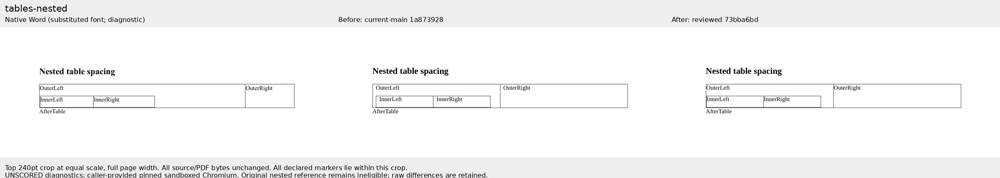

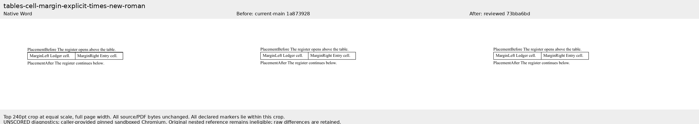

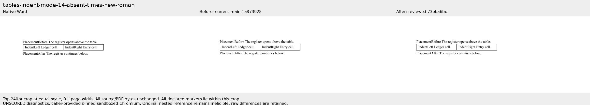

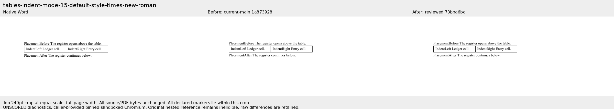

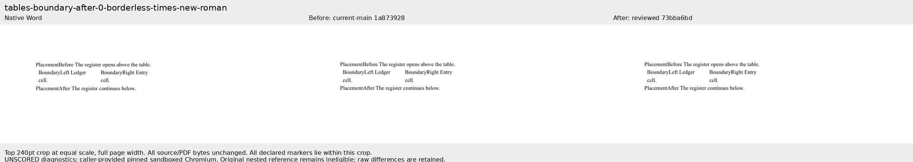

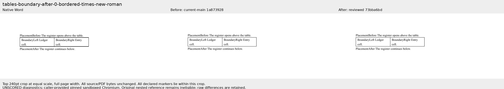

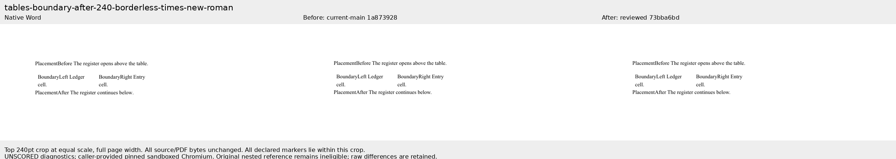

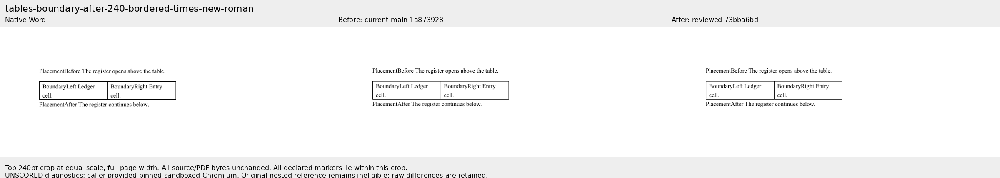

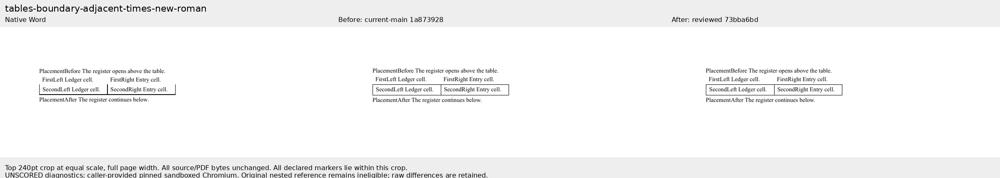

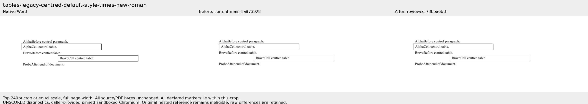

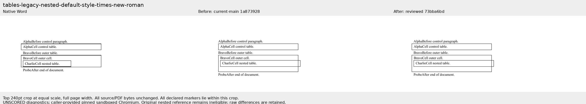

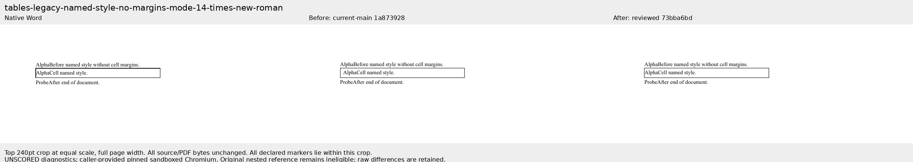

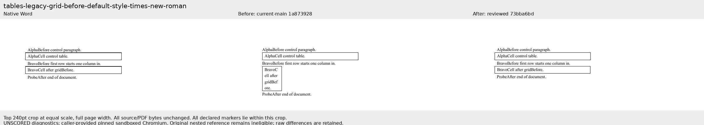

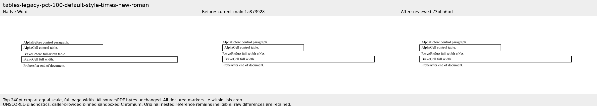
