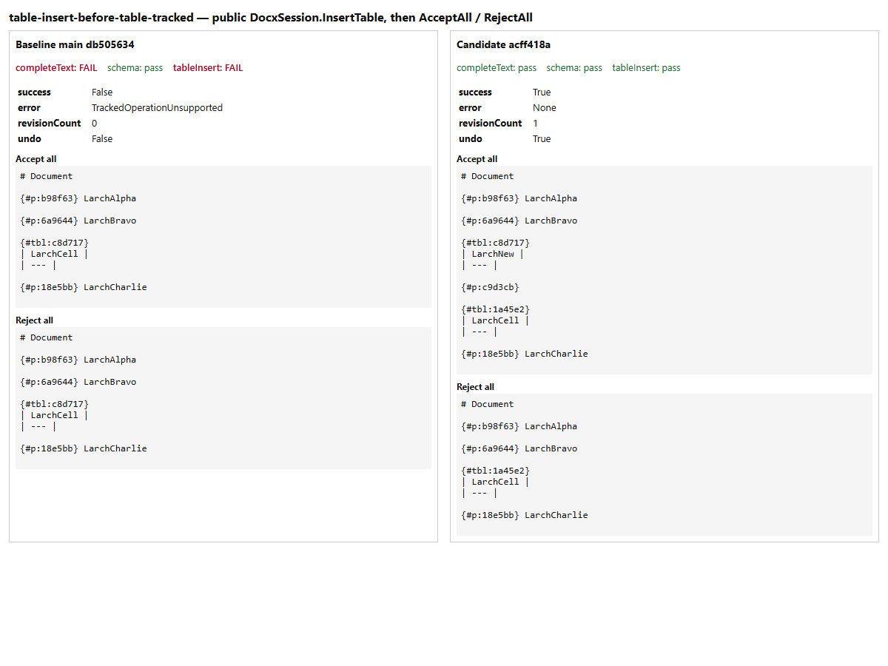
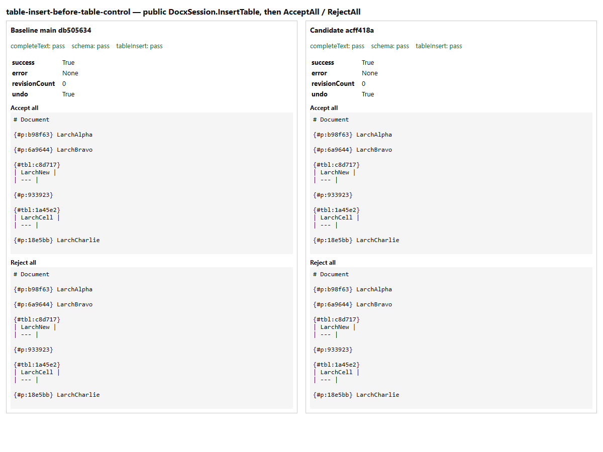
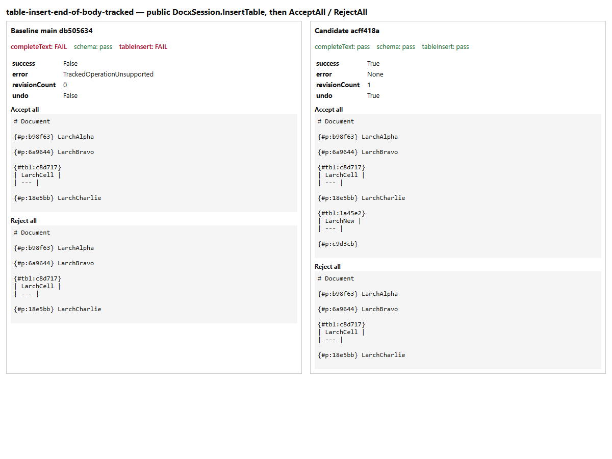
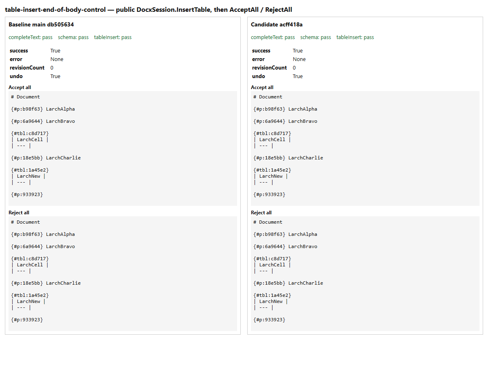

# Tracked table insertion

Two original reproducer/control pairs pin [Docxodus #1626](https://github.com/JSv4/Docxodus/issues/1626).
The public session inserts a one-cell table after a paragraph while recording changes: once before
an existing table (the issue's shape, which needs a closing paragraph between the tables) and once
at the end of the body. Each control performs the same insertion with recording explicitly off.

The tracked result must succeed with exactly one public revision and an undo entry. Accept-all must
give the Markdown of the untracked insertion and reject-all the original document's Markdown.
Controls must succeed with zero revisions, both resolutions giving the inserted table. Complete
projected text and the saved output's Microsoft 365 schema validity are also required.

The [baseline](baseline.json) at `db505634` (main) fails both reproducers with
`TrackedOperationUnsupported` and passes both controls. The [candidate](candidate.json) at
`acff418a` passes all four. The other 32 projection cases are unchanged.

Both runs were measured on Windows. There Docxodus's `ProjectAnchor` slices CRLF Markdown
wrongly, so the `paragraphAnchors` check fails for all 36 cases on both builds. That check is
not part of this issue, and the same environment fails Docxodus's own `ProjectAnchor` tests
(DS310-DS312). Every other check is as stated above. The Windows generator writes case inputs
with backslashes; the committed manifest keeps CI's POSIX paths, so the recorded
`manifestSha256` is that of the same cases with Windows separators. This is an unweighted session diagnostic,
not a Word rendering claim or a PDF/redline score.

All inputs are original literal OOXML and Larch labels. No product fixtures or helpers are copied.
Screenshots show the recorded public outcomes and Markdown, with anchor IDs shortened, captured in
headless Edge.

| Reproducer | Untracked control |
| --- | --- |
|  |  |
|  |  |

```bash
python3 -m bench.projection build --source /path/to/Docxodus --commit FULL_SHA --out runs/table-build
python3 -m bench.projection run --build runs/table-build --output runs/table-result.json
python3 -m unittest discover -s tests -p test_projection.py -v
```
