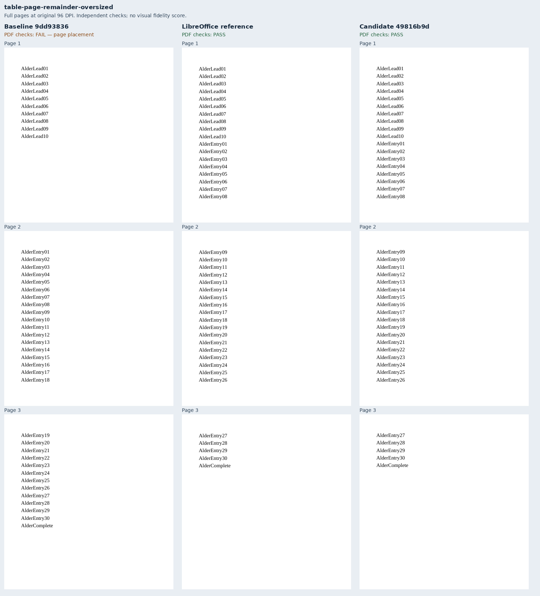
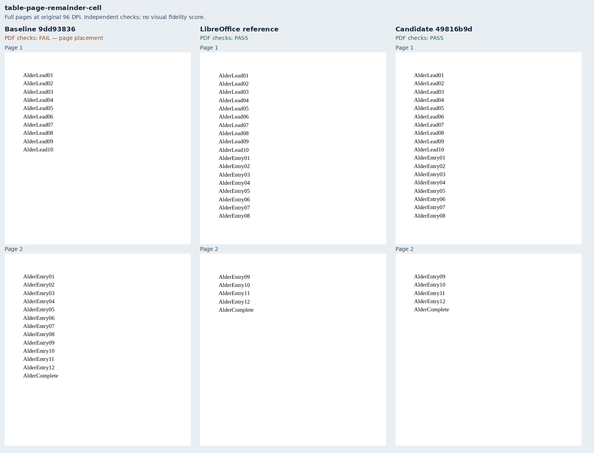
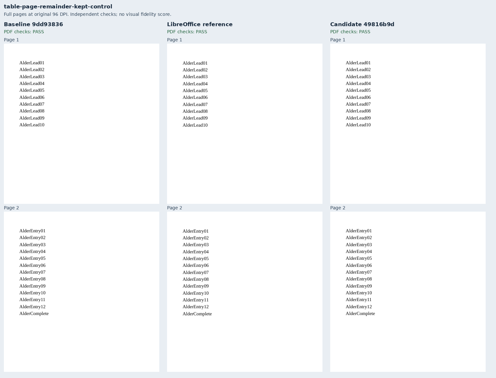
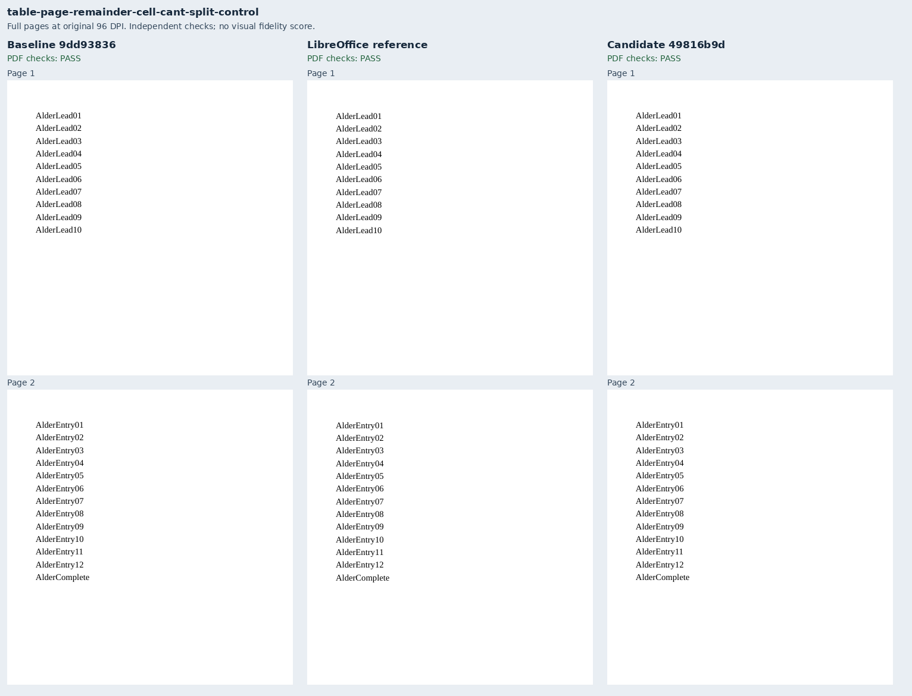

# Tables use the remaining page

Five original Alder ledger cases cover [Docxodus #1569](https://github.com/JSv4/Docxodus/issues/1569).
Three reproduce ordinary rows, an oversized table, and paragraphs inside one cell moving away
from usable page space. Two controls retain an explicit row keep chain or one unsplittable cell.

| Exact production build | PDFs delivered | Independent PDF checks passed |
|---|---:|---:|
| Main `9dd9383631b56c08a32c069b89ce7aa9acf67b75` | 5/5 | 2/5 |
| Fixed `49816b9d4bb54bbef19fed66d28f8990a5bb33f0` | 5/5 | 5/5 |
| LibreOffice reference | 5/5 | 5/5 |

Both renderer revisions were built separately with `bench build-docxodus`, including production
AOT WASM. Captures use the public export API, strict verified fonts and a borrowed sandboxed
Chromium. These are unscored diagnostics, not registered candidate scores or a claim of Word
parity. The final column-fallback warning is covered by product tests; these five cases use one
column. The complete corpus was not rendered.

The 300pt body has ten 16pt lead lines. Its 140pt remainder holds eight entries with 12pt to spare;
a fresh page holds eighteen. Source-authored assertions bind entries 08/09 and, for the oversized
case, 26/27 to their respective pages. Complete token inventories catch lost or repeated content.
Every corrected input validates with Open XML SDK 3.5.1/Microsoft365; the evidence also records
eleven schema-valid public regression inputs. All 468 harness contracts pass.

`core-v106` contains 760 PDF cases. All 755 prior input bytes, assertions and tokens are unchanged;
their shared generator hashes refresh. Scoring rules and tolerances are unchanged. The author
inspected all five full-page sheets. Independent review corrected inherited style ordering and
strengthened the page-cut assertions before these final captures.

`evidence.json` binds exact source trees, production build identities and asset manifests,
input/PDF/raster/sheet hashes, browser/font identities, schema findings and inspection results.
Raw outputs remain under ignored `runs/table-remainder/`. Reproduce with the five manifest cases:

```sh
python3 -m bench build-docxodus --source SOURCE --commit FULL_SHA
python3 -m bench reference libreoffice --manifest MANIFEST --out RUN/reference-final
node docs/results/export-reliability/Capture.mjs SOURCE MANIFEST RUN/candidate ENVIRONMENT
python3 docs/results/export-reliability/Inspect.py MANIFEST RUN/candidate/capture.json
```

Repeat capture/inspection for the baseline. `Compose.py RUN` combines unchanged 96-DPI full-page
rasters after checking their source and manifest bindings; its optional dependency is Pillow.









