# Table placement against Word

`core-v52` adds thirteen Times New Roman table-placement cases for [Docxodus #1219](https://github.com/JSv4/Docxodus/issues/1219) (where a table's first cell text starts across the line) and [Docxodus #1244](https://github.com/JSv4/Docxodus/issues/1244) (the gap between a paragraph and the table after it). Each exact input was captured in Word for the web. All thirteen captures pass their own mandatory checks and register as eligible Word references. Times New Roman keeps the declared family: Word for the web substitutes it for Liberation Serif, which would make a Liberation Serif capture ineligible.

## Capture and eligibility

On October 23, 2026 the exact registered inputs were uploaded unchanged to an authenticated Word for the web session and exported through **File > Export > Download as PDF**, without comments. Playwright drove the browser, Chromium on Linux, for this one-time capture only; the harness and tests need no Office service. No repair, conversion or upgrade prompt appeared, and no content was edited. Word did not report a build number. Every PDF embeds only `TimesNewRomanPSMT`. Importing them with `bench reference import`, using the Times New Roman font contract of the bench #33 Word bundle, registered all thirteen with `eligible: true` and no failing checks.

| Case | Input SHA-256 | Word PDF SHA-256 |
| --- | --- | --- |
| `tables-cell-margin-absent-times-new-roman` | `e651011aced2a44755551d16cd5e47bf52278b7641946fba13f49b7ae3648202` | `d778ae9f5fa1b33f7585fce6fc623e5a8523af1fbd032b1dc129945ff3e3e633` |
| `tables-cell-margin-explicit-times-new-roman` | `bc308dd364f365ca61037fa25af0a80888bd9ed4bbdf7a4112675a2e1069b967` | `a56d82c897b098888794fda58d29ae0d8b1c7b6c24cdf779cd9284edc0b22a3c` |
| `tables-indent-mode-14-stated-times-new-roman` | `741ebedc31401d63f568c71679a8bb45f95afcc7c028a6a5513df858a66760f1` | `d0640057ea52932a4032aa5dc50de5f73c158f0b92a2dc4d9f6ba372fc9f7514` |
| `tables-indent-mode-14-absent-times-new-roman` | `eee8c0d9d9d5fe75b434066b90632e80c528fefa1b98ca48570524ac981d1dae` | `0c0d2ce481461f4eefe99af925fb8dd1a810c1212a8cb72eb2b91a2eeba48884` |
| `tables-indent-mode-15-stated-times-new-roman` | `36f8fad566670119f59923271eb61c9ab2ddaf05ab1f09609b5043e7a2c37354` | `a37d14c17f975cc0505253e24936e6616346f8543c5e7b5b61b0c9c332c0d149` |
| `tables-indent-mode-15-absent-times-new-roman` | `83a01be832a59c0a5e11fc150a7f64cc6499b542e1e7b1bfb15860b8868d7668` | `17777f8076a42f28ba02b534d2777d0d01ae4d4c9612740f4de5a5d651b3d9fc` |
| `tables-indent-mode-14-default-style-times-new-roman` | `1cdb6171758cd85f6668119d7bdc03cbe37adde659af2c2d68df27b7b51ae4f4` | `58d45ae9c45c90e85fd0278b51c9b5846b7bd46d3bb0d14c27894ea7225a2ddc` |
| `tables-indent-mode-15-default-style-times-new-roman` | `b927fb40c5a26106c217688457d6741b760ffdcfb7b7c1eb4573b25647b6a2f0` | `7e4939551f43bf1af8a5baaccf7ef491acdd4e27d94b6b7124b817a9bd1e850e` |
| `tables-boundary-after-0-borderless-times-new-roman` | `b6f4a9f761280b89a2b4cb294ea7f6d988ab143617effbc52a7bd066e5d94830` | `ff1dcd77161d3a763e447d12364a56f4a3d2b84b3ea92b674cfc38792e9b8bf2` |
| `tables-boundary-after-0-bordered-times-new-roman` | `bd07fcf45ef75b316f0d57d60eeaf8911825d81949fe8ac4cfa82a1c9bb432f2` | `b74ee5e54ed5a7547a19bfc483db685168937eb4ea969120fd1d00aad96d6186` |
| `tables-boundary-after-240-borderless-times-new-roman` | `bf285f558c4a971e145c8be8b06283d408f33f09b021981571fb8995e5597ad5` | `cfc571a477e1d51640e9f0c035faba7f5d59852207fc3c899b4ec6ab72410878` |
| `tables-boundary-after-240-bordered-times-new-roman` | `8ef8714704e7b5088bf3ce95ab74c90cd3af3970d478df9acc9db3b3dab0fb93` | `a7c1ce0400b9e31023ec6cd547d15d86bd1f1535ea881b95e1cae58ed98331a3` |
| `tables-boundary-adjacent-times-new-roman` | `6eaffe03476e1f68e7fd74072d95b4c95309ad1d99049fe08ea076664af633ce` | `61ee85cbff07cb44bb36917dd612ac7589d09b20e67f7793f2cf4aed26f44ea9` |

## What Word does

Each document is a paragraph (`PlacementBefore`), a one-row, two-cell table and a closing paragraph, with exact 16pt lines and an 18pt minimum row. The pairs isolate one input each:

- **Cell margins.** `tables-cell-margin-absent` states no `w:tblCellMar` and has no table style; `-explicit` states 108 twips. Word puts the absent case's text just inside the border, so a cell margin nothing states is zero.
- **Compatibility mode and indent.** `tables-indent-mode-{14,15}-{stated,absent}` state a zero `w:tblInd` or none. `-default-style` names no style and inherits a default table style carrying a zero indent and 108-twip margins. In mode 15 all three place the text 6pt in. In mode 14 a stated indent or any table style puts the first cell's text exactly at the margin; only the unstyled, unindented table keeps its border at the margin.
- **Paragraph-to-table boundary.** `tables-boundary-after-{0,240}-{borderless,bordered}` and `tables-boundary-adjacent`. The first row starts where the paragraph's line ends, plus the paragraph's after-spacing and nothing else. The second of two adjacent tables starts where the first ends.

Measured first-cell text start (x, from the body text edge) and the first cell line's distance below `PlacementBefore` (y), both in points, from `pdftotext -bbox` origins:

| Case | Word | LibreOffice | Docxodus v14.0.0 | #1244 branch | #1219 branch |
|---|---:|---:|---:|---:|---:|
| `tables-boundary-adjacent` | +5.5, 16.0 | +5.9, 17.0 | +5.4, 23.2 | +5.4, 15.8 | +5.4, 23.2 |
| `tables-boundary-after-0-bordered` | +6.0, 17.0 | +5.9, 17.0 | +6.1, 24.0 | +6.1, 16.5 | +6.1, 24.0 |
| `tables-boundary-after-0-borderless` | +5.5, 16.0 | +5.4, 16.0 | +5.4, 23.2 | +5.4, 15.8 | +5.4, 23.2 |
| `tables-boundary-after-240-bordered` | +6.0, 29.0 | +5.9, 29.0 | +6.1, 28.5 | +6.1, 28.5 | +6.1, 28.5 |
| `tables-boundary-after-240-borderless` | +5.5, 28.0 | +5.4, 28.0 | +5.4, 27.7 | +5.4, 27.7 | +5.4, 27.7 |
| `tables-cell-margin-absent` | +1.0, 17.0 | +5.9, 17.0 | +6.1, 24.0 | +6.1, 16.5 | +0.8, 24.0 |
| `tables-cell-margin-explicit` | +6.0, 17.0 | +5.9, 17.0 | +6.1, 24.0 | +6.1, 16.5 | +6.1, 24.0 |
| `tables-indent-mode-14-absent` | +5.5, 17.0 | +4.9, 17.0 | +6.1, 24.0 | +6.1, 16.5 | +5.6, 24.0 |
| `tables-indent-mode-14-default-style` | +0.0, 17.0 | +4.9, 17.0 | +6.1, 24.0 | +6.1, 16.5 | +0.2, 24.0 |
| `tables-indent-mode-14-stated` | +0.0, 17.0 | +0.0, 17.0 | +6.1, 24.0 | +6.1, 16.5 | +0.2, 24.0 |
| `tables-indent-mode-15-absent` | +6.0, 17.0 | +5.9, 17.0 | +6.1, 24.0 | +6.1, 16.5 | +6.1, 24.0 |
| `tables-indent-mode-15-default-style` | +6.0, 17.0 | +5.9, 17.0 | +6.1, 24.0 | +6.1, 16.5 | +6.1, 24.0 |
| `tables-indent-mode-15-stated` | +6.0, 17.0 | +5.9, 17.0 | +6.1, 24.0 | +6.1, 16.5 | +6.1, 24.0 |

LibreOffice is 25.8.7.3. Docxodus v14.0.0 is the pre-fix release. The two branches are Docxodus's `fix/issue-1244` and `fix/issue-1219`, each fixing one issue, so each is right only on its own cases. They were measured before later rebases and review changes; the current heads are `3b34cf49` and `4be25c3e`. Those changes touch only tests, documentation and table shapes that none of these cases contain (nested, centred or end-aligned tables, undefined styles, and right-to-left margins). Docxodus PDFs come from `@docxodus/export` built from that source and rendered locally with an injected, unsandboxed Chromium: this host disables Chromium's sandbox, which the bench adapter requires. These are diagnostic measurements, not baselined bench runs.

LibreOffice disagrees with Word on three cases:
- `tables-cell-margin-absent`: it applies its own 108-twip default margin.
- `tables-indent-mode-14-default-style` and `tables-indent-mode-14-absent`: it outdents by its default margin instead of by the inherited one, and outdents a table that Word leaves in place.

Against the LibreOffice track these cases would therefore score a Word-faithful renderer down. The Word captures are the standard for them.

## The original Liberation Serif fixtures

The same session captured six existing fixtures that the issues name. Word substituted Times New Roman, so these captures are evidence only and were not registered:

| Case | Input SHA-256 | Word PDF SHA-256 |
| --- | --- | --- |
| `tables-header-repeat-atleast` | `2f51a6d947e854215df7afdf627d3e13cc4400f112dc2ee1f9cbdd1c9d2738c1` | `e4dbe781d8bb6b9eaec4654ee24ac1efd2b5a821293f34c2e1265ab30c26f701` |
| `tables-header-repeat-exact` | `27b47cfd73e134778e6c372ebbecc3f69f523c596d0037d0b051b8d219329c54` | `07c29ab56202a6d12cbf3d526c798567365e4a66d087ba70d4a7727f6480af69` |
| `tables-row-height-exact-pt` | `cad01d60725935efc767d2e5c85136f6ea484313ebe1d91489f620a9ba7d0058` | `63fe81b956559e76c7dea1a1e18feff6d3e778e6d4d403a891cceff659d471fb` |
| `tables-row-height-exact-twips` | `665de82980cc61cac1c14bb8a7aac78b373d0fc1c3f65c83607084035b4332ff` | `dda55d49091073a9d162e27506ee354191ab0232dd196e5b8afad6691b4182da` |
| `tables-row-height-exact-zero-borderless` | `fdea64816a0fde9919356b940b7213a1b1527bc2ab63488027ce312805eb32e8` | `681d61140f40359b174bfd40ae7ba7493c64b203a447670b0deb8a8249ac2d60` |
| `tables-row-height-exact-zero-only` | `4dbf9026f3314bc4505a3a1f65c8487c5d5fe74c18756cdcc46f1fe963bff2ca` | `17a6646bd46eff0852777a8d86c34075d5b5affd9fe550095755102b85de979a` |

In all four ledger tables, whose cells state no margin, the first cell's text starts 1pt inside the margin (x=73.0). That is the #1219 report's Word figure, and it is the zero-margin rule above, not a compatibility-mode effect.

The two zero-height fixtures show something the suite does not yet encode. Word gives a `w:trHeight w:val="0" w:hRule="exact"` row the height of its content:
- In `tables-row-height-exact-zero-only`, `ZeroAfter` sits 58.5pt below `ZeroBefore`: four lines for that paragraph and three rows.
- In `-zero-borderless`, the zero row between the visible rows is about 14.5pt tall.

Those cases only assert reference-relative positions, so no assertion changes here. A Word-track reference for them would expect the rows to show.

## What stays red at the suite's 0.5pt tolerance

The cases assert reference-relative marker positions within 0.5pt. Measured against these Word captures, with both Docxodus fixes applied, some markers still fall outside that:

- **`tables-boundary-after-0-bordered` and `tables-boundary-after-240-bordered`.** The first cell line sits 0.527pt above Word's. A collapsed CSS border puts half its width above the cell, where Word puts all of it. This half-border error is not part of either issue.
- **`tables-boundary-adjacent`.** `SecondLeft` is 0.634pt off and `PlacementAfter` 1.297pt. The PDF export merges two adjacent tables into one and drops the second table's border (Docxodus #1341), so the second table neither keeps its own border nor adds it between the tables as Word does.
- **The eight bordered horizontal cases** (`tables-cell-margin-*`, `tables-indent-mode-*`). Their horizontal positions are within 0.25pt with the #1219 fix. Every one is a bordered table after a zero-spaced paragraph, so the same 0.5pt half-border error applies vertically. That is inferred from the bordered boundary cases; no single build combining both fixes was measured.

Their markers' horizontal positions, and the 7.5pt gap the cases were written to catch, are within tolerance.

## Screenshots

Each sheet stacks the same crop from Word, LibreOffice, Docxodus v14.0.0 and the Docxodus branch that fixes the case, at 144 DPI. The red line marks the body text edge at 72pt.

### `tables-boundary-adjacent`

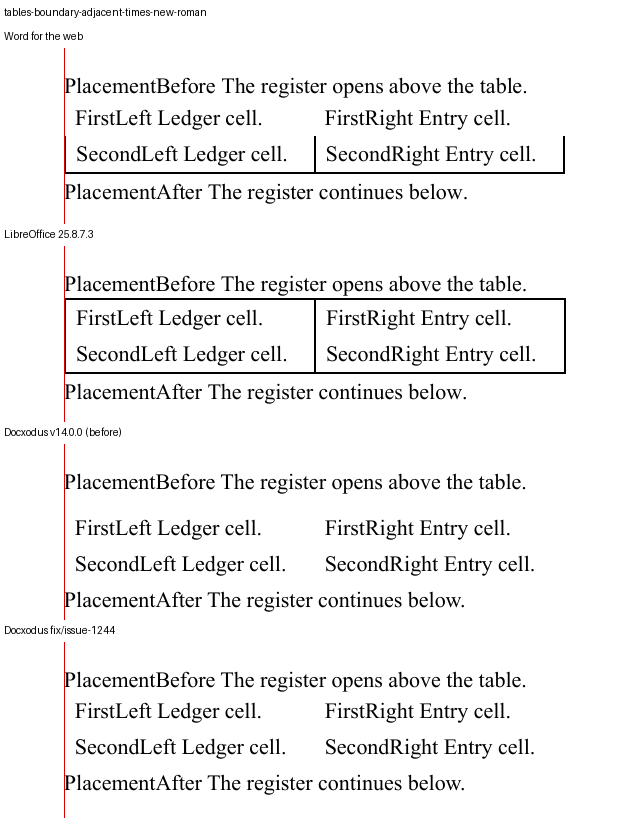

### `tables-boundary-after-0-bordered`

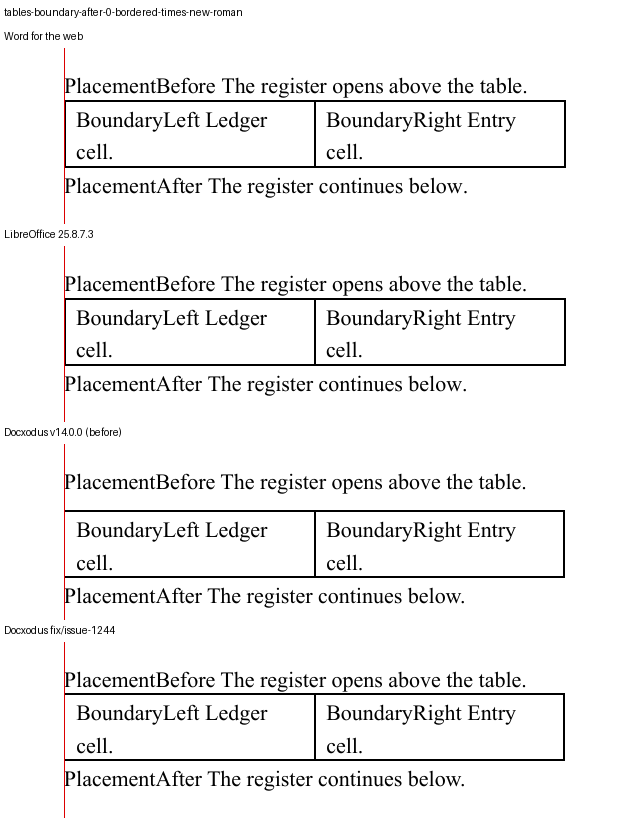

### `tables-boundary-after-0-borderless`

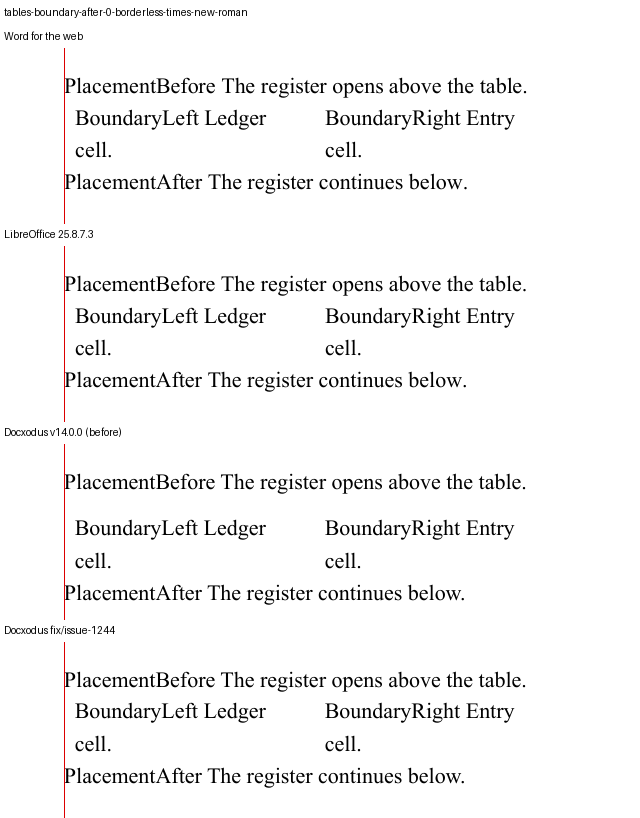

### `tables-boundary-after-240-bordered`

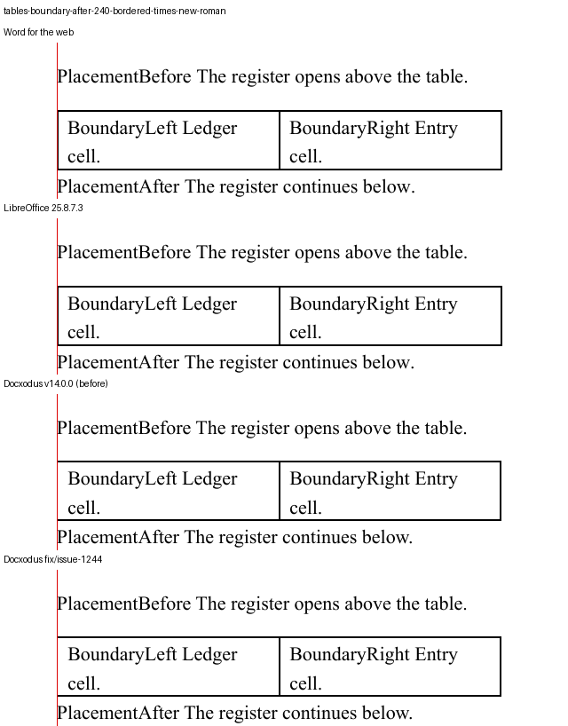

### `tables-boundary-after-240-borderless`

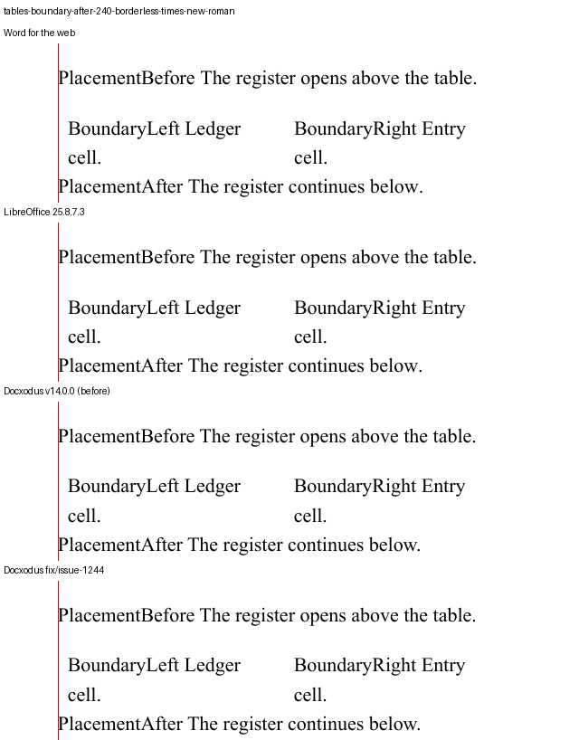

### `tables-cell-margin-absent`

### `tables-cell-margin-explicit`

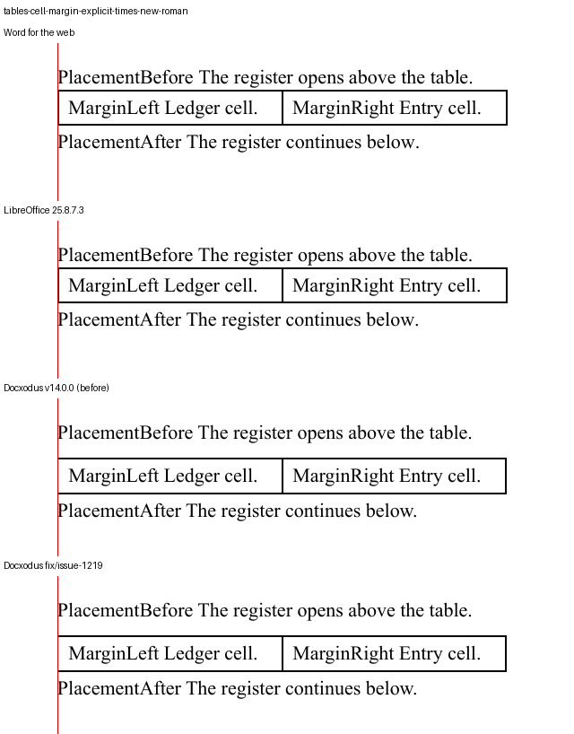

### `tables-indent-mode-14-absent`

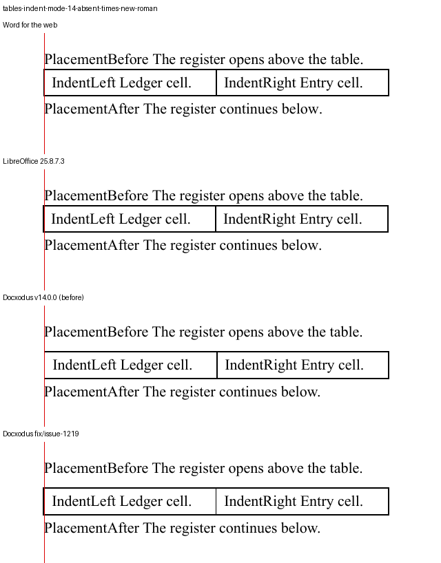

### `tables-indent-mode-14-default-style`

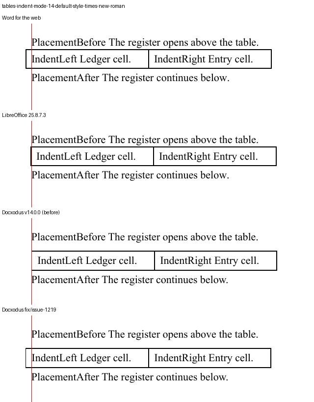

### `tables-indent-mode-14-stated`

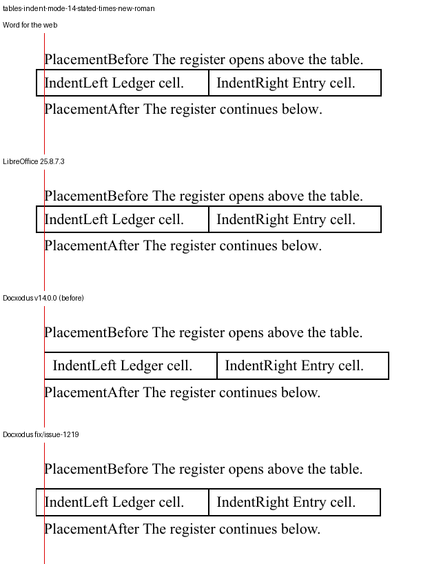

### `tables-indent-mode-15-absent`

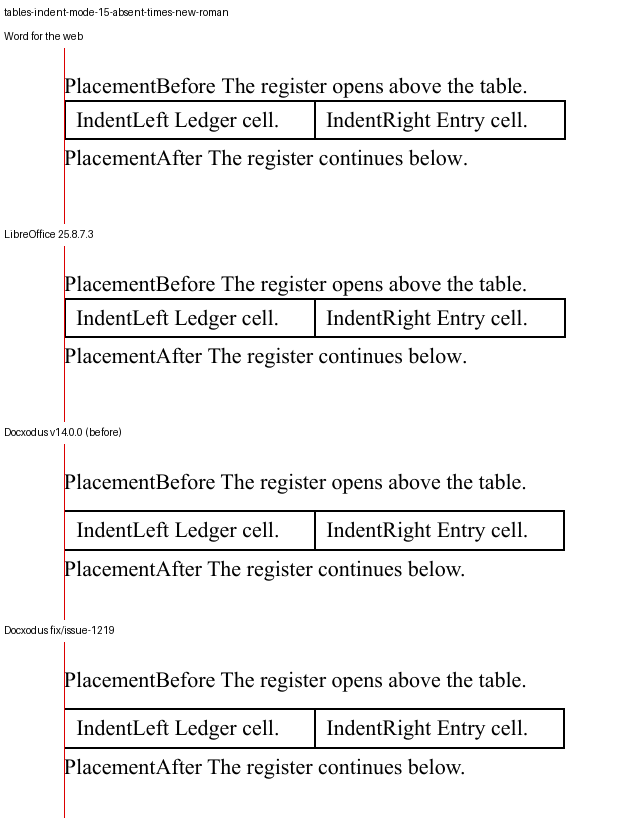

### `tables-indent-mode-15-default-style`

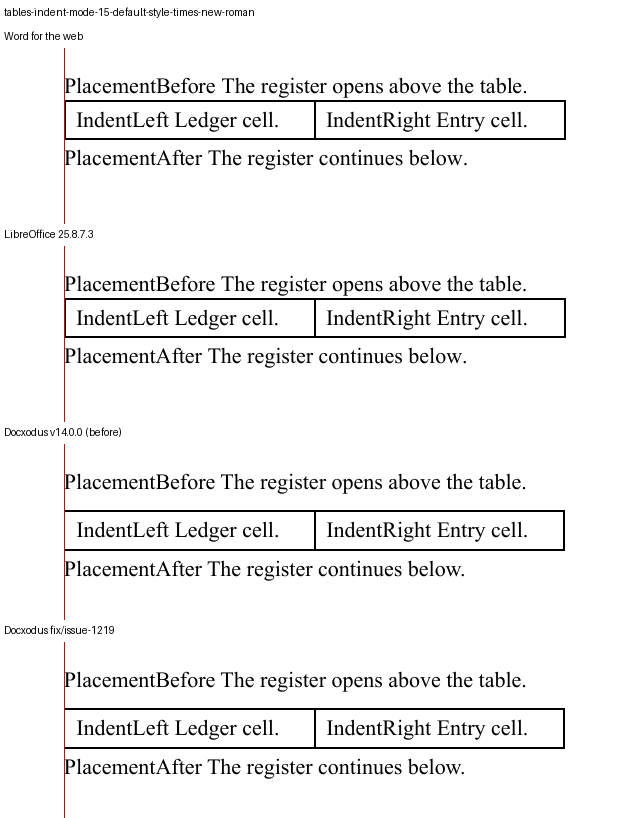

### `tables-indent-mode-15-stated`

