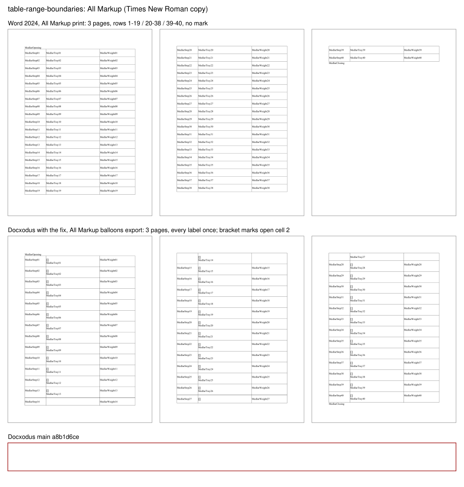
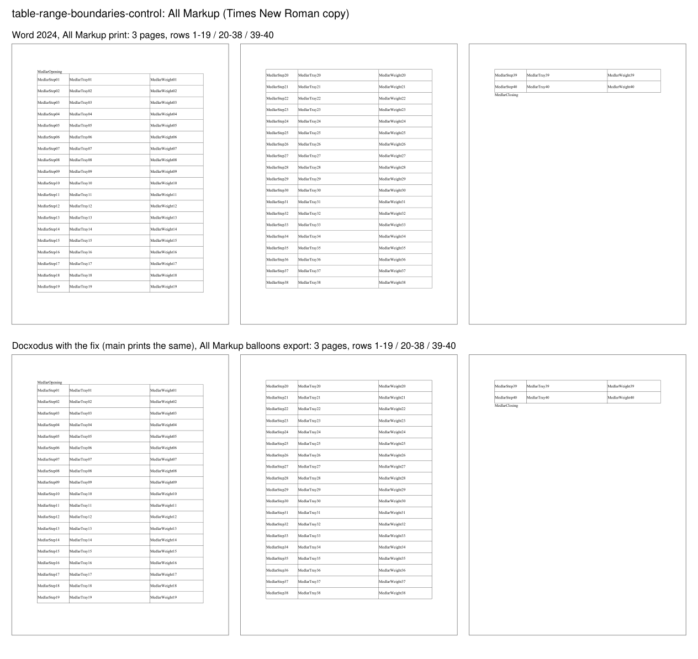

# Range boundaries between table cells (Docxodus #1737)

Two original Medlar cases: a reproducer and a control that differs by one property. Letter paper,
1in margins, 11pt Liberation Serif on exact 12pt lines, one bordered three-column table of 40 rows
with 10pt top and bottom cell margins, taller than a page.

| Case | One difference | Word 2024, final and All Markup |
|---|---|---|
| `table-range-boundaries` | every row holds `w:customXmlInsRangeStart`/`w:customXmlInsRangeEnd` (author and date on the start) between its first and second `w:tc` | 3 pages, rows 1–19, 20–38 and 39–40; no mark for the ranges; `Revisions.Count` is 0 |
| `table-range-boundaries-control` | no range markers | the same 3 pages and rows |

Word 2024 (16.0 build 20326) opened each input read-only, was set to final view or to All Markup,
and saved PDF (`SaveAs2`, format 17), from copies with Liberation Serif replaced by its metric twin
Times New Roman. Word strips custom XML markup on open, so it draws nothing for these ranges and
lays both inputs out alike. The Word-adjudicated `marker-region` assertions pin that layout in the
final print: MedlarStep01 on page 1, MedlarStep20 on page 2 and MedlarStep39 on page 3, each
anywhere on its page.

Each case's PDF companion prints the All Markup balloon profile (`review: markup`,
`markupPresentation: word`, `commentColumnPlacement: balloons`, the profile the issue reproduces
under) and must contain every Medlar label exactly once, inside the paper. It does not compare the
companion's layout: Docxodus deliberately draws each custom XML range boundary as a bracket mark
under markup (Docxodus #538), which Word does not, so its rows there are taller than Word's.

Docxodus main (`a8b1d6ce`) prints both final views, and the control's companion, on three pages
with rows 1–19, 20–38 and 39–40. It fails the reproducer's companion with `pagination_failure`
(`Page 2 body content is clipped`): it wrote the marks between the `<td>` elements of each row,
where HTML moves them out in front of the table, and the paginator then kept the 40 rows as one
block. With the fix for JSv4/Docxodus#1737 the companion prints on three pages with every label once;
the marks open each row's second cell on a line of their own, and rows 14 and 27 break across a page
as rows without `w:cantSplit` may. Labels and page placement were checked with an independent PDF
word extraction (PyMuPDF), not by the bench harness, which needs Poppler and LibreOffice.

LibreOffice references are pending.

Labeled renders of the Times New Roman copies, Word 2024's All Markup print above and Docxodus's
All Markup export (with the fix; main's failure is noted) below:

